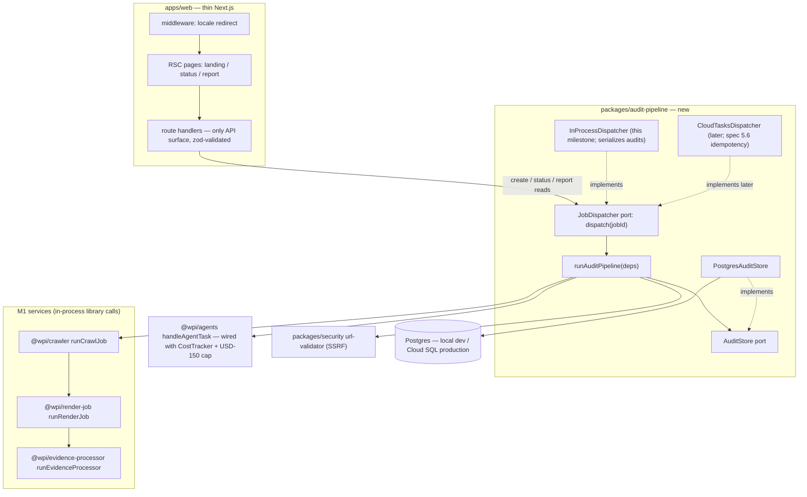
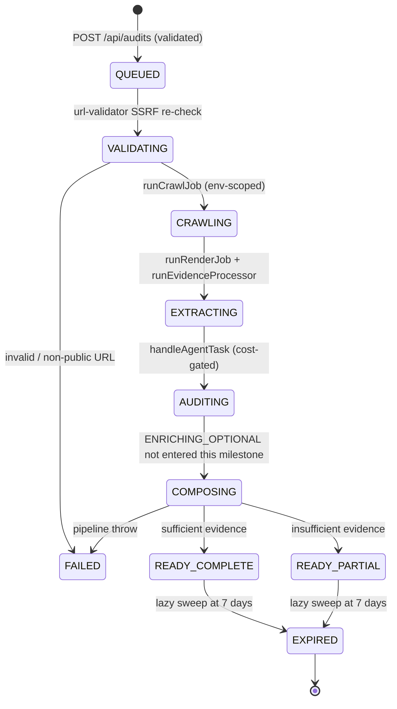
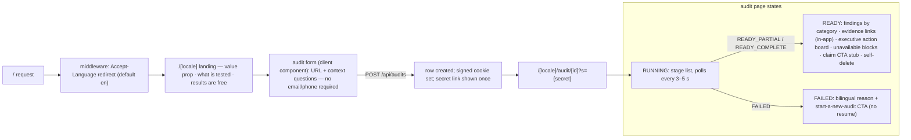
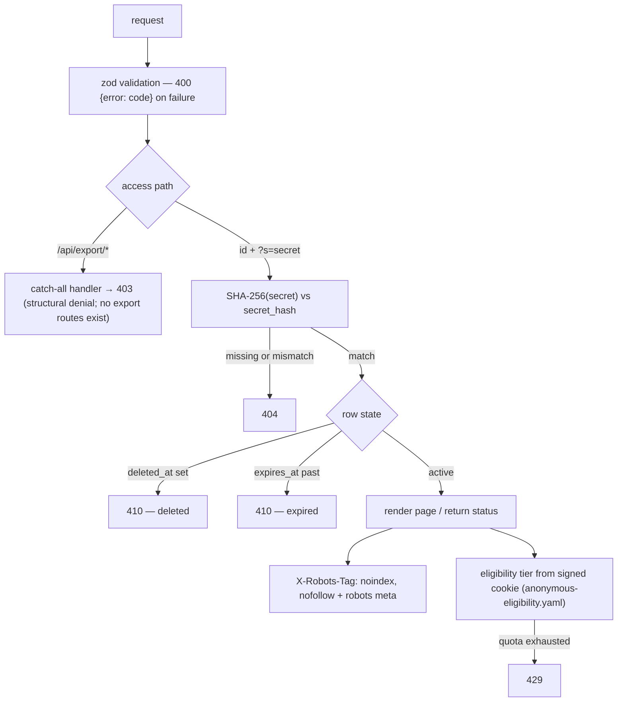
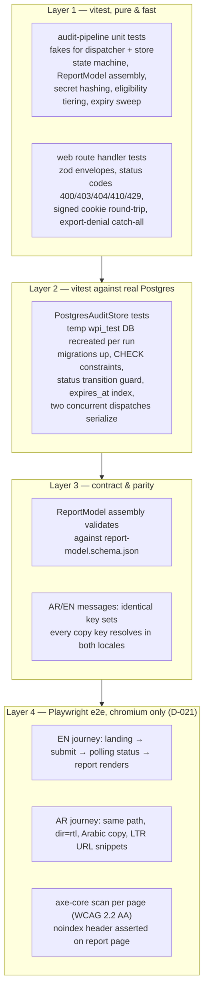

# M4-web Design: Free-Audit Vertical Slice (apps/web)

**Date:** 2026-10-02
**Status:** Draft for user review
**Depends on:** M3 agents service (merged to main at 60b038f)
**Follows:** M0A, M0B, M1 (crawler/render/evidence), M2 (hardening), M3 (agents service)
**Next after this:** services/connectors

## 0. Milestone numbering and scope

The repo's project plan (docs/spec/05-PROJECT-PLAN.md:141–154) numbers this milestone **M3 / INT-04 "Reports, comparison, and action board"**. Internally (superpowers sequence) we label it **M4-web** because it follows the M3 agents-service implementation. When reading repo docs, "repo-M3" means this milestone.

**Scope (locked): the free-audit vertical slice only.**

Landing page (AR/EN) → URL + context questions → private status view → progressive report → claim CTA.

**Deferred (out of scope):** registration/auth, comparison studio, monitoring surfaces, GSC/connections, agency surfaces.

**D-020 constraint:** the invited pilot follows repo-M3 (this milestone); NO public anonymous traffic before repo-M7. Everything built here runs locally / behind invitation until then.

**INT-04 exit gate this design must satisfy** (docs/spec/05-PROJECT-PLAN.md:491–498): report is private, non-indexed, in-app, deletable, 7-day-limited; anonymous export endpoints deny server-side; Arabic RTL and accessibility tests pass.

## 1. Locked decisions

| # | Decision | Notes |
|---|----------|-------|
| 1 | Free-audit vertical slice | Defers registration/auth, comparison, monitoring, connections, agency surfaces |
| 2 | JobDispatcher port + InProcessDispatcher | CloudTasksDispatcher slots into the same port later; spec 5.6 dispatch-idempotency lands there |
| 3 | Postgres via `pg`, plain .sql migrations + tiny runner, no ORM | Cloud SQL production path; local Postgres for dev; temp DB per test run |
| 4 | Anonymous-only, signed secret links | Identity Platform deferred — D-011 (auth provider) is an open decision the repo forbids guessing |
| 5 | Tailwind CSS v4 | To be recorded as **D-022** in docs/decisions.md during implementation |
| 6 | Shape: new `packages/audit-pipeline` + thin apps/web ("Approach A") | Pipeline logic is testable without Next.js; web app stays a rendering + HTTP shell |

## 2. Architecture and package layout



### packages/audit-pipeline (new workspace package `@wpi/audit-pipeline`)

- **Ports** (interfaces owned by this package):
  - `JobDispatcher` — `dispatch(jobId: string): Promise<void>`. Deliberately no `getStatus`: Postgres is the single source of truth for workflow status, read through `AuditStore`. Queue depth for the honest waiting UI comes from the dispatcher's own lightweight signal, not per-job queries.
  - `AuditStore` — create/read/update audit rows; the only persistence seam.
- **`InProcessDispatcher`** (this milestone): runs `runAuditPipeline` in the web server process. Because the M1 entry points read configuration from `process.env` (see §7), it **serializes audits: one at a time per server instance**, scoping env per run and restoring it afterward.
- **`CloudTasksDispatcher`** (later milestone): same port; the pipeline does not change. Spec 4.3 retry/backoff and 5.6 dispatch idempotency are scheduled there, not here.
- **`runAuditPipeline(deps)`**: validateUrl (SSRF, from packages/security) → `runCrawlJob` → `runRenderJob` → `runEvidenceProcessor` → `executeAgent`/`handleAgentTask` per agent (cost-gated) → assemble ReportModel → persist via AuditStore.
- **Migrations:** plain `.sql` files in the package, applied by a tiny runner script (`node` script, no migration framework, no ORM).

### apps/web (existing placeholder, built out)

- Next.js App Router with `[locale]` segment; **RSC by default**, `"use client"` only where interaction requires it (per apps/web/CLAUDE.md).
- **Route handlers are the only API surface** — no server actions for mutations. Full inventory: `POST /api/audits` (create), `GET /api/audits/[id]/status` (poll), `DELETE /api/audits/[id]` (self-delete), and a catch-all `ANY /api/export/*` → 403. There is deliberately no report API route — the report renders server-side in the RSC page, keeping the smallest possible surface.
- Tailwind CSS v4 (D-022), logical properties for RTL.
- Dependencies added: `next-intl` (the one i18n dependency), Tailwind v4, and `@axe-core/playwright` (a11y scans, §6). Nothing else beyond what D-021 already authorizes.

## 3. Audit data flow and pipeline

Workflow states are taken **verbatim** from docs/spec/03-PRODUCTION-CONTRACTS.md:69:

`QUEUED → VALIDATING → CRAWLING → EXTRACTING → AUDITING → ENRICHING_OPTIONAL → COMPOSING → READY_PARTIAL|READY_COMPLETE|FAILED|CANCELLED|EXPIRED`



Mapping:

- **VALIDATING** = M1 `validateUrl` SSRF check. Invalid/non-public ⇒ `FAILED` with a bilingual reason key.
- **CRAWLING** = `runCrawlJob`. **EXTRACTING** = `runRenderJob` + `runEvidenceProcessor`.
- **AUDITING** = agents through `handleAgentTask`, cost-gated at the composition root (§5).
- **ENRICHING_OPTIONAL** stays in the enum (contract) but is never entered in this milestone.
- **READY_PARTIAL** on insufficient evidence: degraded sections render an explicit `unavailable` block with a reason key — **never a fabricated 0% score**.
- **CANCELLED** remains in the enum; no cancel path is built in this milestone.
- **EXPIRED** is set by the lazy sweep (§5); user self-delete sets `deleted_at` (returns 410, distinct from expiry).

Transition rules (enforced in `PostgresAuditStore`, asserted in tests):

- Terminal outcomes `READY_PARTIAL`, `READY_COMPLETE`, `FAILED`, `CANCELLED` are absorbing except for retention: their only legal exit is → `EXPIRED`. No re-running, no un-failing.
- Every status write is a guarded update (`... WHERE status NOT IN ('EXPIRED','CANCELLED') AND deleted_at IS NULL`); a write matching zero rows means the row expired or was deleted mid-run, and the pipeline stops instead of overwriting.
- The expiry sweep marks every non-EXPIRED row past `expires_at` as EXPIRED — covering both 7-day retention of finished reports and stalled in-flight audits.

### Postgres schema (single table this milestone)

```sql
CREATE TABLE audits (
  id             uuid PRIMARY KEY DEFAULT gen_random_uuid(),
  target_url     text        NOT NULL,
  locale         text        NOT NULL CHECK (locale IN ('en','ar')),
  context        jsonb       NOT NULL DEFAULT '{}',
  status         text        NOT NULL CHECK (status IN ('QUEUED','VALIDATING','CRAWLING','EXTRACTING','AUDITING','ENRICHING_OPTIONAL','COMPOSING','READY_PARTIAL','READY_COMPLETE','FAILED','CANCELLED','EXPIRED')),
  failure_reason text,
  secret_hash    text        NOT NULL,
  report         jsonb,
  costs          jsonb,
  created_at     timestamptz NOT NULL DEFAULT now(),
  updated_at     timestamptz NOT NULL DEFAULT now(),
  expires_at     timestamptz NOT NULL,
  deleted_at     timestamptz
);
CREATE INDEX audits_expires_at_idx ON audits (expires_at);
```

This table is the operational store for this milestone; the canonical audit record (schemas/audit.schema.json) constrains it in ways the pipeline must honor and tests must assert: `noindex` always true for anonymous audits, `expires_at` at most 7 days after `created_at`, `audit_tier` carrying the eligibility tier, and `anonymous_access_state` staying ANONYMOUS (claiming is a stub this milestone; D-004 lifecycle comes later). `audits.locale` records the UI language chosen at creation — it selects the default report page language and status copy; the ReportModel's `languages` stays `["en","ar"]` because findings are bilingual template-composed and the reader can switch locale. `context` holds exactly the eight context fields of docs/spec/02-DETAILED-SPECIFICATION.md:103, zod-validated at the route.

### ReportModel assembly (schemas/report-model.schema.json)

Assembly must produce a record valid against `schemas/report-model.schema.json` (required fields: report_id, audit_id, version, access_class, languages, allowed_projections, access, tone, content, lineage_coverage, status, needs_native_review, retention_days, created_at, expires_at). Fixed values for this milestone:

- `access_class: "anonymous"`, `languages: ["en","ar"]`, `allowed_projections: ["web_interactive"]` (schema-required single projection; structural export denial is enforced by the catch-all 403 handler, not by an empty list), `retention_days: 7`, `expires_at = created_at + 7 days`.
- `tone` follows templates/style-guide-ar.md (MSA) and templates/style-guide-en.md (answer-first); `access` reflects signed-secret delivery. Exact enum literals come from the schema and are asserted in tests.
- `needs_native_review`: this milestone composes from natively authored bilingual templates ⇒ `false`; the native-speaker copy review happens at the release gate, not per-report.

**The report deliberately does NOT render the Presence Readiness 0–100 score.** The deterministic scoring engine (v1 formulas, seven category weights, critical caps, confidence — docs/spec/02-DETAILED-SPECIFICATION.md:162, never blended per D-012) does not exist anywhere in the repo (verified 2026-10-02: zero hits across services/ and packages/). Inventing a substitute number would violate the methodology contracts. The report renders M3's agent findings grouped by category; the score engine is required pre-pilot work, recorded in §9.

## 4. Web UI, i18n, and RTL



### i18n and RTL mechanics

- **Remove the dead `i18n` key** from apps/web/next.config.ts (it is Pages-Router-only and ignored by App Router).
- Routes move under `app/[locale]/` with locales `en` and `ar`; middleware redirects `/` by `Accept-Language`, default `en`.
- Locale layout sets `<html lang>` and `dir="rtl"` for `ar`.
- **next-intl** with native copy in `messages/en.json` and `messages/ar.json` — Arabic is authored natively (MSA), not machine-mirrored from English. Latin-script URLs embedded in Arabic copy stay LTR.
- Fonts via `next/font`: Inter (Latin) + IBM Plex Sans Arabic. Tailwind logical properties (`ps-`, `pe-`, `ms-`, `me-`) throughout.

### Pages

- **`/[locale]` landing:** value proposition; "what is tested" section; "results are free"; the audit form (client component — URL input plus the context questions fixed by docs/spec/02-DETAILED-SPECIFICATION.md:103: organization, type, offering, market, customer language, audience, optional competitors, up to 10 target keywords; no required email/phone); AR/EN switch; Methodology / Privacy / Terms links. The v1-baseline §5 requirements for the landing page, form, and reporting still apply (02-DETAILED-SPECIFICATION.md:140).
- **Methodology / Privacy / Terms:** three small static pages under `[locale]`, bilingual. Methodology summarizes the repo's spec overview and rule categories; Privacy summarizes the retention + anonymous-eligibility policy (docs/anonymous-eligibility-policy.md); Terms is minimal pilot-stage text (free anonymous audit, no warranty, retention as per Privacy). Needed so the landing has no dead links.
- **`/[locale]/audit/[id]?s={secret}`:**
  - **RUNNING:** ordered stage list (state machine names), current stage highlighted, polling every 3–5 s against the status route.
  - **READY (PARTIAL or COMPLETE):** full RSC-rendered report — findings grouped by category with severity, evidence links (in-app viewer only, no download — D-002), executive action board, `unavailable` blocks with reasons for degraded sections, a claim CTA stub (no auth behind it yet), and a self-delete control.
  - **FAILED:** bilingual reason text + "start a new audit" CTA. No resume.
- The **first-audit response sets a signed HttpOnly cookie** (HMAC, `AUDIT_COOKIE_SECRET` env) that anchors anonymous eligibility tiering.

## 5. Security and error handling



- **URL validation twice:** fail-fast zod + `url-validator` at creation, and full re-validation inside the pipeline before crawling (SSRF defense in depth, matching M1 semantics).
- **zod at every route handler**; error envelope is always `{ error: code }` with statuses 400 (validation), 404 (unknown id / missing or wrong secret), 403 (export denial), 410 (deleted or expired), 429 (eligibility exhausted).
- **Secrets:** each audit gets a 32-byte random secret, delivered once in the URL; **only the SHA-256 hash is stored** (`secret_hash`). Cookie is HMAC-signed with `AUDIT_COOKIE_SECRET`, HttpOnly.
- **Secret hygiene in the browser:** the report page sets `<meta name="referrer" content="no-referrer">` and outbound links carry `rel="noreferrer"`, so the `?s=` secret never leaks via the Referer header. Residual exposure in server access logs is accepted for the local, invitation-only pilot (D-020).
- **Eligibility tiering is server-side**, per config/anonymous-eligibility.yaml (1st audit rich ~20 pages; 2nd reduced sample; later preview-only), keyed on the signed cookie. A blocked-cookie visitor counts as first-time; that exposure is contained by the invitation-only pilot (D-020). Client-visible copy states what tier offers without leaking internals. Deleting an audit does not reset the eligibility counter — the cookie's audit count only ever increases in this milestone.
- **Structural export denial:** no export routes exist anywhere in the app; a catch-all `/api/export/*` handler returns 403 server-side (defense independent of route inventory); `allowed_projections: []` in every ReportModel.
- **Budget wiring at the composition root:** the dispatcher adapter constructs a fresh `CostTracker` per pipeline run and passes it into `handleAgentTask` as the budget gate — closing the M3 "CostTracker/Orchestrator wiring at composition root" backlog item for this execution path. Run cost is persisted into `audits.costs` at run end (success or failure). D-020's USD 150 is a **combined monthly** cap for hosting and paid calls (docs/decisions.md:32, A-001); monthly enforcement requires cost persistence across audits (spec 4.5, deferred backlog), so this milestone enforces only the per-audit hard stop.
- **reCAPTCHA deferred** (D-020); the route leaves an env-flag-gated placeholder point.
- **Expiry without cron:** rows past `expires_at` are marked EXPIRED by a lazy sweep on read plus a sweep on server startup.
- **Pipeline failures:** any throw ⇒ status `FAILED` + `failure_reason` (a bilingual message key, not a raw stack) + UI offers "start a new audit". No resume.

## 6. Testing strategy



- **Layer 1 (vitest, pure):** pipeline behavior with fake dispatcher + fake store — every state transition including all failure paths (invalid URL ⇒ FAILED with reason key; insufficient evidence ⇒ READY_PARTIAL with `unavailable` + reason, never 0%); ReportModel assembly; secret stored as SHA-256 only; eligibility tier 1st/2nd/3rd; lazy expiry sweep; guarded terminal transitions — no write escapes a row absorbed by EXPIRED/CANCELLED semantics, and a zero-row guarded write stops the pipeline. Route-handler tests for each status code and the `{ error: code }` envelope; signed-cookie round-trip and tamper rejection; export catch-all returns 403 before any other logic.
- **Layer 2 (real Postgres):** `PostgresAuditStore` tests run against a `wpi_test` database dropped/recreated per run (plain psql — no testcontainers/Docker dependency). Migrations apply cleanly on an empty DB; the CHECK constraint rejects invalid status; the expires_at index exists; **two concurrent dispatches to the InProcessDispatcher serialize** (one-at-a-time guarantee).
- **Layer 3 (contract & parity):** assembled reports validate against schemas/report-model.schema.json (same pattern as the repo's schema lint); `messages/en.json` and `messages/ar.json` have identical key sets and every key resolves in both locales (acceptance requires Arabic/English parity, docs/spec/01-PRODUCT-REQUIREMENTS.md:373–374).
- **Layer 4 (Playwright, chromium only):** core EN and AR journeys per project-plan §7 (05 §7:307) run against a **stub dispatcher** that advances states on a timer — no real crawl, no Gemini, no network. `@axe-core/playwright` scans landing + report in both locales at the WCAG 2.2 AA threshold; the report URL is asserted to return `X-Robots-Tag: noindex, nofollow`.
- **Manual release-gate checklist** (not automated, mirrors 05 §7:309): keyboard-only navigation, 320px reflow, screen-reader pass in both locales, native-speaker review of the Arabic copy.
- **Explicitly out of scope for web tests:** crawler/render/evidence behavior (owned by M1's 339-test suite) and agent execution quality (owned by M3's 94 tests). Web tests inject fakes through the ports.

## 7. Honest constraints

- **M1 entry points are env-configured:** `runCrawlJob`, `runRenderJob`, and `runEvidenceProcessor` are parameterless and read `process.env` (`AUDIT_ID`, `ROOT_URL`, `OUTPUT_DIR`, …). The InProcessDispatcher therefore scopes env per run and **serializes audits — one at a time per server instance**. Acceptable for the pilot; refactoring the M1 entry points to take parameters is deferred backlog (it becomes mandatory with CloudTasksDispatcher).
- Dev machine runs Node 24 vs D-021's Node 22 LTS — a known, already-recorded repo-wide concern, unchanged by this design.
- The one-at-a-time constraint makes the dev server single-audit; the UI must communicate queue position honestly rather than pretend parallelism.

## 8. Explicit non-goals

- Registration, login, Identity Platform (D-011 is open — not guessed), any authenticated surface.
- Comparison studio, monitoring dashboards, GSC/connections, agency surfaces.
- PDF/CSV/JSON export or evidence download in any form, ever (D-002).
- Public anonymous traffic (D-020 — before repo-M7).
- Cloud Tasks deployment, cron-based expiry, audit cancel path.
- PDF rendering of reports.

## 9. Governance

- **Record D-022** (Tailwind CSS v4) in docs/decisions.md during implementation — the register is append-only; D-021 is currently the last entry.
- **Score engine is a pre-pilot gate, not part of this milestone:** the Presence Readiness scoring engine (v1 formulas, category weights, critical caps, confidence — 02-DETAILED-SPECIFICATION.md:162) must be built and reviewed before the D-020 pilot; the report UI is designed to accept it without layout change.
- **Deliberately not decided here** (repo forbids guessing open decisions): Identity Platform provider (D-011), reCAPTCHA introduction timing, Cloud Tasks migration timing.
- Exit-gate traceability: §0 lists the INT-04 gate items; §3 (retention/expiry/delete), §4 (in-app report, noindex), §5 (export denial, secret access), §6 (RTL + a11y tests) each close one or more of them.

## 10. Global constraints (binding for the implementation plan)

- pnpm workspace monorepo; strict TypeScript; **no `any`, no `@ts-ignore`** (apps/web/CLAUDE.md).
- RSC by default; `"use client"` only where required; **no client-side secrets or API keys**.
- Every page sets `lang` and `dir`.
- Exactly one new i18n dependency: next-intl. No ORM. No new test runners beyond Vitest + Playwright (chromium).
- All copy exists in both locales with identical key sets; Arabic is natively authored MSA.
- Reports: private, non-indexed, in-app only, deletable, 7-day retention; export structurally denied; degraded sections show `unavailable` + reason, never 0%.
- Everything stays local — no remote, no push, no PR.
