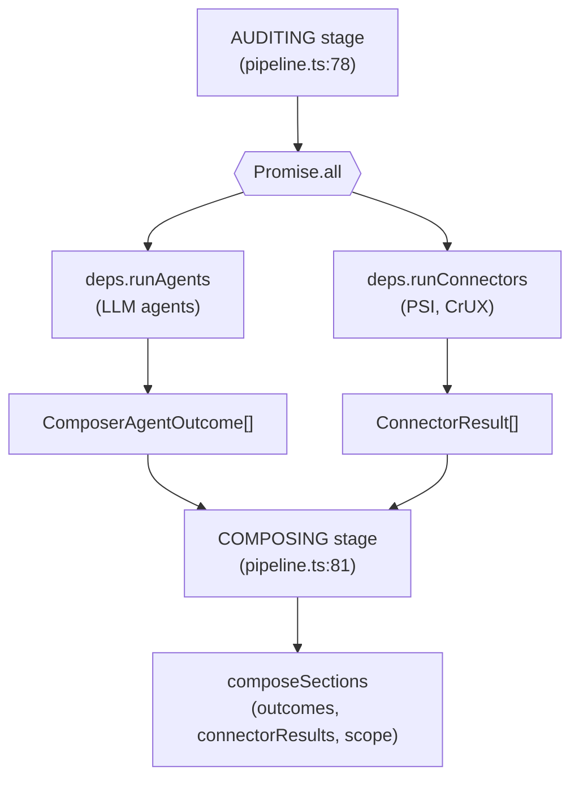

# M5 Design: Read-Only Data Connectors (PSI + CrUX)

**Date:** 2026-10-03  
**Status:** Draft for user review  
**Depends on:** M4-web (merged to main)  
**Precedes:** M5 connectors implementation plan

## 0. Milestone scope and numbering

The repo's project plan (docs/spec/05-PROJECT-PLAN.md) numbers this milestone **M4 / INT-05 "Data connectors: PSI, CrUX"**. Internally (superpowers sequence) we label it **M5** because it follows M4-web.

**Scope (locked): read-only performance data connectors for anonymous audits.**

- PSI (PageSpeed Insights) API v5 — Core Web Vitals + top 3 opportunities
- CrUX (Chrome User Experience Report) API — real-user metrics (LCP, FID/INP, CLS)
- Graceful degradation: connector failures don't fail the audit; unavailability noted in report
- Framework pattern: generic connector interface + registry + runner + concrete implementations

**Deferred (out of scope):**

- GSC (Google Search Console) — requires OAuth (D-011 auth provider decision pending)
- GA4 (Google Analytics 4) — requires OAuth (D-011 auth provider decision pending)
- Connected/registered audit flows (ENRICHING_OPTIONAL state) — reserved for OAuth-dependent connectors
- Write paths (M9 "First safe connector and impact ledger")

**Constraints:**

- D-011: auth provider is an open decision — no OAuth integration in this milestone
- D-020: no public anonymous traffic before repo-M7 — everything runs locally/behind invitation
- API keys via environment variables only (`WPI_PSI_API_KEY`), never hardcoded or client-side
- No `any`/`@ts-ignore`, no ORM, Vitest + Playwright only

## 1. Architecture decision: connector integration point

### The problem

The audit pipeline state machine (from 03-PRODUCTION-CONTRACTS.md:69) defines:

```
QUEUED → VALIDATING → CRAWLING → EXTRACTING → AUDITING → ENRICHING_OPTIONAL → COMPOSING → READY_PARTIAL|READY_COMPLETE|FAILED|CANCELLED|EXPIRED
```

The M4-web implementation (pipeline.ts) **intentionally skips ENRICHING_OPTIONAL** for anonymous audits:

```typescript
// pipeline.ts:78-81
await requireTransition(deps.store, auditId, "AUDITING");
const outcomes = await deps.runAgents(raw, evidenceIds, scope);

await requireTransition(deps.store, auditId, "COMPOSING");
const composed = composeSections(outcomes, scope);
```

From M4 spec (2026-10-02-m4-web-frontend-design.md:119):

> **ENRICHING_OPTIONAL** stays in the enum (contract) but is never entered in this milestone.

From state-machines.md:31:

> Registered audits with connected sources insert the connected-analysis states (section 2) between ENRICHING_OPTIONAL and COMPOSING.

**Key insight:** ENRICHING_OPTIONAL is the entry point for **connected/registered audits** (GSC, GA4 with OAuth), not for anonymous free audits. PSI/CrUX are read-only public APIs that don't need OAuth — they shouldn't trigger the ENRICHING_OPTIONAL state.

### The solution: parallel execution during AUDITING

**Decision:** Connectors run **in parallel with agents during AUDITING**, not as a separate pipeline stage.

**Rationale:**

1. **PSI/CrUX are read-only, public APIs** — no OAuth, no user connection, no state machine change needed
2. **They enrich the same audit** — performance data feeds the composer alongside agent findings
3. **Graceful degradation fits naturally** — connector failures add to `unavailable[]` (same pattern as agent failures)
4. **No pipeline state machine changes** — stays within AUDITING → COMPOSING (preserves M4 design)
5. **Performance** — parallel execution doesn't add latency

**Architecture:**



**Pipeline change (pipeline.ts):**

```typescript
await requireTransition(deps.store, auditId, "AUDITING");

// Run agents and connectors in parallel
const [outcomes, connectorResults] = await Promise.all([
  deps.runAgents(raw, evidenceIds, scope),
  deps.runConnectors(raw.target_url, raw.context),
]);

await requireTransition(deps.store, auditId, "COMPOSING");
const composed = composeSections(outcomes, connectorResults, scope);
```

**PipelineDeps port addition:**

```typescript
export interface PipelineDeps {
  // ... existing fields ...
  runConnectors: (url: string, context: AuditContext) => Promise<ConnectorResult[]>;
}
```

**Composer signature change (composer.ts):**

```typescript
export function composeSections(
  outcomes: ComposerAgentOutcome[],
  connectorResults: ConnectorResult[], // NEW
  scope: TierScope,
): ComposeResult {
  // Merge agent findings + connector data
  // Connector failures → unavailable[] (same as agent failures)
}
```

## 2. Connector framework design

### Package structure

**Location:** `services/connectors/` (existing placeholder)

**Files:**

```
services/connectors/
├── src/
│   ├── index.ts                    # Public exports
│   ├── types.ts                    # Connector, ConnectorResult interfaces
│   ├── runner.ts                   # runConnectors() orchestrator
│   ├── registry.ts                 # Connector registry
│   ├── psi/
│   │   ├── index.ts                # PSI connector
│   │   ├── client.ts               # PSI API client
│   │   └── types.ts                # PSI response types
│   └── crux/
│       ├── index.ts                # CrUX connector
│       ├── client.ts               # CrUX API client
│       └── types.ts                # CrUX response types
├── tests/
│   ├── runner.test.ts
│   ├── psi.test.ts
│   └── crux.test.ts
├── package.json                    # @wpi/connectors
├── tsconfig.json
└── CLAUDE.md
```

### Core interfaces

**types.ts:**

```typescript
export interface Connector {
  name: string;
  run(url: string, context: AuditContext): Promise<ConnectorResult>;
}

export type ConnectorResult =
  | { ok: true; connector: string; data: ConnectorData }
  | { ok: false; connector: string; unavailable_reason_key: string };

export interface ConnectorData {
  // Union of connector-specific data shapes
  psi?: PsiData;
  crux?: CruxData;
}

export interface PsiData {
  core_web_vitals: {
    lcp: number; // Largest Contentful Paint (ms)
    fid: number; // First Input Delay (ms) — or INP
    cls: number; // Cumulative Layout Shift
  };
  opportunities: Array<{
    id: string;
    title: string;
    savings_ms?: number;
    severity: "high" | "medium" | "low";
  }>;
}

export interface CruxData {
  metrics: {
    lcp: { good: number; needs_improvement: number; poor: number };
    fid: { good: number; needs_improvement: number; poor: number };
    cls: { good: number; needs_improvement: number; poor: number };
  };
  origin: string;
  effective_connection_type: string;
}
```

**runner.ts:**

```typescript
export async function runConnectors(
  url: string,
  context: AuditContext,
): Promise<ConnectorResult[]> {
  const connectors = getRegistry();
  const results = await Promise.allSettled(
    connectors.map((connector) => connector.run(url, context)),
  );

  return results.map((result, index) => {
    if (result.status === "fulfilled") {
      return result.value;
    }
    // Connector threw — convert to graceful failure
    return {
      ok: false as const,
      connector: connectors[index].name,
      unavailable_reason_key: `unavailable.connector.${connectors[index].name}`,
    };
  });
}
```

**registry.ts:**

```typescript
import type { Connector } from "./types.js";
import { PsiConnector } from "./psi/index.js";
import { CruxConnector } from "./crux/index.js";

let registry: Connector[] | null = null;

export function getRegistry(): Connector[] {
  if (registry === null) {
    registry = [new PsiConnector(), new CruxConnector()];
  }
  return registry;
}

// For tests
export function setRegistry(connectors: Connector[]): void {
  registry = connectors;
}
```

### PSI connector

**psi/index.ts:**

```typescript
import type { Connector, ConnectorResult } from "../types.js";
import { fetchPsiData } from "./client.js";

export class PsiConnector implements Connector {
  name = "psi";

  async run(url: string, _context: AuditContext): Promise<ConnectorResult> {
    const apiKey = process.env["WPI_PSI_API_KEY"];
    if (apiKey === undefined || apiKey === "") {
      return {
        ok: false,
        connector: this.name,
        unavailable_reason_key: "unavailable.connector.psi.missing_api_key",
      };
    }

    try {
      const data = await fetchPsiData(url, apiKey);
      return { ok: true, connector: this.name, data: { psi: data } };
    } catch (error) {
      return {
        ok: false,
        connector: this.name,
        unavailable_reason_key: "unavailable.connector.psi.api_error",
      };
    }
  }
}
```

**psi/client.ts:**

```typescript
import type { PsiData } from "./types.js";

export async function fetchPsiData(url: string, apiKey: string): Promise<PsiData> {
  const params = new URLSearchParams({
    url,
    key: apiKey,
    strategy: "mobile",
    category: "performance",
  });

  const response = await fetch(
    `https://www.googleapis.com/pagespeedonline/v5/runPagespeed?${params}`,
    { signal: AbortSignal.timeout(30_000) },
  );

  if (!response.ok) {
    throw new Error(`PSI API returned ${response.status}`);
  }

  const json = (await response.json()) as PsiApiResponse;
  return extractPsiData(json);
}

function extractPsiData(apiResponse: PsiApiResponse): PsiData {
  // Extract Core Web Vitals from lighthouseResult.audits
  const audits = apiResponse.lighthouseResult.audits;

  return {
    core_web_vitals: {
      lcp: audits["largest-contentful-paint"]?.numericValue ?? 0,
      fid: audits["max-potential-fid"]?.numericValue ?? 0,
      cls: audits["cumulative-layout-shift"]?.numericValue ?? 0,
    },
    opportunities: extractTopOpportunities(audits, 3),
  };
}

function extractTopOpportunities(
  audits: Record<string, PsiAudit>,
  limit: number,
): PsiData["opportunities"] {
  // Filter to opportunity audits with savings, sort by impact, take top N
  // ...
}
```

### CrUX connector

**crux/index.ts:**

```typescript
import type { Connector, ConnectorResult } from "../types.js";
import { fetchCruxData } from "./client.js";

export class CruxConnector implements Connector {
  name = "crux";

  async run(url: string, _context: AuditContext): Promise<ConnectorResult> {
    try {
      const origin = new URL(url).origin;
      const data = await fetchCruxData(origin);
      return { ok: true, connector: this.name, data: { crux: data } };
    } catch (error) {
      return {
        ok: false,
        connector: this.name,
        unavailable_reason_key: "unavailable.connector.crux.api_error",
      };
    }
  }
}
```

**crux/client.ts:**

```typescript
import type { CruxData } from "./types.js";

export async function fetchCruxData(origin: string): Promise<CruxData> {
  // CrUX API is public, no API key needed
  const response = await fetch(`https://chromeuxmetrics.googleapis.com/v1/records:queryRecord`, {
    method: "POST",
    headers: { "Content-Type": "application/json" },
    body: JSON.stringify({ url: origin }),
    signal: AbortSignal.timeout(10_000),
  });

  if (!response.ok) {
    throw new Error(`CrUX API returned ${response.status}`);
  }

  const json = (await response.json()) as CruxApiResponse;
  return extractCruxData(json, origin);
}

function extractCruxData(apiResponse: CruxApiResponse, origin: string): CruxData {
  const record = apiResponse.record;

  return {
    metrics: {
      lcp: extractMetricDistribution(record.metrics.largest_contentful_paint),
      fid: extractMetricDistribution(record.metrics.first_input_delay),
      cls: extractMetricDistribution(record.metrics.cumulative_layout_shift),
    },
    origin,
    effective_connection_type: record.metrics.effective_connection_type?.category ?? "unknown",
  };
}

function extractMetricDistribution(metric: CruxMetric): {
  good: number;
  needs_improvement: number;
  poor: number;
} {
  return {
    good: metric.good?.percent ?? 0,
    needs_improvement: metric.needs_improvement?.percent ?? 0,
    poor: metric.poor?.percent ?? 0,
  };
}
```

## 3. Composer integration

**composer.ts changes:**

```typescript
export function composeSections(
  outcomes: ComposerAgentOutcome[],
  connectorResults: ConnectorResult[], // NEW
  scope: TierScope,
): ComposeResult {
  const findings: StoredFinding[] = [];
  const unavailable: UnavailableBlock[] = [];
  const costLines: StoredCostLine[] = [];
  const availableSections = new Set<string>();

  // Process agent outcomes (existing logic)
  for (const outcome of outcomes) {
    // ... existing agent processing ...
  }

  // Process connector results (NEW)
  for (const result of connectorResults) {
    if (!result.ok) {
      unavailable.push({
        section: "performance", // or "technical" — depends on report model
        reason_key: result.unavailable_reason_key,
      });
      continue;
    }

    // Connector succeeded — data is available for report
    // For M5, we just note availability; agents can reference connector data
    // via evidence in future milestones
    availableSections.add("performance");
  }

  return {
    findings,
    unavailable,
    action_board: deriveActionItems(findings, scope.actionBoardCap),
    summary_bullets: SECTION_ORDER.filter((section) => availableSections.has(section)).map(
      (section) => `report.summary.${section}`,
    ),
    costs: {
      currency: "USD",
      agents: costLines,
      total_usd: costLines.reduce((sum, line) => sum + line.usd, 0),
    },
  };
}
```

**Note:** M5 connectors provide data availability. The actual use of PSI/CrUX data in findings/recommendations can be enhanced in later milestones (e.g., agents referencing connector data via evidence). For M5, the goal is:

1. Fetch the data
2. Make it available (even if not fully utilized by agents yet)
3. Report unavailability gracefully

## 4. Container wiring

**apps/web/src/services/container.ts:**

```typescript
import { runConnectors } from "@wpi/connectors";

function buildPipeline(fields: PipelineFields) {
  return {
    // ... existing fields ...
    runConnectors: async (url: string, context: AuditContext) => {
      return runConnectors(url, context);
    },
  };
}
```

**Environment variables:**

```bash
# .env.local (example)
WPI_PSI_API_KEY=your_psi_api_key_here
# CrUX API is public, no key needed
```

## 5. Testing strategy

### Unit tests (Vitest)

**services/connectors/tests/runner.test.ts:**

```typescript
import { describe, it, expect, beforeEach } from "vitest";
import { runConnectors } from "../src/runner.js";
import { setRegistry } from "../src/registry.js";
import type { Connector } from "../src/types.js";

describe("runConnectors", () => {
  beforeEach(() => {
    // Reset registry
    setRegistry([]);
  });

  it("runs all connectors in parallel", async () => {
    const mockConnectors: Connector[] = [
      { name: "test-1", run: async () => ({ ok: true, connector: "test-1", data: {} }) },
      { name: "test-2", run: async () => ({ ok: true, connector: "test-2", data: {} }) },
    ];
    setRegistry(mockConnectors);

    const results = await runConnectors("https://example.com", {} as any);
    expect(results).toHaveLength(2);
    expect(results.every((r) => r.ok)).toBe(true);
  });

  it("handles connector failure gracefully", async () => {
    const mockConnectors: Connector[] = [
      { name: "test-1", run: async () => ({ ok: true, connector: "test-1", data: {} }) },
      {
        name: "test-2",
        run: async () => {
          throw new Error("API down");
        },
      },
    ];
    setRegistry(mockConnectors);

    const results = await runConnectors("https://example.com", {} as any);
    expect(results).toHaveLength(2);
    expect(results[0].ok).toBe(true);
    expect(results[1].ok).toBe(false);
    expect((results[1] as any).unavailable_reason_key).toBe("unavailable.connector.test-2");
  });
});
```

**services/connectors/tests/psi.test.ts:**

```typescript
import { describe, it, expect, vi, beforeEach } from "vitest";
import { PsiConnector } from "../src/psi/index.js";

describe("PsiConnector", () => {
  beforeEach(() => {
    vi.stubEnv("WPI_PSI_API_KEY", "test-key");
    global.fetch = vi.fn();
  });

  it("returns unavailable when API key is missing", async () => {
    vi.stubEnv("WPI_PSI_API_KEY", undefined);
    const connector = new PsiConnector();
    const result = await connector.run("https://example.com", {} as any);
    expect(result.ok).toBe(false);
    expect((result as any).unavailable_reason_key).toBe(
      "unavailable.connector.psi.missing_api_key",
    );
  });

  it("fetches PSI data successfully", async () => {
    vi.mocked(global.fetch).mockResolvedValue({
      ok: true,
      json: async () => ({ lighthouseResult: { audits: {/* ... */} } }),
    } as any);

    const connector = new PsiConnector();
    const result = await connector.run("https://example.com", {} as any);
    expect(result.ok).toBe(true);
    expect((result as any).data.psi).toBeDefined();
  });

  it("handles API error gracefully", async () => {
    vi.mocked(global.fetch).mockResolvedValue({ ok: false, status: 500 } as any);
    const connector = new PsiConnector();
    const result = await connector.run("https://example.com", {} as any);
    expect(result.ok).toBe(false);
    expect((result as any).unavailable_reason_key).toBe("unavailable.connector.psi.api_error");
  });
});
```

### Integration tests

**packages/audit-pipeline/tests/pipeline-connectors.test.ts:**

```typescript
import { describe, it, expect } from "vitest";
import { runAuditPipeline } from "../src/pipeline.js";
import { InMemoryAuditStore } from "../src/audit-store.js";

describe("pipeline with connectors", () => {
  it("runs connectors in parallel with agents", async () => {
    const store = new InMemoryAuditStore();
    const auditId = await store.create({/* ... */});

    const outcome = await runAuditPipeline(
      {
        store,
        validateUrl: async () => ({ ok: true }),
        crawl: async () => {},
        render: async () => {},
        processEvidence: async () => [],
        runAgents: async () => [/* mock agents */],
        runConnectors: async () => [
          { ok: true, connector: "psi", data: { psi: {/* ... */} } },
          { ok: true, connector: "crux", data: { crux: {/* ... */} } },
        ],
        tierScopes: {/* ... */},
      },
      auditId,
    );

    expect(outcome).toBe("completed");
    const record = await store.getRaw(auditId);
    expect(record?.status).toBe("READY_COMPLETE");
  });

  it("continues when connectors fail", async () => {
    const store = new InMemoryAuditStore();
    const auditId = await store.create({/* ... */});

    const outcome = await runAuditPipeline(
      {
        store,
        // ...
        runConnectors: async () => [
          { ok: false, connector: "psi", unavailable_reason_key: "unavailable.connector.psi" },
        ],
        // ...
      },
      auditId,
    );

    expect(outcome).toBe("completed"); // Audit succeeds despite connector failure
    const record = await store.getRaw(auditId);
    expect(record?.report.unavailable).toContainEqual(
      expect.objectContaining({ reason_key: "unavailable.connector.psi" }),
    );
  });
});
```

## 6. Data scope and limitations

### What M5 connectors provide

**PSI data:**

- Core Web Vitals: LCP, FID (or INP), CLS
- Top 3 performance opportunities (from Lighthouse audits)
- Mobile strategy (matches mobile-first indexing)

**CrUX data:**

- Real-user metrics (RUM) for LCP, FID, CLS
- Distribution: good / needs improvement / poor percentages
- Origin-level data (not page-specific)
- Effective connection type

### What M5 connectors do NOT provide

- **No agent integration:** M5 connectors fetch data but agents don't yet use it for findings. The data is available in the pipeline but not fully utilized. Future milestones can enhance agents to reference connector data via evidence.
- **No report UI changes:** M5 focuses on the backend framework. The report UI can be enhanced in later milestones to display performance data.
- **No GSC/GA4:** OAuth-dependent connectors are deferred (D-011).
- **No write paths:** M9 handles safe write operations.

### Limitations

- **PSI API quota:** Free tier has limits; production usage may require quota increases
- **CrUX data availability:** Not all origins have CrUX data (requires sufficient Chrome usage)
- **No historical data:** M5 fetches current snapshot only; historical trending is deferred
- **No comparison:** M5 doesn't compare against competitors (deferred to comparison studio milestone)

## 7. Security and privacy

- **API keys:** `WPI_PSI_API_KEY` via environment variable only, never hardcoded or client-side
- **No client-side secrets:** All API calls happen server-side in `services/connectors`
- **SSRF protection:** URLs are already validated by `packages/security` before reaching connectors
- **No PII:** Connectors fetch public performance data only
- **Report privacy:** Connector data is part of the private report (same access controls as M4)

## 8. Success criteria

**M5 is complete when:**

1. ✅ PSI connector fetches Core Web Vitals + top 3 opportunities
2. ✅ CrUX connector fetches real-user metrics
3. ✅ Connectors run in parallel with agents during AUDITING
4. ✅ Connector failures don't fail the audit (graceful degradation)
5. ✅ Unavailability is reported via `unavailable[]` blocks
6. ✅ All tests pass (unit + integration)
7. ✅ No `any`/`@ts-ignore`, no hardcoded secrets, no ORM
8. ✅ Bilingual i18n keys for unavailability reasons (en + ar)

## 9. Open questions

**None for M5 scope.** All decisions are made:

- Integration point: parallel with agents during AUDITING
- Scope: PSI + CrUX only (GSC/GA4 deferred)
- Graceful degradation: continue without data, note unavailability
- Data scope: Core Web Vitals + top 3 opportunities

## 10. Implementation order

1. **Connector framework** — types, registry, runner
2. **PSI connector** — client + connector + tests
3. **CrUX connector** — client + connector + tests
4. **Pipeline integration** — add `runConnectors` to PipelineDeps, parallel execution
5. **Composer integration** — merge connector results into composeSections
6. **Container wiring** — wire `runConnectors` in apps/web
7. **i18n keys** — add unavailability reasons to en.json/ar.json
8. **Final verification** — full suite + typecheck + lint

## 11. What remains after M5

**M6+:**

- Agent integration: agents reference connector data via evidence
- Report UI: display performance data in report view
- GSC/GA4 connectors (after D-011 auth provider decision)
- Connected audit flows (ENRICHING_OPTIONAL state for registered users)
- Comparison studio: compare against competitors
- Monitoring surfaces
- Agency surfaces

**M9:**

- First safe connector and impact ledger (write paths)

**repo-M7:**

- Public anonymous traffic (after D-020 constraint lifts)
