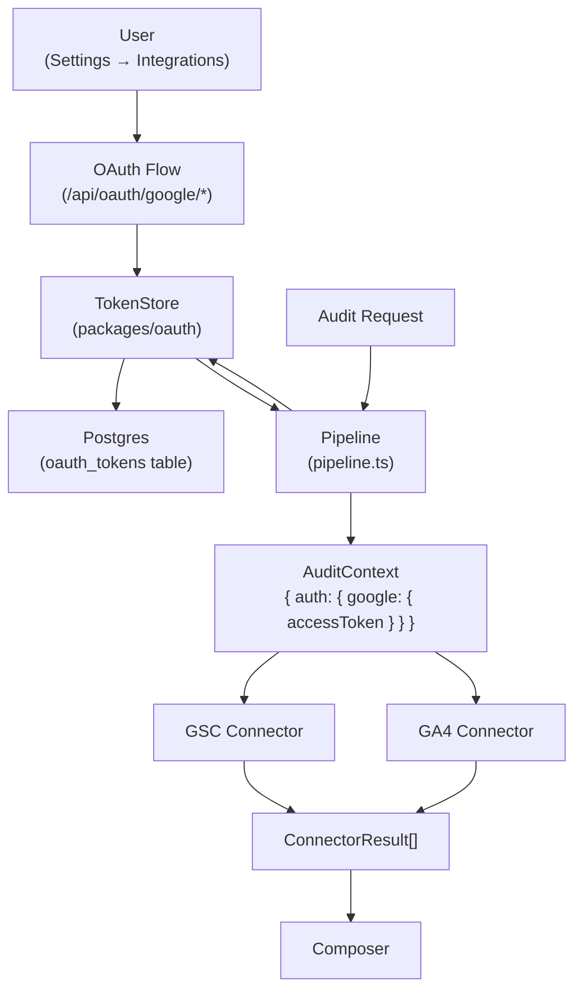

# GSC and GA4 Connectors Design

**Date:** 2026-10-04  
**Status:** Draft for user review  
**Depends on:** M5 connectors (merged to main)  
**Precedes:** GSC/GA4 connectors implementation plan

## 0. Milestone scope and numbering

This design extends the M5 connector framework with **OAuth-dependent connectors** for Google Search Console (GSC) and Google Analytics 4 (GA4). These connectors integrate real search performance and user analytics data into the WPI bilingual audit platform.

**Scope (locked): read-only GSC and GA4 data connectors with full OAuth 2.0 flow.**

- **GSC connector**: Search Analytics (queries, clicks, impressions, CTR, position by page/country) + Index Coverage (important pages indexed ratio)
- **GA4 connector**: Core page metrics (pageviews, unique pageviews, avg time on page, bounce rate, entrances/exits)
- **OAuth 2.0**: Full Google OAuth flow with consent, token exchange, encrypted storage (AES-256-GCM)
- **Graceful degradation**: Missing auth or API failures produce `unavailable[]` entries, don't crash audits
- **Shared OAuth package**: `packages/oauth/` handles encryption, token storage, and retrieval

**Deferred (out of scope):**

- Token refresh (access tokens expire after 1 hour; manual re-connect required for now)
- Per-site GA4 property IDs (global property ID via env var for now)
- User authentication integration (OAuth endpoints stub userId for now)
- Sitemap-based index coverage sampling (simple sampling: homepage + target URL)
- GSC-003 generative AI impressions (comes from client upload, not API)
- CSRF validation in OAuth callback (state parameter generated but not validated; implementation will add session-based validation)

**Constraints:**

- D-011: auth provider decision resolved — Google OAuth 2.0
- D-020: no public anonymous traffic before repo-M7 — OAuth flow behind invitation
- OAuth tokens encrypted at rest (AES-256-GCM, `WPI_OAUTH_ENCRYPTION_KEY` env var)
- No `any`/`@ts-ignore`, no ORM, Vitest + Playwright only
- URL Inspection API rate limits: 2,000 queries/day, 600/minute — simple sampling only

## 1. Architecture decision: Approach C (shared OAuth package)

### The problem

GSC and GA4 require OAuth 2.0 authentication. The audit pipeline needs to pass access tokens to connectors, but tokens are user-specific and site-specific. Three approaches were considered:

**Approach A: Connector-specific OAuth**

- Each connector (GSC, GA4) implements its own OAuth flow
- Duplicate token storage logic
- Harder to add more Google APIs later

**Approach B: Pipeline-managed tokens**

- Pipeline resolves tokens and passes them via `AuditContext`
- Connectors remain stateless
- Pipeline becomes aware of OAuth details

**Approach C: Shared OAuth package (chosen)**

- `packages/oauth/` handles encryption, storage, retrieval
- Pipeline resolves tokens via `TokenStore` and passes them via `AuditContext`
- Connectors remain stateless and unaware of OAuth mechanics
- Easy to extend for more Google APIs

### The solution: Approach C

**Decision:** Shared `packages/oauth/` package + extended `AuditContext` with optional auth tokens + pipeline resolves tokens before passing to connectors.

**Rationale:**

1. **Separation of concerns**: OAuth mechanics isolated in one package
2. **Stateless connectors**: Connectors receive tokens via context, don't manage them
3. **Pipeline orchestration**: Pipeline resolves tokens once, passes to all connectors
4. **Extensibility**: Easy to add more Google APIs (e.g., Google Business Profile) by extending `TokenStore`
5. **Testability**: `TokenStore` can be mocked independently

**Architecture:**



## 2. OAuth package design

### Package structure

**Location:** `packages/oauth/` (new)

**Files:**

```
packages/oauth/
├── src/
│   ├── index.ts              # Public exports
│   ├── encryption.ts         # AES-256-GCM encryption/decryption
│   ├── token-store.ts        # TokenStore class (Postgres)
│   └── types.ts              # OAuthToken, StoredToken interfaces
├── tests/
│   ├── encryption.test.ts
│   └── token-store.test.ts
├── package.json              # @wpi/oauth
├── tsconfig.json
└── CLAUDE.md
```

### Core interfaces

**types.ts:**

```typescript
export interface OAuthToken {
  userId: string;
  provider: "google";
  siteUrl: string;
  accessToken: string;
  refreshToken?: string;
  expiresAt: Date;
}

export interface StoredToken {
  id: string;
  user_id: string;
  provider: string;
  site_url: string;
  access_token_encrypted: Buffer;
  refresh_token_encrypted?: Buffer;
  expires_at: Date;
  created_at: Date;
  updated_at: Date;
}
```

### Encryption

**encryption.ts:**

```typescript
import { randomBytes, createCipheriv, createDecipheriv } from "node:crypto";

const ALGORITHM = "aes-256-gcm";
const IV_LENGTH = 12;
const AUTH_TAG_LENGTH = 16;

function getEncryptionKey(): Buffer {
  const key = process.env["WPI_OAUTH_ENCRYPTION_KEY"];
  if (!key) {
    throw new Error("WPI_OAUTH_ENCRYPTION_KEY environment variable is required");
  }
  const keyBuffer = Buffer.from(key, "base64");
  if (keyBuffer.length !== 32) {
    throw new Error("WPI_OAUTH_ENCRYPTION_KEY must be 32 bytes (base64-encoded)");
  }
  return keyBuffer;
}

export function encrypt(plaintext: string): Buffer {
  const key = getEncryptionKey();
  const iv = randomBytes(IV_LENGTH);
  const cipher = createCipheriv(ALGORITHM, key, iv);

  const encrypted = Buffer.concat([cipher.update(plaintext, "utf8"), cipher.final()]);
  const authTag = cipher.getAuthTag();

  return Buffer.concat([iv, authTag, encrypted]);
}

export function decrypt(encrypted: Buffer): string {
  const key = getEncryptionKey();
  const iv = encrypted.subarray(0, IV_LENGTH);
  const authTag = encrypted.subarray(IV_LENGTH, IV_LENGTH + AUTH_TAG_LENGTH);
  const ciphertext = encrypted.subarray(IV_LENGTH + AUTH_TAG_LENGTH);

  const decipher = createDecipheriv(ALGORITHM, key, iv);
  decipher.setAuthTag(authTag);

  const decrypted = Buffer.concat([decipher.update(ciphertext), decipher.final()]);

  return decrypted.toString("utf8");
}
```

### Token storage

**token-store.ts:**

```typescript
import type { Pool } from "pg";
import type { OAuthToken, StoredToken } from "./types.js";
import { encrypt, decrypt } from "./encryption.js";

export class TokenStore {
  constructor(private readonly pool: Pool) {}

  async save(token: OAuthToken): Promise<void> {
    const accessTokenEncrypted = encrypt(token.accessToken);
    const refreshTokenEncrypted = token.refreshToken ? encrypt(token.refreshToken) : null;

    await this.pool.query(
      `INSERT INTO oauth_tokens (
        user_id, provider, site_url, 
        access_token_encrypted, refresh_token_encrypted, expires_at
      ) VALUES ($1, $2, $3, $4, $5, $6)
      ON CONFLICT (user_id, provider, site_url) 
      DO UPDATE SET 
        access_token_encrypted = EXCLUDED.access_token_encrypted,
        refresh_token_encrypted = EXCLUDED.refresh_token_encrypted,
        expires_at = EXCLUDED.expires_at,
        updated_at = NOW()`,
      [
        token.userId,
        token.provider,
        token.siteUrl,
        accessTokenEncrypted,
        refreshTokenEncrypted,
        token.expiresAt,
      ],
    );
  }

  async findByUserAndSite(
    userId: string,
    provider: string,
    siteUrl: string,
  ): Promise<StoredToken | null> {
    const result = await this.pool.query<StoredToken>(
      `SELECT * FROM oauth_tokens 
       WHERE user_id = $1 AND provider = $2 AND site_url = $3`,
      [userId, provider, siteUrl],
    );
    return result.rows[0] ?? null;
  }

  async decryptAccessToken(stored: StoredToken): Promise<string> {
    return decrypt(stored.access_token_encrypted);
  }

  async delete(userId: string, provider: string, siteUrl: string): Promise<void> {
    await this.pool.query(
      `DELETE FROM oauth_tokens 
       WHERE user_id = $1 AND provider = $2 AND site_url = $3`,
      [userId, provider, siteUrl],
    );
  }
}
```

### Database schema

**Migration:** `migrations/006-oauth-tokens.sql`

```sql
CREATE TABLE oauth_tokens (
  id UUID PRIMARY KEY DEFAULT gen_random_uuid(),
  user_id TEXT NOT NULL,
  provider TEXT NOT NULL,
  site_url TEXT NOT NULL,
  access_token_encrypted BYTEA NOT NULL,
  refresh_token_encrypted BYTEA,
  expires_at TIMESTAMPTZ NOT NULL,
  created_at TIMESTAMPTZ NOT NULL DEFAULT NOW(),
  updated_at TIMESTAMPTZ NOT NULL DEFAULT NOW(),
  UNIQUE (user_id, provider, site_url)
);

CREATE INDEX idx_oauth_tokens_user_provider_site
  ON oauth_tokens (user_id, provider, site_url);
```

## 3. Connector interface extension

### AuditContext extension

**services/connectors/src/types.ts:**

```typescript
export interface AuditContext {
  locale: "en" | "ar";
  tier: "free" | "rich" | "reduced" | "preview";
  auth?: {
    google?: {
      accessToken: string;
    };
  };
}
```

### ConnectorData extension

```typescript
export interface ConnectorData {
  psi?: PsiData;
  crux?: CruxData;
  gsc?: GscData;
  ga4?: Ga4Data;
}
```

### GSC data shape

```typescript
export interface GscData {
  search_analytics: {
    date_range: { start: string; end: string };
    totals: {
      queries: number;
      clicks: number;
      impressions: number;
      ctr: number;
      average_position: number;
    };
    by_page: Array<{
      url: string;
      clicks: number;
      impressions: number;
      ctr: number;
      average_position: number;
    }>;
    by_country: Array<{
      country: string;
      clicks: number;
      impressions: number;
      ctr: number;
      average_position: number;
    }>;
    top_queries: Array<{
      query: string;
      clicks: number;
      impressions: number;
      ctr: number;
      average_position: number;
    }>;
  };
  index_coverage: {
    important_pages_total: number;
    important_pages_indexed: number;
    indexed_ratio: number;
  };
  generative_ai?: {
    impressions: number;
  };
}
```

**Note:** `generative_ai.impressions` is optional and comes from a client upload (GSC-003), not the GSC API. The connector does not populate this field.

### GA4 data shape

```typescript
export interface Ga4Data {
  date_range: { start: string; end: string };
  timezone: string;
  pages: Array<{
    url: string;
    pageviews: number;
    unique_pageviews: number;
    average_time_on_page_seconds: number;
    bounce_rate: number;
    entrances: number;
    exits: number;
  }>;
}
```

## 4. GSC connector design

### Package structure

**Location:** `services/connectors/src/gsc/` (new)

**Files:**

```
services/connectors/src/gsc/
├── index.ts          # GscConnector export
├── client.ts         # GSC API client
├── connector.ts      # GscConnector implementation
└── types.ts          # GSC API response types
```

### GSC API client

**client.ts:**

```typescript
import type { GscSearchAnalyticsResponse, GscUrlInspectionResponse } from "./types.js";

const GSC_API_BASE = "https://www.googleapis.com/webmasters/v3";

export class GscClient {
  constructor(private readonly accessToken: string) {}

  async getSearchAnalytics(
    siteUrl: string,
    dateRange: { start: string; end: string },
  ): Promise<GscSearchAnalyticsResponse> {
    const response = await fetch(
      `${GSC_API_BASE}/sites/${encodeURIComponent(siteUrl)}/searchAnalytics/query`,
      {
        method: "POST",
        headers: {
          Authorization: `Bearer ${this.accessToken}`,
          "Content-Type": "application/json",
        },
        body: JSON.stringify({
          startDate: dateRange.start,
          endDate: dateRange.end,
          dimensions: ["query", "page", "country"],
          rowLimit: 1000,
        }),
      },
    );
    if (!response.ok) {
      throw new Error(`GSC Search Analytics API error: ${response.status}`);
    }
    return (await response.json()) as GscSearchAnalyticsResponse;
  }

  async inspectUrl(siteUrl: string, inspectionUrl: string): Promise<GscUrlInspectionResponse> {
    const response = await fetch(`${GSC_API_BASE}/urlInspection/inspect`, {
      method: "POST",
      headers: {
        Authorization: `Bearer ${this.accessToken}`,
        "Content-Type": "application/json",
      },
      body: JSON.stringify({
        siteUrl,
        inspectionUrl,
      }),
    });
    if (!response.ok) {
      throw new Error(`GSC URL Inspection API error: ${response.status}`);
    }
    return (await response.json()) as GscUrlInspectionResponse;
  }
}
```

### GSC connector implementation

**connector.ts:**

```typescript
import type { AuditContext, Connector, ConnectorResult } from "../types.js";
import type { GscData } from "../types.js";
import { GscClient } from "./client.js";

export class GscConnector implements Connector {
  name = "gsc";

  async run(url: string, context: AuditContext): Promise<ConnectorResult> {
    if (!context.auth?.google?.accessToken) {
      return {
        ok: false,
        connector: this.name,
        unavailable_reason_key: "unavailable.auth.missing",
      };
    }

    try {
      const client = new GscClient(context.auth.google.accessToken);
      const siteUrl = new URL(url).origin;
      const dateRange = {
        start: new Date(Date.now() - 28 * 24 * 60 * 60 * 1000).toISOString().split("T")[0]!,
        end: new Date().toISOString().split("T")[0]!,
      };

      const [analytics, indexCoverage] = await Promise.all([
        client.getSearchAnalytics(siteUrl, dateRange),
        this.computeIndexCoverage(client, siteUrl, url),
      ]);

      const gscData: GscData = {
        search_analytics: this.mapSearchAnalytics(analytics, dateRange),
        index_coverage: indexCoverage,
      };

      return {
        ok: true,
        connector: this.name,
        data: { gsc: gscData },
      };
    } catch (error) {
      return {
        ok: false,
        connector: this.name,
        unavailable_reason_key: "unavailable.connector.gsc",
      };
    }
  }

  private async computeIndexCoverage(
    client: GscClient,
    siteUrl: string,
    targetUrl: string,
  ): Promise<GscData["index_coverage"]> {
    // Simple sampling: homepage + target URL
    const importantPages = [`${siteUrl}/`, targetUrl];

    let indexedCount = 0;
    for (const page of importantPages) {
      try {
        const inspection = await client.inspectUrl(siteUrl, page);
        if (inspection.inspectionResult?.indexStatusResult?.verdict === "VERDICT_PASSED") {
          indexedCount++;
        }
      } catch {
        // URL inspection failed, skip
      }
    }

    return {
      important_pages_total: importantPages.length,
      important_pages_indexed: indexedCount,
      indexed_ratio: indexedCount / importantPages.length,
    };
  }

  private mapSearchAnalytics(
    response: GscSearchAnalyticsResponse,
    dateRange: { start: string; end: string },
  ): GscData["search_analytics"] {
    const rows = response.rows ?? [];

    const totals = rows.reduce(
      (acc, row) => ({
        queries: acc.queries + 1,
        clicks: acc.clicks + row.clicks,
        impressions: acc.impressions + row.impressions,
        ctr: 0,
        average_position: 0,
      }),
      { queries: 0, clicks: 0, impressions: 0, ctr: 0, average_position: 0 },
    );
    totals.ctr = totals.impressions > 0 ? totals.clicks / totals.impressions : 0;
    totals.average_position =
      rows.length > 0
        ? rows.reduce((sum, row) => sum + row.position * row.impressions, 0) / totals.impressions
        : 0;

    const byPage = new Map<string, GscData["search_analytics"]["by_page"][number]>();
    const byCountry = new Map<string, GscData["search_analytics"]["by_country"][number]>();
    const topQueries: GscData["search_analytics"]["top_queries"] = [];

    for (const row of rows) {
      const page = row.keys[1];
      const country = row.keys[2];
      const query = row.keys[0];

      if (page) {
        const existing = byPage.get(page) ?? {
          url: page,
          clicks: 0,
          impressions: 0,
          ctr: 0,
          average_position: 0,
        };
        existing.clicks += row.clicks;
        existing.impressions += row.impressions;
        byPage.set(page, existing);
      }

      if (country) {
        const existing = byCountry.get(country) ?? {
          country,
          clicks: 0,
          impressions: 0,
          ctr: 0,
          average_position: 0,
        };
        existing.clicks += row.clicks;
        existing.impressions += row.impressions;
        byCountry.set(country, existing);
      }

      if (query) {
        topQueries.push({
          query,
          clicks: row.clicks,
          impressions: row.impressions,
          ctr: row.ctr,
          average_position: row.position,
        });
      }
    }

    return {
      date_range: dateRange,
      totals,
      by_page: Array.from(byPage.values()),
      by_country: Array.from(byCountry.values()),
      top_queries: topQueries.slice(0, 100),
    };
  }
}
```

### GSC scoring rules (from spec)

**GSC-001**: URL Inspection shows at least 90% of important pages indexed (weight 5)

- Connector provides `index_coverage.indexed_ratio`
- Agent evaluates: `indexed_ratio >= 0.9` → pass, else fail

**GSC-002**: Site is included in generative AI features (attested, weight 5)

- Checklist attestation, not API-driven
- Agent evaluates: manual check or client-provided attestation

**GSC-003**: Generative AI impressions from client export (unscored)

- Comes from client upload, not GSC API
- `generative_ai.impressions` field in GscData is optional and populated elsewhere

### URL Inspection API rate limits

- 2,000 queries/day
- 600 queries/minute
- **Mitigation**: Simple sampling (homepage + target URL = 2 queries per audit)

## 5. GA4 connector design

### Package structure

**Location:** `services/connectors/src/ga4/` (new)

**Files:**

```
services/connectors/src/ga4/
├── index.ts          # Ga4Connector export
├── client.ts         # GA4 Data API client
├── connector.ts      # Ga4Connector implementation
└── types.ts          # GA4 API response types
```

### GA4 API client

**client.ts:**

```typescript
import type { Ga4DataResponse } from "./types.js";

const GA4_API_BASE = "https://analyticsdata.googleapis.com";

export class Ga4Client {
  constructor(
    private readonly accessToken: string,
    private readonly propertyId: string,
  ) {}

  async getPageMetrics(
    dateRange: { start: string; end: string },
    urls: string[],
  ): Promise<Ga4DataResponse> {
    const response = await fetch(`${GA4_API_BASE}/v1beta/properties/${this.propertyId}:runReport`, {
      method: "POST",
      headers: {
        Authorization: `Bearer ${this.accessToken}`,
        "Content-Type": "application/json",
      },
      body: JSON.stringify({
        dateRanges: [dateRange],
        dimensions: [{ name: "pagePath" }],
        metrics: [
          { name: "screenPageViews" },
          { name: "totalUsers" },
          { name: "averageSessionDuration" },
          { name: "bounceRate" },
          { name: "entrances" },
          { name: "exits" },
        ],
        dimensionFilter: {
          filter: {
            fieldName: "pagePath",
            inListFilter: {
              values: urls.map((url) => new URL(url).pathname),
            },
          },
        },
      }),
    });
    if (!response.ok) {
      throw new Error(`GA4 Data API error: ${response.status}`);
    }
    return (await response.json()) as Ga4DataResponse;
  }
}
```

### GA4 connector implementation

**connector.ts:**

```typescript
import type { AuditContext, Connector, ConnectorResult } from "../types.js";
import type { Ga4Data } from "../types.js";
import { Ga4Client } from "./client.js";

export class Ga4Connector implements Connector {
  name = "ga4";

  async run(url: string, context: AuditContext): Promise<ConnectorResult> {
    if (!context.auth?.google?.accessToken) {
      return {
        ok: false,
        connector: this.name,
        unavailable_reason_key: "unavailable.auth.missing",
      };
    }

    const propertyId = process.env["WPI_GA4_PROPERTY_ID"];
    if (!propertyId) {
      return {
        ok: false,
        connector: this.name,
        unavailable_reason_key: "unavailable.ga4.property_not_configured",
      };
    }

    try {
      const client = new Ga4Client(context.auth.google.accessToken, propertyId);
      const dateRange = {
        start: new Date(Date.now() - 28 * 24 * 60 * 60 * 1000).toISOString().split("T")[0]!,
        end: new Date().toISOString().split("T")[0]!,
      };

      const response = await client.getPageMetrics(dateRange, [url]);
      const ga4Data: Ga4Data = this.mapPageMetrics(response, dateRange);

      return {
        ok: true,
        connector: this.name,
        data: { ga4: ga4Data },
      };
    } catch (error) {
      return {
        ok: false,
        connector: this.name,
        unavailable_reason_key: "unavailable.connector.ga4",
      };
    }
  }

  private mapPageMetrics(
    response: Ga4DataResponse,
    dateRange: { start: string; end: string },
  ): Ga4Data {
    const timezone = response.metadata?.timezone ?? "UTC";
    const rows = response.rows ?? [];

    const pages = rows.map((row) => {
      const pagePath = row.dimensionValues[0]?.value ?? "";
      const pageviews = Number(row.metricValues[0]?.value ?? 0);
      const uniquePageviews = Number(row.metricValues[1]?.value ?? 0);
      const avgTimeOnPage = Number(row.metricValues[2]?.value ?? 0);
      const bounceRate = Number(row.metricValues[3]?.value ?? 0);
      const entrances = Number(row.metricValues[4]?.value ?? 0);
      const exits = Number(row.metricValues[5]?.value ?? 0);

      return {
        url: pagePath,
        pageviews,
        unique_pageviews: uniquePageviews,
        average_time_on_page_seconds: avgTimeOnPage,
        bounce_rate: bounceRate,
        entrances,
        exits,
      };
    });

    return {
      date_range: dateRange,
      timezone,
      pages,
    };
  }
}
```

### GA4 property ID configuration

**Decision:** Global property ID via environment variable (`WPI_GA4_PROPERTY_ID`)

**Rationale:**

- Simplifies initial implementation
- One GA4 property per WPI instance
- Per-site property IDs deferred to future milestone

**Environment variable:**

```bash
# .env.local
WPI_GA4_PROPERTY_ID=123456789
```

## 6. Pipeline integration

### Token resolution

**packages/audit-pipeline/src/pipeline.ts:**

```typescript
import { TokenStore } from "@wpi/oauth";

export async function runAudit(input: {
  auditId: string;
  store: AuditStore;
  tokenStore: TokenStore;
  userId: string;
  deps: PipelineDeps;
}): Promise<void> {
  const raw = await input.store.getRaw(input.auditId);
  if (!raw) throw new Error(`Audit ${input.auditId} not found`);

  const locale = raw.locale;
  const tier = raw.tier;
  const scope = deriveTierScope(tier);

  // Resolve OAuth tokens
  const googleToken = await input.tokenStore.findByUserAndSite(
    input.userId,
    "google",
    raw.target_url,
  );

  let accessToken: string | undefined;
  if (googleToken) {
    try {
      accessToken = await input.tokenStore.decryptAccessToken(googleToken);
    } catch {
      // Token decryption failed, connectors will run without auth
    }
  }

  const context: AuditContext = {
    locale,
    tier,
    auth: accessToken ? { google: { accessToken } } : undefined,
  };

  await input.store.transition(input.auditId, "AUDITING");

  const [outcomes, connectorResults] = await Promise.all([
    deps.runAgents(raw, evidenceIds, scope),
    deps.runConnectors(raw.target_url, context),
  ]);

  // ... rest of pipeline
}
```

### PipelineDeps extension

```typescript
export interface PipelineDeps {
  // ... existing fields ...
  runConnectors: (url: string, context: AuditContext) => Promise<ConnectorResult[]>;
}
```

**Note:** The `runConnectors` dependency is already present from M5. The only change is that `AuditContext` now includes optional `auth` tokens.

## 7. Composer extension

### CONNECTOR_SECTION mapping

**packages/audit-pipeline/src/composer.ts:**

```typescript
const CONNECTOR_SECTION: Record<string, "keywords" | "performance"> = {
  psi: "performance",
  crux: "performance",
  gsc: "keywords",
  ga4: "performance",
};
```

### Composer integration

```typescript
export function composeSections(
  outcomes: ComposerAgentOutcome[],
  connectorResults: ConnectorResult[],
  scope: TierScope,
): ComposeResult {
  const findings: StoredFinding[] = [];
  const unavailable: UnavailableBlock[] = [];
  const costLines: StoredCostLine[] = [];
  const availableSections = new Set<string>();

  // Process agent outcomes (existing logic)
  for (const outcome of outcomes) {
    // ... existing agent processing ...
  }

  // Process connector results (updated)
  for (const result of connectorResults) {
    const section = CONNECTOR_SECTION[result.connector] ?? "performance";
    if (!result.ok) {
      unavailable.push({
        section,
        reason_key: result.unavailable_reason_key,
      });
      continue;
    }
    availableSections.add(section);
  }

  return {
    findings,
    unavailable,
    action_board: deriveActionItems(findings, scope.actionBoardCap),
    summary_bullets: SECTION_ORDER.filter((section) => availableSections.has(section)).map(
      (section) => `report.summary.${section}`,
    ),
    costs: {
      currency: "USD",
      agents: costLines,
      total_usd: costLines.reduce((sum, line) => sum + line.usd, 0),
    },
  };
}
```

**Change:** Connector results now map to sections via `CONNECTOR_SECTION` lookup instead of hardcoded `"performance"`.

## 8. Web UI integration

### OAuth authorization endpoint

**apps/web/src/app/api/oauth/google/authorize/route.ts:**

```typescript
import { NextResponse } from "next/server";

const GOOGLE_AUTH_URL = "https://accounts.google.com/o/oauth2/v2/auth";

export async function GET(request: Request) {
  const { searchParams } = new URL(request.url);
  const siteUrl = searchParams.get("site_url");
  if (!siteUrl) {
    return NextResponse.json({ error: "site_url required" }, { status: 400 });
  }

  const state = crypto.randomUUID();
  // Store state in session/cookie for CSRF validation (omitted for brevity)

  const params = new URLSearchParams({
    client_id: process.env["GOOGLE_OAUTH_CLIENT_ID"]!,
    redirect_uri: `${process.env["NEXT_PUBLIC_APP_URL"]}/api/oauth/google/callback`,
    response_type: "code",
    scope: [
      "https://www.googleapis.com/auth/webmasters.readonly",
      "https://www.googleapis.com/auth/analytics.readonly",
    ].join(" "),
    access_type: "offline",
    prompt: "consent",
    state,
    site_url: siteUrl,
  });

  return NextResponse.redirect(`${GOOGLE_AUTH_URL}?${params}`);
}
```

### OAuth callback endpoint

**apps/web/src/app/api/oauth/google/callback/route.ts:**

```typescript
import { NextResponse } from "next/server";
import { TokenStore } from "@wpi/oauth";
import { Pool } from "pg";

const GOOGLE_TOKEN_URL = "https://oauth2.googleapis.com/token";

export async function GET(request: Request) {
  const { searchParams } = new URL(request.url);
  const code = searchParams.get("code");
  const state = searchParams.get("state");
  const siteUrl = searchParams.get("site_url");

  if (!code || !state || !siteUrl) {
    return NextResponse.json({ error: "Missing parameters" }, { status: 400 });
  }

  // Validate state (CSRF check, omitted for brevity)

  const tokenResponse = await fetch(GOOGLE_TOKEN_URL, {
    method: "POST",
    headers: { "Content-Type": "application/x-www-form-urlencoded" },
    body: new URLSearchParams({
      client_id: process.env["GOOGLE_OAUTH_CLIENT_ID"]!,
      client_secret: process.env["GOOGLE_OAUTH_CLIENT_SECRET"]!,
      code,
      grant_type: "authorization_code",
      redirect_uri: `${process.env["NEXT_PUBLIC_APP_URL"]}/api/oauth/google/callback`,
    }),
  });

  if (!tokenResponse.ok) {
    return NextResponse.json({ error: "Token exchange failed" }, { status: 500 });
  }

  const tokens = await tokenResponse.json();
  const expiresAt = new Date(Date.now() + tokens.expires_in * 1000);

  const pool = new Pool({ connectionString: process.env["DATABASE_URL"] });
  const tokenStore = new TokenStore(pool);

  // TODO: Get userId from session/auth context (stubbed for now)
  const userId = "placeholder";

  await tokenStore.save({
    userId,
    provider: "google",
    siteUrl,
    accessToken: tokens.access_token,
    refreshToken: tokens.refresh_token,
    expiresAt,
  });

  return NextResponse.redirect("/settings/integrations?connected=true");
}
```

### Settings → Integrations UI

**apps/web/src/app/settings/integrations/page.tsx:**

```typescript
"use client";

export default function IntegrationsPage() {
  const handleConnect = () => {
    const siteUrl = prompt("Enter site URL:");
    if (siteUrl) {
      window.location.href = `/api/oauth/google/authorize?site_url=${encodeURIComponent(siteUrl)}`;
    }
  };

  return (
    <div className="container mx-auto max-w-2xl p-6">
      <h1 className="mb-6 text-2xl font-bold">Integrations</h1>
      <div className="rounded-lg border p-6">
        <h2 className="mb-2 text-lg font-semibold">Google Search Console & Analytics</h2>
        <p className="mb-4 text-sm text-gray-600">
          Connect your Google account to include search performance and analytics data in audits.
        </p>
        <button
          onClick={handleConnect}
          className="rounded bg-blue-600 px-4 py-2 text-white hover:bg-blue-700"
        >
          Connect Google
        </button>
      </div>
    </div>
  );
}
```

### User authentication stub

**Decision:** Stub `userId` as `"placeholder"` for now

**Rationale:**

- User authentication system not yet implemented
- OAuth flow works end-to-end with stub
- Real user auth integration deferred to future milestone

## 9. Error handling and graceful degradation

### Error categories

**1. Missing auth token**

- **Cause**: User hasn't connected Google account
- **Behavior**: Connector returns `unavailable.auth.missing`
- **Impact**: Audit continues without GSC/GA4 data

**2. Token decryption failure**

- **Cause**: Encryption key mismatch or corrupted data
- **Behavior**: Pipeline catches error, passes `undefined` accessToken
- **Impact**: Connectors run without auth, return `unavailable.auth.missing`

**3. API errors (401, 403, 429, 500)**

- **Cause**: Token expired, insufficient permissions, rate limit, server error
- **Behavior**: Connector catches error, returns `unavailable.connector.gsc` or `unavailable.connector.ga4`
- **Impact**: Audit continues without that connector's data

**4. Missing configuration**

- **Cause**: `WPI_GA4_PROPERTY_ID` not set
- **Behavior**: GA4 connector returns `unavailable.ga4.property_not_configured`
- **Impact**: Audit continues without GA4 data

### Unavailability reason keys

```typescript
// Auth
"unavailable.auth.missing";

// GSC
"unavailable.connector.gsc";

// GA4
"unavailable.ga4.property_not_configured";
"unavailable.connector.ga4";
```

### i18n keys (en.json / ar.json)

```json
{
  "unavailable": {
    "auth": {
      "missing": "Google account not connected"
    },
    "connector": {
      "gsc": "Google Search Console data unavailable",
      "ga4": "Google Analytics data unavailable"
    },
    "ga4": {
      "property_not_configured": "GA4 property not configured"
    }
  }
}
```

## 10. Security and privacy

### OAuth token security

- **Encryption at rest**: AES-256-GCM with `WPI_OAUTH_ENCRYPTION_KEY` (32 bytes, base64-encoded)
- **Key management**: Environment variable only, never hardcoded
- **Token scope**: Read-only (`webmasters.readonly`, `analytics.readonly`)
- **Token lifetime**: Access tokens expire after 1 hour (no refresh for now)

### Data privacy

- **No PII in logs**: Access tokens never logged
- **Report privacy**: GSC/GA4 data is part of the private report (same access controls as M4)
- **SSRF protection**: URLs validated by `packages/security` before reaching connectors
- **No client-side secrets**: All OAuth flows happen server-side

### Compliance

- **D-020**: No public anonymous traffic before repo-M7 — OAuth flow behind invitation
- **GDPR**: User consent obtained via Google OAuth consent screen
- **Data retention**: Tokens stored until user disconnects or deletes account
- **CSRF protection**: State parameter generated in authorize endpoint; session-based validation deferred to implementation (noted in deferred list)

## 11. Testing strategy

### Unit tests (Vitest)

**packages/oauth/tests/encryption.test.ts:**

```typescript
import { describe, it, expect, beforeEach, afterEach } from "vitest";
import { encrypt, decrypt } from "../src/encryption.js";

describe("encryption", () => {
  beforeEach(() => {
    // 32 bytes, base64-encoded
    process.env["WPI_OAUTH_ENCRYPTION_KEY"] = Buffer.alloc(32, "a").toString("base64");
  });

  afterEach(() => {
    delete process.env["WPI_OAUTH_ENCRYPTION_KEY"];
  });

  it("encrypts and decrypts plaintext", () => {
    const plaintext = "test-access-token";
    const encrypted = encrypt(plaintext);
    const decrypted = decrypt(encrypted);
    expect(decrypted).toBe(plaintext);
  });

  it("produces different ciphertexts for same plaintext", () => {
    const plaintext = "test-access-token";
    const encrypted1 = encrypt(plaintext);
    const encrypted2 = encrypt(plaintext);
    expect(encrypted1).not.toEqual(encrypted2); // Different IVs
  });

  it("throws if encryption key is missing", () => {
    delete process.env["WPI_OAUTH_ENCRYPTION_KEY"];
    expect(() => encrypt("test")).toThrow(
      "WPI_OAUTH_ENCRYPTION_KEY environment variable is required",
    );
  });
});
```

**services/connectors/tests/gsc.test.ts:**

```typescript
import { describe, it, expect, vi, beforeEach } from "vitest";
import { GscConnector } from "../src/gsc/connector.js";

describe("GscConnector", () => {
  beforeEach(() => {
    global.fetch = vi.fn();
  });

  it("returns unavailable when auth is missing", async () => {
    const connector = new GscConnector();
    const result = await connector.run("https://example.com", {
      locale: "en",
      tier: "rich",
    });
    expect(result.ok).toBe(false);
    expect((result as any).unavailable_reason_key).toBe("unavailable.auth.missing");
  });

  it("fetches GSC data successfully", async () => {
    vi.mocked(global.fetch).mockResolvedValue({
      ok: true,
      json: async () => ({ rows: [] }),
    } as any);

    const connector = new GscConnector();
    const result = await connector.run("https://example.com", {
      locale: "en",
      tier: "rich",
      auth: { google: { accessToken: "test-token" } },
    });
    expect(result.ok).toBe(true);
    expect((result as any).data.gsc).toBeDefined();
  });

  it("handles API error gracefully", async () => {
    vi.mocked(global.fetch).mockResolvedValue({ ok: false, status: 401 } as any);
    const connector = new GscConnector();
    const result = await connector.run("https://example.com", {
      locale: "en",
      tier: "rich",
      auth: { google: { accessToken: "test-token" } },
    });
    expect(result.ok).toBe(false);
    expect((result as any).unavailable_reason_key).toBe("unavailable.connector.gsc");
  });
});
```

### Integration tests

**packages/audit-pipeline/tests/pipeline-oauth.test.ts:**

```typescript
import { describe, it, expect } from "vitest";
import { runAuditPipeline } from "../src/pipeline.js";
import { InMemoryAuditStore } from "../src/audit-store.js";
import { InMemoryTokenStore } from "./helpers.js";

describe("pipeline with OAuth tokens", () => {
  it("resolves tokens and passes to connectors", async () => {
    const store = new InMemoryAuditStore();
    const tokenStore = new InMemoryTokenStore();

    // Save a token
    await tokenStore.save({
      userId: "user-1",
      provider: "google",
      siteUrl: "https://example.com",
      accessToken: "test-access-token",
      expiresAt: new Date(Date.now() + 3600 * 1000),
    });

    const auditId = await store.create({
      target_url: "https://example.com",
      locale: "en",
      tier: "rich",
    });

    let capturedContext: any;
    const outcome = await runAuditPipeline(
      {
        store,
        tokenStore,
        userId: "user-1",
        runConnectors: async (url, context) => {
          capturedContext = context;
          return [];
        },
        // ... other deps
      },
      auditId,
    );

    expect(capturedContext.auth?.google?.accessToken).toBe("test-access-token");
  });

  it("continues when token decryption fails", async () => {
    const store = new InMemoryAuditStore();
    const tokenStore = new InMemoryTokenStore({ failDecrypt: true });

    await tokenStore.save({
      userId: "user-1",
      provider: "google",
      siteUrl: "https://example.com",
      accessToken: "test-access-token",
      expiresAt: new Date(Date.now() + 3600 * 1000),
    });

    const auditId = await store.create({
      target_url: "https://example.com",
      locale: "en",
      tier: "rich",
    });

    let capturedContext: any;
    const outcome = await runAuditPipeline(
      {
        store,
        tokenStore,
        userId: "user-1",
        runConnectors: async (url, context) => {
          capturedContext = context;
          return [];
        },
        // ... other deps
      },
      auditId,
    );

    expect(capturedContext.auth).toBeUndefined();
    expect(outcome).toBe("completed");
  });
});
```

## 12. Data scope and limitations

### What this design provides

**GSC data:**

- Search Analytics: queries, clicks, impressions, CTR, average position (28-day window)
- Breakdown by page, country, query
- Index coverage: ratio of important pages indexed (simple sampling: homepage + target URL)

**GA4 data:**

- Core page metrics: pageviews, unique pageviews, avg time on page, bounce rate, entrances, exits (28-day window)
- Timezone-aware data

**OAuth:**

- Full Google OAuth 2.0 flow with consent
- Encrypted token storage (AES-256-GCM)
- Token retrieval and decryption in pipeline

### What this design does NOT provide

- **Token refresh**: Access tokens expire after 1 hour; user must manually re-connect
- **Per-site GA4 property IDs**: Global property ID via env var for now
- **User authentication integration**: OAuth endpoints stub `userId` as `"placeholder"`
- **Sitemap-based index coverage**: Simple sampling (2 pages) instead of sitemap parsing
- **GSC-003 generative AI impressions**: Comes from client upload, not API

### Limitations

- **URL Inspection API rate limits**: 2,000 queries/day, 600/minute — simple sampling only
- **GA4 property ID**: One property per WPI instance (no per-site configuration)
- **No token refresh**: Manual re-connect required after 1 hour
- **No user auth**: Stubbed `userId` until auth system is implemented
- **28-day window**: Fixed date range (not configurable)

## 13. Success criteria

**This design is complete when:**

1. ✅ OAuth package encrypts and stores tokens (AES-256-GCM)
2. ✅ GSC connector fetches search analytics + index coverage
3. ✅ GA4 connector fetches page metrics
4. ✅ Pipeline resolves tokens and passes to connectors via `AuditContext`
5. ✅ Composer maps connector results to sections (gsc → keywords, ga4 → performance)
6. ✅ OAuth flow works end-to-end (authorize → callback → token storage)
7. ✅ Settings → Integrations UI allows users to connect Google
8. ✅ Missing auth or API failures produce `unavailable[]` entries (graceful degradation)
9. ✅ All tests pass (unit + integration)
10. ✅ No `any`/`@ts-ignore`, no hardcoded secrets, no ORM
11. ✅ Bilingual i18n keys for unavailability reasons (en + ar)

## 14. Open questions

**None for this scope.** All decisions are made:

- Architecture: Approach C (shared OAuth package)
- Auth: Full OAuth 2.0 with Google
- Token storage: Encrypted in Postgres (AES-256-GCM)
- GSC scope: Search Analytics + Index Coverage (simple sampling)
- GA4 scope: Core page metrics (global property ID)
- User auth: Stubbed for now
- Token refresh: Deferred (manual re-connect)

## 15. Implementation order

1. **OAuth package** — encryption, token storage, database migration
2. **GSC connector** — client + connector + tests
3. **GA4 connector** — client + connector + tests
4. **Pipeline integration** — token resolution, context passing
5. **Composer extension** — CONNECTOR_SECTION mapping
6. **OAuth endpoints** — authorize + callback routes
7. **Settings UI** — Integrations page
8. **i18n keys** — unavailability reasons (en + ar)
9. **Final verification** — full suite + typecheck + lint

## 16. What remains after this design

**Future milestones:**

- Token refresh (automatic renewal before expiration)
- Per-site GA4 property IDs (user-configurable)
- User authentication integration (real `userId` from session)
- Sitemap-based index coverage sampling (parse sitemap.xml, sample important pages)
- GSC-003 generative AI impressions (client upload flow)
- Agent integration: agents reference GSC/GA4 data via evidence
- Report UI: display search analytics and page metrics in report view
- Comparison studio: compare GSC/GA4 data against competitors
- Monitoring surfaces: track OAuth token usage and API quotas
