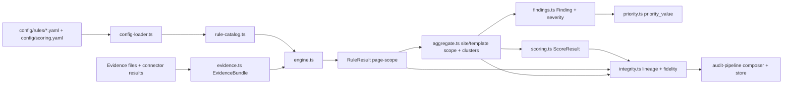
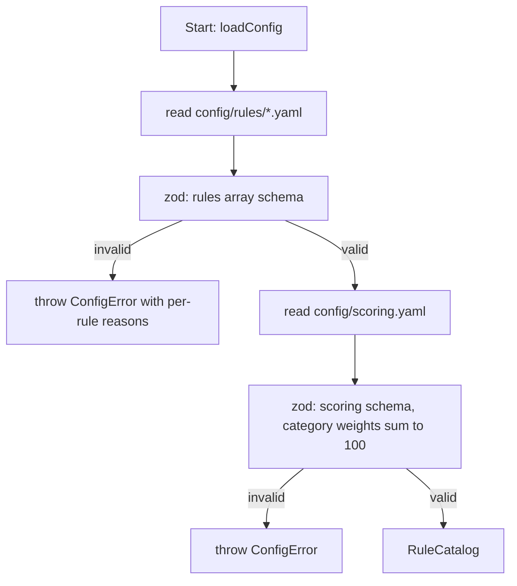
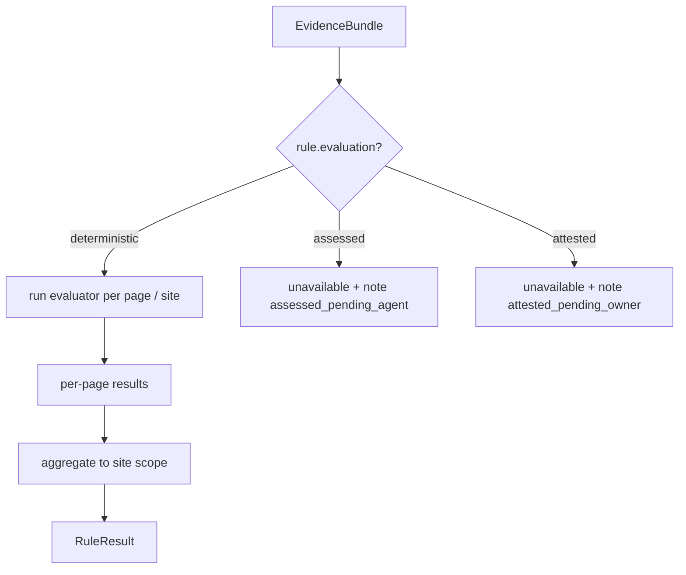
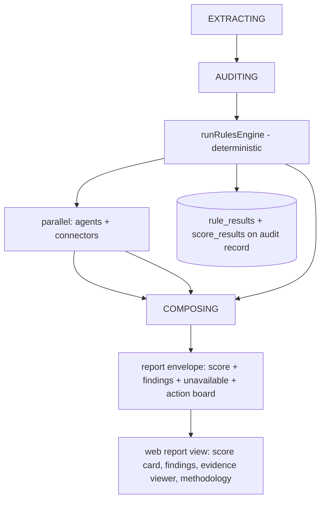

# M2 Design Spec: Deterministic Rules Engine, Scoring & Integrity

Date: 2026-10-05
Status: Approved design, pending user spec review
Milestone: M2 — Integrity and Presence Readiness (INT-03)
Authority: `docs/spec/05-PROJECT-PLAN.md` §M2, `docs/spec/02-DETAILED-SPECIFICATION.md` §6 and §15, `config/scoring.yaml`, `schemas/rule-*.schema.json`, `schemas/score-result.schema.json`, `schemas/finding.schema.json`

## 1. Goal

Build the deterministic core of the product: a versioned rules engine that evaluates crawled evidence against the 77 configured rules, computes the Presence Readiness score (categories, weights, critical caps, coverage, confidence), generates findings with priority, attaches lineage and fidelity labels, and integrates into the audit pipeline so real reports show deterministic findings and a reproducible score.

**Exit gate (from project plan):** independent score reproduction and golden fixtures pass; invalid data cannot produce valid-looking results.

**Decisions locked with user:**
- Evidence-first evaluators: each rule has a TypeScript evaluator grouped by the evidence it consumes.
- New package `@wpi/rules-engine/` for everything, including the integrity module.
- No condition-expression DSL, no plugin system.

**Out of scope for M2:** nightly recomputation job scheduling (function shipped, scheduler later), PDF/CSV exports, experience effectiveness scoring (M5), keyword-dependent rules SEO-011/SEO-012 (return `not_applicable` without keyword data), GSC-002 attestation checklist UI (reported as attested-pending), AI visibility.

## 2. Package structure

```
packages/rules-engine/
├── package.json                 # @wpi/rules-engine
├── src/
│   ├── index.ts                 # public API
│   ├── config-loader.ts         # parse + zod-validate rule YAMLs and scoring.yaml
│   ├── rule-catalog.ts          # RuleCatalog: registry + tier/applicability filtering
│   ├── evidence.ts              # EvidenceBundle types (engine input contract)
│   ├── evaluators/
│   │   ├── crawl.ts             # CRW-001..012
│   │   ├── seo.ts               # SEO-001..012, SPAM-001
│   │   ├── structured-data.ts   # STR-001..008
│   │   ├── aeo.ts               # deterministic AEO subset (AEO-002..005, 007, 008, 010, 011)
│   │   ├── geo.ts               # deterministic GEO subset (GEO-001..004, 006, 008..011)
│   │   ├── i18n-accessibility.ts# I18N-001..004, A11Y-001..004, MOB-001, AGT-001..002
│   │   └── performance-security.ts # PRF-001..004, SEC-001..003, DEL-001
│   ├── engine.ts                # runRulesEngine(bundle, catalog): RuleResult[]
│   ├── aggregate.ts             # per-page → site/template aggregation, template clustering
│   ├── scoring.ts               # category scores, readiness, critical caps, coverage, confidence
│   ├── findings.ts              # RuleResult[] → Finding[] (severity mapping)
│   ├── priority.ts              # priority_value = impact*reach*confidence/effort + group/horizon
│   └── integrity.ts             # lineage attachment, freshness, fidelity mapping
└── tests/
    ├── golden/                  # golden fixtures for reproduction
    └── ...
```

Consumers: `packages/audit-pipeline` (calls engine in AUDITING stage), `services/agents` (eval-rule tool gets the real `RuleEngine`).



## 3. Data contracts

### 3.1 LoadedRule (from YAML, zod-validated)

Mirrors `schemas/rule-definition.schema.json` field names:

```ts
// Field names mirror config/rules/*.yaml and schemas/rule-definition.schema.json.
interface LoadedRule {
  id: string;                       // "CRW-001"
  category: RuleCategory;           // "crawlability" | "on_page" | "structured_data" | "aeo" | "geo" | "i18n_accessibility" | "performance_security"
  title: string;
  importance_weight: number;        // 1-5 for scored rules; 0 for unscored
  scored: boolean;                  // false for GSC-003, GEO-010, AGT-002, SPAM-001
  evaluation: "deterministic" | "assessed" | "attested";
  connected_tier_only: boolean;     // true for GSC-001..003 only
  requires_data?: "keyword_data" | "business_profile_or_merchant_center";  // SEO-011, SEO-012, GEO-011
  critical_cap?: string;            // cap id, e.g. "homepage_unretrievable"; max_score resolved from ScoringConfig.critical_caps
  applicability: string;            // free text from YAML; machine conditions live in evaluators
  standards: { pass: string; partial?: string; fail: string };
  fidelity_label: string;           // "computed" | "assessed" | "observed" | "attested"
}
```

The loader preserves extra YAML fields (`change`, `source_reference`) via zod passthrough; they are not consumed by the engine. Rule criticality is derived from `critical_cap` presence — the YAML has no separate critical flag.

### 3.2 ScoringConfig (from `config/scoring.yaml`)

```ts
interface ScoringConfig {
  methodology_version: string;                      // "0.1.0-draft"
  category_weights: Record<RuleCategory, number>;   // 20/15/10/20/15/10/10
  result_values: { pass: 1; partial: 0.5; fail: 0 };
  critical_caps: Array<{ cap_id: string; max_score: number; trigger_rule: string }>;
  confidence: { high_min_coverage: 0.9; medium_min_coverage: 0.7 };
}
```

### 3.3 EvidenceBundle (engine input)

The pipeline adapter (in `audit-pipeline`) maps evidence files + connector outputs into:

```ts
interface EvidenceBundle {
  methodology_version: string;
  tier: "rich" | "reduced" | "preview";
  locale: "en" | "ar";
  site: {
    root_url: string;
    homepage: PageEvidence | null;        // null → CRW-001 fail path
    robots: RobotsEvidence;               // fetched robots.txt content + parsed directives
    sitemap: SitemapEvidence;             // sitemap availability + URL count
    llms_txt: { present: boolean; references: string[] } | null;
    security: { https_valid: boolean; cert_error?: string; hsts: boolean };
  };
  pages: PageEvidence[];                  // every crawled page (1..20)
  connectors: {
    psi?: PsiEvidence;                    // lab performance metrics
    crux?: CruxEvidence;                  // field Core Web Vitals
    gsc?: GscEvidence;                    // indexing counts (OAuth)
  };
  keyword_data?: never;                   // M2: keyword rules → not_applicable
}

interface PageEvidence {
  evidence_id: string;
  url: string;
  final_url: string;
  status_code: number;
  content_type: string;
  content_hash: string;
  fetched_at: string;
  render: { rendered: boolean; render_reason?: string };
  title: string | null;
  meta_description: string | null;
  canonical: string | null;
  lang: string | null;
  viewport_meta: string | null;
  headings: { level: number; text: string }[];
  word_count: number;
  main_content_bytes: number;
  structured_data: JsonLdBlock[];         // extracted JSON-LD
  links: { href: string; rel?: string }[];
  robots_directive: "index" | "noindex" | "none";   // meta/X-Robots-Tag
}
```

**Extractor extension required:** the crawler extractor currently captures headings and links only. M2 adds `title`, `meta_description`, `canonical`, `lang`, `viewport`, `meta robots`, and JSON-LD blocks to `extractContent` (and to evidence JSON). This is an M2 task, not a design risk.

### 3.4 Outputs (stored, schema-conformant)

- `RuleResult` — one per rule at site scope (aggregated), matching `schemas/rule-result.schema.json` (`rule_result_id`, `audit_id`, `rule_id`, `methodology_version`, `result`, `method`, `scope`, `affected_urls`, `evidence_ids`, `confidence`, `evaluated_at`, `lineage`).
- `ScoreResult` — presence_readiness + 7 presence_category scores, matching `schemas/score-result.schema.json`.
- `Finding` — user-facing findings, matching `schemas/finding.schema.json`.
- `PriorityItem` — action board entries (composer schema, extended with `priority_value`, `group`, `horizon`).

## 4. Config loader

Loads at pipeline boot (per audit run, cheap): reads the 7 YAML files + `scoring.yaml`, zod-validates, throws `ConfigError` listing every violation (fail-closed — a malformed rule file aborts the audit before crawling, never silently skips rules).



Catalog filtering per audit:
- **Tier filtering:** preview tier excludes connected-tier rules (GSC-001..003) entirely — they are not expected, so they do not count against coverage.
- **`connected_tier_only` with no token (rich/reduced tier):** rule still evaluates — emits `unavailable` with reason `gsc_not_connected` — and **stays in the coverage denominator** (it was expected; absence must lower coverage, not raise the score). See §6.3.
- **`requires_data` with no data source in M2** (SEO-011, SEO-012 `keyword_data`; GEO-011 `business_profile_or_merchant_center`): the product has no keyword-upload or business-profile feature yet, so these rules are `not_applicable` and excluded from the denominator. When those features ship, the same rules become connector-absence cases (denominator).

## 5. Evaluator pattern

One exported function per rule, named `eval<ID>` (e.g. `evalCRW001`), signature:

```ts
type RuleEvaluation = {
  result: "pass" | "partial" | "fail" | "not_applicable" | "unavailable" | "error";
  evidence_ids: string[];        // >=1 when pass/partial/fail
  rationale?: string;            // assessed only
  cap_trigger?: boolean;         // SPAM-001 etc.
};
type Evaluator = (bundle: EvidenceBundle) => RuleEvaluation;                 // site-scope rules
type PageEvaluator = (page: PageEvidence, bundle: EvidenceBundle) => RuleEvaluation;  // per-page rules
```

Scope per rule follows the rule's standard text: rules about site-wide artifacts (robots.txt, sitemap, llms.txt, HTTPS, homepage retrieval, sitewide noindex) are site-scope `Evaluator`s; rules whose standard describes individual pages (titles, meta descriptions, headings, structured data on pages, viewport, lang) are per-page `PageEvaluator`s. The implementation plan enumerates the scope of all 77 rules explicitly.



**Handled specially:**
- Assessed rules (AEO-001, AEO-006, AEO-009, GEO-005, GEO-007): engine emits `unavailable` with reason `assessed_pending_agent`. When the auditor agent runs with a real Gemini key, the agent stage converts these to assessed RuleResults via the eval-rule tool (M3 wiring, exercised in M2 integration tests with stub agent).
- GSC-001..003 (connected tier only): no token → `unavailable`, reason `gsc_not_connected`, counted in coverage denominator; token → GSC-001 evaluates, GSC-002 emits `unavailable`/reason `attested_pending` (attestation checklist is a later milestone; the rule's fidelity fallback is attested), GSC-003 (fidelity observed) is unscored/report-only.
- SEO-011/SEO-012 (`keyword_data`) and GEO-011 (`business_profile_or_merchant_center`): `not_applicable` in M2 — no such data source exists as a product feature yet (see §4).
- SPAM-001: unscored; evaluator emits `fail` + `cap_trigger: true` when thin/doorway/hidden-text patterns are detected deterministically (hidden text via CSS display tricks in render evidence, doorway via near-duplicate page clusters). scoring.yaml marks the cap as an ASSUMPTION pending calibration with a M0 DECIDE on what confirms a failure; M2 default is deterministic detection via `cap_trigger`, flagged for methodology-owner calibration.
- Unscored report-only rules (GSC-003, GEO-010, AGT-002): evaluators still emit results for report display, but they never enter any denominator and never produce findings (§8.1).

## 6. Aggregation, template clustering, scope

### 6.1 Page → site aggregation (deterministic policy)

For page-scoped rules, per-page results aggregate to one site-scope RuleResult:

```
failed_ratio = failed_pages / checked_pages
failed_ratio == 0            → pass
0 < failed_ratio <= 0.49     → partial
failed_ratio >= 0.5          → fail
affected_urls = failing page URLs (capped at 20, plus count)
```

Per-page pass/partial/fail counts as fail-equivalent for ratio when result is `fail`; `partial` pages count as 0.5 fail. `not_applicable` pages are removed from the denominator.

### 6.2 Template clustering

Deterministic URL-pattern clustering: normalize path → replace numeric/hex segments with `{id}`, collapse query strings, group by first-two path segments + depth. Clusters with ≥ 3 pages where the same rule fails on ≥ 60% of cluster pages produce a template-scoped RuleResult (scope `template`, `template_cluster_key` set) alongside the site-scope result. This satisfies "template/page classification and recurring issue clustering" without ML. Template-scoped results are informational for findings display only — scoring consumes site-scope RuleResults exclusively.

### 6.3 Coverage accounting

```
total_expected_applicable_weight = Σ importance_weight of catalog rules applicable to this audit's tier and requirements
measurable_applicable_weight     = Σ importance_weight of those rules whose result ∈ {pass, partial, fail}
coverage = measurable / total_expected
```

Rules excluded because a connector was absent still count in the denominator (they were expected) — this is what makes absent GSC/PSI data lower coverage rather than silently raising the score.

```mermaid
flowchart TD
    P[per-page results] --> R[ratio aggregation]
    R --> S[site RuleResult]
    P --> C[URL-pattern clustering]
    C -->|>=3 pages, >=60% fail| T[template RuleResult + cluster key]
    S + T --> COV[coverage: measurable / expected weight]
```

## 7. Scoring engine

Implements `config/scoring.yaml` exactly:

1. **Category score:** `100 * Σ(result_value × weight) / Σ(weight)` over scored rules with pass/partial/fail in that category. Empty denominator → `value: null` (category unavailable). This resolves scoring.yaml's `category_score_when_no_measurable_rule` DECIDE_AT_M0 with the "unavailable + renormalize with disclosure" option: null categories drop out of both numerator and denominator (renormalize over available categories) and the score card discloses which categories were unavailable.
2. **Pre-cap readiness:** `Σ(category_value × category_weight / 100)` over available categories.
3. **Critical caps:** after the weighted sum, `readiness = min(pre_cap, every triggered cap.max_score)`. For the five rule-condition caps (homepage_unretrievable/CRW-001, sitewide_noindex/CRW-003, robots_blocks_general_search/CRW-004, empty_main_content/DEL-001, https_unavailable/PRF-001), the cap triggers when its rule's site-scope result is `fail` — the evaluator implements exactly the cap's stated condition. spam_policy_confirmed/SPAM-001 additionally requires the evaluator's `cap_trigger` flag (deterministic pattern detection). `applied_cap` records cap_id, max_score, rule_id, reason_key on the ScoreResult. unsafe_canonical_domain never reaches scoring (security rejection at intake, per scoring.yaml).
4. **Confidence:** tested high first, then medium, else low (scoring.yaml evaluation_order). High: coverage ≥ 0.90 AND pages inspected ≥ 10 AND all critical stages completed. Medium: coverage ≥ 0.70 AND homepage inspected AND ≥ 4 important pages inspected besides the homepage. Critical stages = VALIDATING, CRAWLING, EXTRACTING, AUDITING (resolves scoring.yaml's `critical_stages` DECIDE_AT_M0 with the YAML's own candidates); a stage "completed" when no failure degradation was recorded for it in the run.
5. Full precision internally; round only at presentation. ScoreResult stores full precision `value` + `pre_cap_value` per schema.

**Separation rule D-012:** engine only ever computes presence_readiness / presence_category. No other signal is blended.

```mermaid
flowchart TD
    RR[site-scope RuleResults] --> CS[7 category scores]
    CS --> PC[pre-cap readiness, renormalized over available categories]
    PC --> CAP{critical caps triggered?}
    CAP -->|yes| MC[readiness = min pre-cap, caps; applied_cap recorded]
    CAP -->|no| FIN[readiness = pre-cap]
    MC + FIN + COV[coverage] --> CONF[confidence high/medium/low]
    --> SR[ScoreResult stored]
```

## 8. Findings, severity, priority

### 8.1 Severity mapping (deterministic)

| Rule result | weight ≥ 4 or critical_cap present | weight 3 | weight ≤ 2 |
|---|---|---|---|
| fail | critical | high | medium |
| partial | high | medium | low |
| pass | — | — | — (no finding) |

Unscored rules: SPAM-001 (critical_cap present) produces a critical finding on `fail`; GSC-003, GEO-010, AGT-002 are report-only — their results render in the report but never produce findings and never enter denominators (scoring.yaml `separation.unscored_rules`).

`evidence_state`: deterministic → `verified`; assessed → `inferred`; attested → `client_stated`. `affected_scope.sampled = true` always (anonymous audits are samples).

### 8.2 Priority (from scoring.yaml)

```
priority_value = impact × reach × confidence_factor / effort
impact = rule.importance_weight (1-5)
reach  = ceil(5 × affected_pages / pages_checked)   (1-5; M2 fallback — GSC-impression-based reach arrives with connected data later)
effort = per-category constant (crawlability 2, on_page 2, structured_data 3, aeo 3, geo 4, i18n 3, performance_security 3)
confidence_factor = high 1.0 / medium 0.75 / low 0.5
groups, in precedence order: critical_blocker (critical severity) > measurement_fix > quick_win (effort ≤ 2 and impact ≥ 3) > strategic_opportunity (effort ≥ 4) > polish (rest)
measurement_fix entries derive from `unavailable` RuleResults (data gaps): impact = rule importance_weight, reach = 5, effort = 1; they sort immediately after critical_blockers.
display bands (M2 defaults, versioned, pending methodology-owner calibration — resolves scoring.yaml display_bands DECIDE_AT_M0): critical ≥ 10, high ≥ 6, medium ≥ 3, low < 3.
horizons: "0-30d" = critical band or critical_blocker group; "31-60d" = high or medium band; "61-90d" = low band.
```

Executive board = top 8–12 by priority_value, critical_blockers first. No traffic/revenue forecasts anywhere.

## 9. Integrity module

- **Lineage:** every RuleResult / ScoreResult / Finding gets a `lineage` object per `common.schema.json` — `parent_ids = evidence_ids`, `fidelity_label = computed` (deterministic results) or `assessed`, `content_hash` = SHA-256 over sorted evidence ids + methodology_version, `method = "deterministic"`, `validation_state = "validated"`.
- **Freshness:** engine checks each evidence item's `fetched_at` against `config/freshness.yaml` (evidence 7 days). Stale evidence → rule result `unavailable` + reason `stale_evidence`; stale evidence never produces a passing score contribution.
- **Fidelity:** the report-facing tag mapping lives here: computed→verified, assessed→inferred, attested→client_stated, observed→verified. `not_verified` for results whose evaluation started but could not complete (error).
- **Invalid-data guard:** engine refuses to score when any input evidence fails hash verification (the pipeline already verifies; engine re-checks the bundle's declared hashes) — throws `IntegrityError` → audit fails with `failure.integrity_error`. Invalid data cannot produce valid-looking results.

## 10. Pipeline integration

In `packages/audit-pipeline`:

1. New stage order inside AUDITING: **rules engine first** (deterministic), then agents + connectors in parallel as today, then compose.
2. New `RulesEngineStage` port in the pipeline's service container so web wiring can inject the real `@wpi/rules-engine` implementation (local mode) or a stub (test mode).
3. Pipeline adapter maps evidence files → `EvidenceBundle` (evidence directory + render manifest + connector results passed in).
4. Engine outputs stored on the audit record: `rule_results`, `score_results` (columns on `audits` table via new migration), and merged into the report envelope.
5. Composer changes:
   - Deterministic findings merged with agent findings (deterministic first, severity-sorted).
   - `unavailable[]` gains blocks for assessed/attested/connected rules that are `unavailable` (reason keys: `unavailable.assessed_pending_agent`, `unavailable.gsc_not_connected`, …).
   - Action board now built from priority items (deterministic + agent findings merged, capped by tier).
   - Limitation keys `limitation.score_engine_deferred` and `limitation.deterministic_rules_deferred` removed; report model gains `score` (presence_readiness summary with coverage/confidence/applied caps) — validated against an extended `report-model.schema.json`.
6. `services/agents` eval-rule tool: injected `RuleEngine` now backed by the stored RuleResults (read-only lookup; agents can read deterministic results and submit assessed results — never overwrite deterministic ones; enforced by result `method` in the store).



## 11. Web integration (minimal M2 surface)

- **Score card** on report view: overall readiness (rounded), confidence, coverage ("checked X of Y weight"), pre-cap + applied caps listed, methodology_version.
- **Findings by area** now includes deterministic findings with severity chips, evidence state tags, affected scope ("X of Y checked pages"), and priority group.
- **Evidence viewer page** (`/audit/[id]/evidence`): list of evidence objects per page (final URL, status, hash, fetched-at, render info) — read-only, secret-gated, no-index. Raw JSON shown via details/summary (no new deps).
- **Methodology disclosure section:** category weights table, rule counts per category, link text for scoring.yaml formulas (static content in i18n catalogs, en + ar).
- **i18n:** all new user-facing strings in `en.json` + `ar.json` (RTL-safe layout).

## 12. Error handling

| Condition | Behavior |
|---|---|
| Config YAML invalid | `ConfigError` before crawl; audit `FAILED` with `failure.config_invalid` |
| Evidence hash mismatch | `IntegrityError`; audit `FAILED` with `failure.integrity_error`; no score emitted |
| Evaluator throws | that rule → `error` result (leaves denominator); engine continues; logged |
| Missing evidence group (e.g. no PSI) | rules in that group → `unavailable` with reason key |
| Empty denominator (all rules unavailable) | ScoreResult `value: null`, report shows "not measurable this run" |

Engine never throws mid-run except integrity/config failures — a buggy evaluator degrades to `error`, never fabricates a pass.

## 13. Testing strategy

1. **Unit tests per evaluator** (TDD): golden evidence inputs → exact result. All 77 rules covered (including not_applicable/unavailable paths).
2. **Golden fixture reproduction (exit gate):** the Python proof `scripts/proofs/proof_1_reproduce_score.py` logic becomes a TS test: given stored RuleResults, score math reproduces bit-for-bit. Plus a new golden e2e fixture: fixed synthetic evidence bundle → expected RuleResults + ScoreResult + findings snapshot (JSON committed under `packages/rules-engine/tests/golden/`).
3. **Cap tests:** each of the 6 scoreable caps triggers and clamps correctly; multiple caps → lowest wins.
4. **Coverage/confidence tests:** absent connectors lower coverage; confidence thresholds at 0.90/0.70 boundaries.
5. **Integrity tests:** tampered hash → IntegrityError; stale evidence → unavailable, not pass.
6. **Invalid-rejection (exit gate):** a RuleResult with fail + empty evidence_ids is rejected by schema validation in the pipeline (mirrors proof_2).
7. **Pipeline integration test:** stub dispatcher audit runs engine, record contains rule_results + score_results; composer output includes deterministic finding + score; assessed rules land in unavailable[].
8. **Web:** Playwright e2e extended — report page shows score card and deterministic finding; evidence viewer renders; RTL snapshot for score card.

## 14. Exit criteria

- [ ] All 77 rules load from YAML; malformed config fails closed.
- [ ] Golden fixtures reproduce scores exactly (TS test + existing Python proof both green).
- [ ] Every ScoreResult/Finding/RuleResult carries lineage + fidelity label; schema validation passes.
- [ ] Tampered evidence cannot produce a score.
- [ ] Report shows score card, deterministic findings, evidence viewer, methodology disclosure (en + ar).
- [ ] `limitation.score_engine_deferred` / `limitation.deterministic_rules_deferred` removed.
- [ ] Full monorepo suite green (build, typecheck, tests, Playwright).
