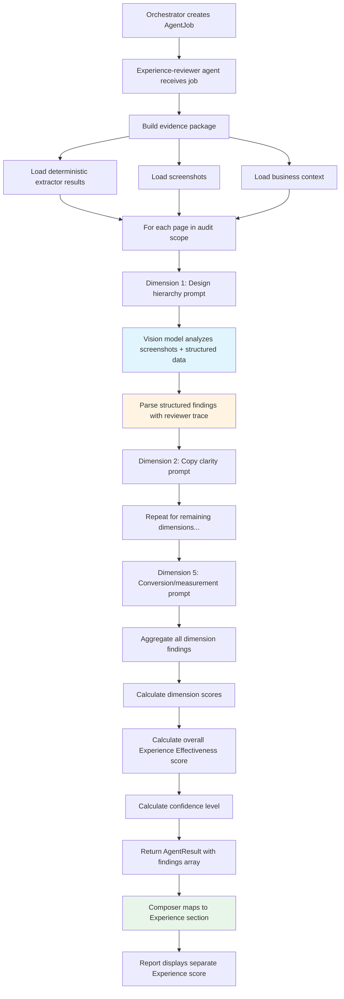
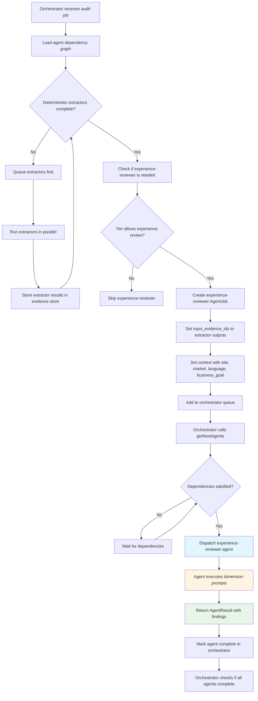
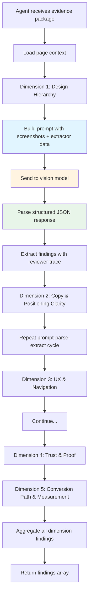
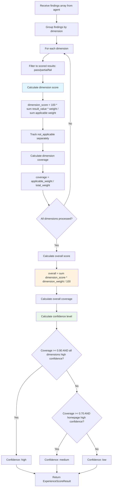
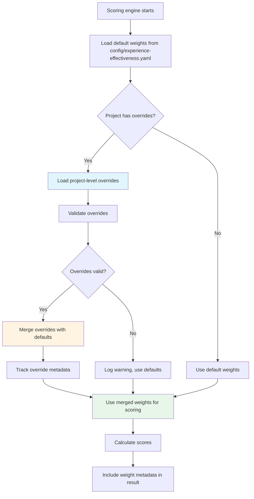
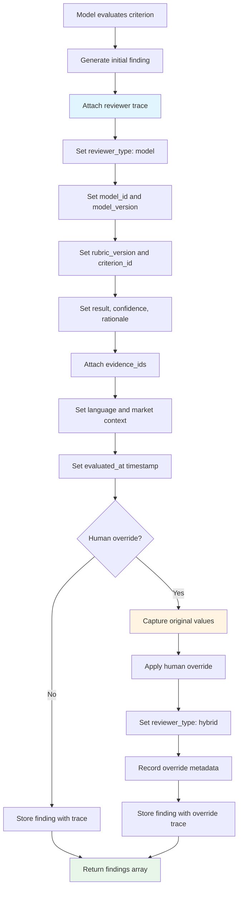
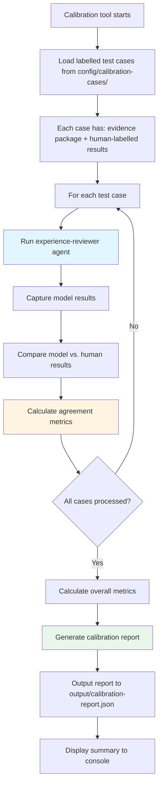
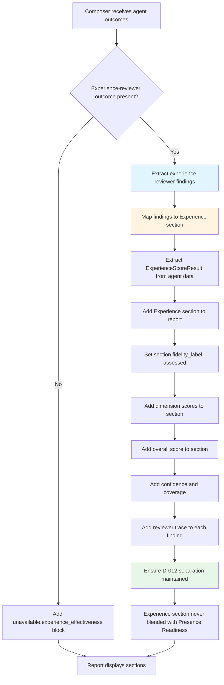

# M5 Experience Effectiveness Design Spec

**Date:** 2026-10-07  
**Status:** Draft for review  
**Methodology version:** 0.1.0-draft

## Overview

M5 Experience Effectiveness adds a model-assisted subjective review layer to the audit pipeline, evaluating website experience quality across 23 rubric criteria in 5 dimensions. This is a **separate output** from Presence Readiness (D-012 separation rule) and appears in its own "Experience" section of the report.

**Key architectural decisions:**

- New agent type in existing M3 agent service (reuses orchestrator, provider adapters, cost tracking)
- Vision-capable model analyzes screenshots directly (not OCR'd)
- One prompt per dimension (5 calls per page) for context coherence and calibratability
- Fixed default weights with project-level overrides (tracked and require justification)
- Separate calibration tool for model validation before production
- Results in separate "Experience" section (D-012 compliance)
- Reviewer trace stored in finding's data field
- Deterministic extractor results passed as structured JSON in prompts
- Single model with language-aware prompts handles all languages

## Section 1: Overall Architecture

The Experience Effectiveness layer adds a new **experience-reviewer agent** to the existing M3 agent service. This agent reuses the orchestrator, provider adapters, cost tracking, and tool system already built for M3 agents.

**Process flow:**



**Key architectural choices:**

- **Reuse M3 infrastructure**: No new orchestration layer; experience-reviewer is just another agent type
- **Vision-first**: Screenshots analyzed directly by Gemini Pro Vision (or equivalent), not OCR'd first
- **Dimension-per-prompt**: Balances context coherence (model sees all evidence for one dimension at a time) with calibratability (each dimension's judgment is isolated)
- **Language-aware prompts**: Single model handles all languages; prompts include language context and model flags low confidence for non-English content

## Section 2: Agent Configuration and Orchestration

The experience-reviewer agent is configured as a new agent type in the existing agent configuration system, reusing the orchestrator's dependency graph.

**Configuration structure:**

```yaml
# config/agents/experience-reviewer.yaml
name: experience-reviewer
milestone: M5
reads_untrusted_content: true
model_tier: vision-capable # Gemini Pro Vision or equivalent
tools:
  - read_screenshot # Loads screenshot evidence
  - read_extractor_output # Loads deterministic extractor results
  - parse_structured_json # Parses model output
forbidden_tools: []
```

**Orchestration flow:**



**Key details:**

- Experience-reviewer runs **after** deterministic extractors (dependency enforced by orchestrator)
- Input evidence IDs reference extractor outputs (heading, form, contact, policy, language, analytics, viewport, wayfinding)
- Context includes site URL, market, language, and optional business_goal from the audit job
- Agent returns findings array with reviewer trace in each finding's data field
- Cost tracking reuses existing provider adapter usage reporting

## Section 3: Evidence Package Structure and Dimension Prompts

The experience-reviewer agent receives a structured evidence package containing all inputs needed for evaluation.

**Evidence package structure:**

```typescript
interface ExperienceEvidencePackage {
  page_url: string;
  language: string;
  market: string;
  business_goal?: string;

  // Screenshots (analyzed by vision model)
  screenshots: {
    viewport: string; // evidence_id for viewport screenshot
    full_page: string; // evidence_id for full-page screenshot
    above_fold: string; // evidence_id for above-fold screenshot
  };

  // Deterministic extractor outputs (structured JSON)
  extractor_results: {
    heading: HeadingExtractorOutput;
    form: FormExtractorOutput;
    contact: ContactExtractorOutput;
    policy: PolicyExtractorOutput;
    language: LanguageExtractorOutput;
    analytics: AnalyticsExtractorOutput;
    viewport: ViewportExtractorOutput;
    wayfinding: WayfindingExtractorOutput;
  };

  // Presence Readiness results (for context)
  readiness_results: {
    score: number | null;
    categories: CategoryResult[];
    confidence: "high" | "medium" | "low";
  };
}
```

**Dimension prompt flow:**



**Prompt structure (per dimension):**

```
You are evaluating a website page for {dimension_name}.

PAGE CONTEXT:
- URL: {page_url}
- Language: {language}
- Market: {market}
- Business goal: {business_goal}

SCREENSHOTS:
[Viewport screenshot attached]
[Above-fold screenshot attached]

DETERMINISTIC EXTRACTOR RESULTS:
{JSON output from relevant extractors}

PRESENCE READINESS CONTEXT:
- Overall score: {score}
- Confidence: {confidence}

EVALUATE THE FOLLOWING CRITERIA:
{List of criteria for this dimension with pass/partial/fail standards}

For each criterion, return:
{
  "criterion_id": "EXP-DH-01",
  "result": "pass" | "partial" | "fail" | "not_applicable",
  "confidence": "high" | "medium" | "low",
  "rationale": "Brief explanation citing specific evidence",
  "evidence_ids": ["screenshot_viewport", "extractor_heading"],
  "limitations": ["Any constraints affecting this judgment"]
}

Return results as a JSON array.
```

**Key details:**

- Each dimension prompt includes only the extractors relevant to that dimension (e.g., Design Hierarchy gets heading + viewport extractors)
- Screenshots are attached as images (vision model analyzes directly)
- Model must return structured JSON matching the finding schema
- Rationale must cite specific evidence (screenshot regions, extractor outputs)
- Limitations array captures uncertainty (e.g., "Low confidence due to non-English content")

## Section 4: Scoring Engine

The scoring engine aggregates dimension-level findings into an overall Experience Effectiveness score.

**Scoring flow:**



**Score calculation:**

```typescript
interface ExperienceScoreResult {
  experience_effectiveness: number; // 0-100
  dimensions: {
    design_hierarchy: DimensionScore;
    copy_and_positioning_clarity: DimensionScore;
    ux_and_navigation: DimensionScore;
    trust_and_proof: DimensionScore;
    conversion_path_and_measurement: DimensionScore;
  };
  coverage: number; // 0-1
  confidence: "high" | "medium" | "low";
  fidelity_label: "assessed"; // Always "assessed" for model-evaluated
  methodology_version: string;
}

interface DimensionScore {
  score: number; // 0-100
  coverage: number; // 0-1
  criteria_count: number;
  applicable_count: number;
  not_applicable_count: number;
}
```

**Result value mapping:**

- `pass` → 1.00
- `partial` → 0.50
- `fail` → 0.00
- `not_applicable` → excluded from denominator
- `unavailable` → excluded, reduces confidence
- `error` → excluded, reduces confidence

**Confidence levels:**

- **High**: Coverage ≥ 0.90, all dimensions high confidence, minimum 10 pages inspected
- **Medium**: Coverage ≥ 0.70, homepage high confidence, minimum 5 pages inspected
- **Low**: Coverage < 0.70, fewer than 5 pages, or any critical dimension unavailable

**Key details:**

- No critical caps (unlike Presence Readiness)
- Rounding only at presentation boundary (calculate with full precision)
- Show pre-cap score and all dimension scores
- Fidelity label is always "assessed" (model-evaluated)
- Methodology version tracked for reproducibility

## Section 5: Weight Configuration and Project Overrides

Weights are configured at two levels: fixed defaults in the config file, with optional project-level overrides.

**Weight configuration flow:**



**Default weights configuration:**

```yaml
# config/experience-effectiveness.yaml
methodology_version: "0.1.0-draft"
score_name: experience_effectiveness
display_name:
  en: "Experience Effectiveness"
  ar: "فعالية التجربة"

# Dimension weights (must sum to 100)
dimensions:
  design_hierarchy:
    weight: 20
    title: "Design hierarchy and visual structure"
  copy_and_positioning_clarity:
    weight: 20
    title: "Copy and positioning clarity"
  ux_and_navigation:
    weight: 20
    title: "UX and navigation"
  trust_and_proof:
    weight: 20
    title: "Trust and proof"
  conversion_path_and_measurement:
    weight: 20
    title: "Conversion path and measurement"

# Criterion weights within each dimension (must sum to 100 per dimension)
criteria:
  design_hierarchy:
    EXP-DH-01: 25 # Visual hierarchy clarity
    EXP-DH-02: 20 # Focal point effectiveness
    EXP-DH-03: 20 # Whitespace and breathing room
    EXP-DH-04: 15 # Consistency of design language
    EXP-DH-05: 20 # Mobile-first responsiveness

  copy_and_positioning_clarity:
    EXP-CP-01: 30 # Value proposition clarity
    EXP-CP-02: 25 # Headline effectiveness
    EXP-CP-03: 25 # Supporting copy quality
    EXP-CP-04: 20 # Call-to-action clarity

  ux_and_navigation:
    EXP-UX-01: 25 # Navigation clarity
    EXP-UX-02: 20 # Wayfinding effectiveness
    EXP-UX-03: 20 # Information architecture
    EXP-UX-04: 15 # Interaction design quality
    EXP-UX-05: 20 # Accessibility baseline

  trust_and_proof:
    EXP-TP-01: 25 # Trust signals presence
    EXP-TP-02: 20 # Social proof effectiveness
    EXP-TP-03: 20 # Authority indicators
    EXP-TP-04: 15 # Transparency and honesty
    EXP-TP-05: 20 # Security and privacy signals

  conversion_path_and_measurement:
    EXP-CV-01: 25 # CTA prominence and clarity
    EXP-CV-02: 20 # Form usability
    EXP-CV-03: 20 # Conversion funnel coherence
    EXP-CV-04: 15 # Measurement and analytics
    EXP-CV-05: 20 # Friction reduction
```

**Project-level override structure:**

```json
{
  "project_id": "abc123",
  "overrides": {
    "dimensions": {
      "conversion_path_and_measurement": {
        "weight": 30,
        "justification": "E-commerce site prioritizes conversion optimization",
        "approved_by": "seo_lead",
        "approved_at": "2026-10-01T12:00:00Z"
      }
    },
    "criteria": {
      "EXP-CP-01": {
        "weight": 35,
        "justification": "SaaS product requires strong value proposition",
        "approved_by": "seo_lead",
        "approved_at": "2026-10-01T12:00:00Z"
      }
    }
  }
}
```

**Key details:**

- Default weights are fixed and versioned (bump methodology_version on changes)
- Project overrides require justification and approval tracking
- Overrides are validated (dimension weights must still sum to 100, criterion weights must still sum to 100 per dimension)
- Invalid overrides log a warning and fall back to defaults
- Weight metadata included in score result for traceability
- Overrides stored in project configuration (database or config file)

## Section 6: Reviewer Trace Structure

Every finding includes a complete reviewer trace for auditability and calibration.

**Reviewer trace structure:**

```typescript
interface ReviewerTrace {
  // Rubric identification
  rubric_version: string; // e.g., "0.1.0-draft"
  criterion_id: string; // e.g., "EXP-DH-01"
  criterion_name: string; // e.g., "Visual hierarchy clarity"

  // Evaluation result
  result: "pass" | "partial" | "fail" | "not_applicable" | "unavailable" | "error";
  confidence: "high" | "medium" | "low";
  rationale: string; // Brief explanation citing specific evidence

  // Evidence references
  evidence_ids: string[]; // IDs of screenshots, extractor outputs used

  // Reviewer identification
  reviewer_type: "model" | "human" | "hybrid";
  model_id?: string; // e.g., "gemini-pro-vision"
  model_version?: string; // e.g., "gemini-1.5-pro-002"

  // Language and context
  language: string; // e.g., "en", "ar"
  language_direction: "ltr" | "rtl";
  market: string; // e.g., "US", "SA"

  // Timestamps
  evaluated_at: string; // ISO 8601 timestamp
  prompt_version: string; // Version of the prompt template used

  // Override trace (if human overrode model judgment)
  override?: {
    original_result: string;
    original_confidence: string;
    original_rationale: string;
    overridden_by: string; // User ID or "calibration_reviewer"
    overridden_at: string; // ISO 8601 timestamp
    override_reason: string;
  };

  // Limitations
  limitations: string[]; // e.g., ["Low confidence due to non-English content"]
}
```

**Reviewer trace flow:**



**Key details:**

- Reviewer trace stored in finding's `data` field (follows existing agent pattern)
- Every finding must have complete trace (no partial traces)
- Override trace captures full audit trail (original → overridden)
- Model ID and version tracked for reproducibility
- Prompt version tracked (prompts are versioned in config)
- Limitations array captures uncertainty factors
- Trace enables calibration (compare model vs. human judgments)

## Section 7: Calibration Tool Design

A separate calibration tool loads labelled test cases, runs the model, computes agreement metrics, and outputs a calibration report.

**Calibration flow:**



**Test case structure:**

```typescript
interface CalibrationTestCase {
  case_id: string; // e.g., "case-001"
  description: string; // Brief description of the test site/page

  // Evidence package (same as production)
  evidence_package: ExperienceEvidencePackage;

  // Human-labelled ground truth
  human_results: {
    [criterion_id: string]: {
      result: "pass" | "partial" | "fail" | "not_applicable";
      confidence: "high" | "medium" | "low";
      rationale: string;
    };
  };

  // Metadata
  labelled_by: string; // Reviewer name or ID
  labelled_at: string; // ISO 8601 timestamp
  language: string;
  market: string;
  site_type: string; // e.g., "ecommerce", "saas", "local-business"
}
```

**Calibration report structure:**

```typescript
interface CalibrationReport {
  generated_at: string;
  model_id: string;
  model_version: string;
  rubric_version: string;

  // Overall metrics
  overall: {
    total_cases: number;
    weighted_cohen_kappa: number; // Agreement metric (0-1, higher is better)
    exact_match_rate: number; // % of criteria with exact match
    adjacent_match_rate: number; // % within 1 level (pass↔partial, partial↔fail)
    confidence_distribution: {
      model: { high: number; medium: number; low: number };
      human: { high: number; medium: number; low: number };
    };
  };

  // Per-dimension metrics
  dimensions: {
    [dimension_name: string]: {
      criteria_count: number;
      exact_match_rate: number;
      weighted_cohen_kappa: number;
      disagreements: Array<{
        case_id: string;
        criterion_id: string;
        model_result: string;
        human_result: string;
        model_rationale: string;
        human_rationale: string;
      }>;
    };
  };

  // Per-criterion metrics
  criteria: {
    [criterion_id: string]: {
      total_evaluations: number;
      exact_match_rate: number;
      weighted_cohen_kappa: number;
      disagreement_count: number;
    };
  };

  // Recommendations
  recommendations: string[]; // e.g., ["EXP-DH-03 needs prompt refinement"]
}
```

**Calibration tool usage:**

```bash
# Run calibration with default test cases
pnpm calibration:run

# Run calibration with specific test cases
pnpm calibration:run --cases config/calibration-cases/ecommerce/

# Run calibration for specific dimension only
pnpm calibration:run --dimension design_hierarchy

# Generate calibration report with custom output path
pnpm calibration:run --output reports/calibration-2026-10-07.json
```

**Key details:**

- Calibration tool is separate from production code (clear separation)
- Test cases stored in `config/calibration-cases/` (organized by site type)
- Weighted Cohen's kappa measures agreement (accounts for chance agreement)
- Exact match rate: % of criteria where model and human agree exactly
- Adjacent match rate: % within 1 level (pass↔partial is closer than pass↔fail)
- Disagreements logged with full rationale for prompt refinement
- Target: weighted kappa ≥ 0.70 before production deployment
- Calibration run after every prompt or rubric change

## Section 8: Report Integration (Composer Changes)

The composer maps experience-reviewer results to a separate "Experience" section in the report, maintaining D-012 separation.

**Composer integration flow:**



**Composer changes:**

```typescript
// In composer.ts

const EXPERIENCE_SECTION = "experience";

export function composeSections(
  outcomes: ComposerAgentOutcome[],
  connectorResults: ConnectorResult[],
  scope: TierScope,
  rulesOutput?: RulesEngineOutput,
): ComposeResult {
  const findings: StoredFinding[] = [];
  const unavailable: UnavailableBlock[] = [];
  const costLines: StoredCostLine[] = [];
  const availableSections = new Set<string>();

  // ... existing code for rules engine and other agents ...

  // Process experience-reviewer outcome separately
  const experienceOutcome = outcomes.find((o) => o.agent_name === "experience-reviewer");

  if (!experienceOutcome) {
    unavailable.push({
      section: EXPERIENCE_SECTION,
      reason_key: "unavailable.experience_effectiveness",
    });
  } else if (!experienceOutcome.ok) {
    unavailable.push({
      section: EXPERIENCE_SECTION,
      reason_key:
        experienceOutcome.unavailable_reason_key ?? "unavailable.experience_effectiveness",
    });
  } else {
    availableSections.add(EXPERIENCE_SECTION);

    // Map findings to Experience section
    for (const finding of experienceOutcome.findings) {
      if (finding.result_state === "unavailable") continue;

      findings.push({
        id: randomUUID(),
        agent: "experience-reviewer",
        section: EXPERIENCE_SECTION,
        severity: deriveSeverity(finding.data),
        state: finding.result_state,
        confidence: finding.confidence,
        evidence_ids: [...finding.evidence_ids],
        data: {
          ...finding.data,
          // Reviewer trace is already in finding.data
        },
      });
    }

    // Extract experience score from agent result
    const experienceScore = experienceOutcome.data?.experience_score as
      ExperienceScoreResult | undefined;

    // Add to ComposeResult
    // ... (see ComposeResult changes below)
  }

  // ... rest of composer logic ...
}
```

**ComposeResult changes:**

```typescript
export interface ComposeResult {
  findings: StoredFinding[];
  unavailable: UnavailableBlock[];
  action_board: StoredActionItem[];
  summary_bullets: string[];
  costs: StoredCosts;
  score: ScoreResult | null; // Presence Readiness score
  experience_score: ExperienceScoreResult | null; // NEW: Experience Effectiveness score
}
```

**Report structure:**

```typescript
interface Report {
  // ... existing sections ...

  sections: {
    technical: TechnicalSection;
    keywords: KeywordsSection;
    content: ContentSection;
    performance: PerformanceSection;
    experience: ExperienceSection; // NEW: Separate Experience section
  };

  scores: {
    presence_readiness: ScoreResult | null;
    experience_effectiveness: ExperienceScoreResult | null; // NEW
  };
}

interface ExperienceSection {
  fidelity_label: "assessed";
  score: ExperienceScoreResult;
  dimensions: {
    design_hierarchy: DimensionResult;
    copy_and_positioning_clarity: DimensionResult;
    ux_and_navigation: DimensionResult;
    trust_and_proof: DimensionResult;
    conversion_path_and_measurement: DimensionResult;
  };
  findings: StoredFinding[]; // With full reviewer trace
}
```

**Key details:**

- Experience section is completely separate from Presence Readiness (D-012 compliance)
- Never blended, averaged, or used to cap Presence Readiness
- Fidelity label is always "assessed" (model-evaluated)
- Reviewer trace included in every finding's data field
- Experience score stored separately in ComposeResult
- UI displays Experience section as its own card/section (like AI visibility)
- Exports keep Experience separate from Presence Readiness

## Section 9: Language Handling

A single model with language-aware prompts handles all languages, flagging low confidence for non-English content.

**Language handling flow:**

```mermaid
flowchart TD
    A[Agent receives evidence package] --> B[Extract language from context]
    B --> C{Language is English?}
    C -->|Yes| D[Use standard English prompt]
    C -->|No| E[Use language-aware prompt]
    E --> F[Add language context to prompt]
    F --> G[Add note: Evaluate in {language}, respond in English]
    G --> H[Model evaluates content]
    H --> I{Model confident in language?}
    I -->|Yes| J[Set confidence: high/medium as appropriate]
    I -->|No| K[Set confidence: low]
    K --> L[Add limitation: Low confidence due to non-English content]
    J --> M[Return findings]
    L --> M

    style E fill:#e1f5ff
    style K fill:#fff4e1
    style M fill:#e8f5e9
```

**Language-aware prompt additions:**

```
LANGUAGE CONTEXT:
- Page language: {language}
- Language direction: {ltr|rtl}
- Market: {market}

INSTRUCTIONS:
- Evaluate the content in its original language ({language})
- Apply the same rubric criteria regardless of language
- Respond in English (rationale, limitations)
- If you are uncertain about the meaning or quality due to language barriers, set confidence to "low" and add a limitation: "Low confidence due to non-English content"
- For RTL languages (Arabic, Hebrew), pay special attention to layout direction and text alignment
```

**Key details:**

- Single model handles all languages (no separate models per language)
- Prompts include language context (language code, direction, market)
- Model instructed to evaluate in original language, respond in English
- Model flags low confidence for non-English content when uncertain
- Limitations array captures language-related uncertainty
- RTL languages get special attention for layout and alignment
- Calibration tool includes multilingual test cases to validate language handling
- Future enhancement: language-specific rubric adaptations (not in v1)

## Separation from Presence Readiness (D-012 Compliance)

Experience Effectiveness is a **separate output** from Presence Readiness. The two scores are never blended, averaged, or used to cap each other.

**Separation rules:**

- Experience Effectiveness appears in its own "Experience" section
- Presence Readiness appears in its own "Technical" section (and related sections)
- Each score has its own confidence, coverage, and denominators
- UI and exports never confuse the two
- Experience Effectiveness never caps Presence Readiness
- Presence Readiness never influences Experience Effectiveness

**Reference:** `config/scoring.yaml` separation section (D-012)

## Rubric Criteria

The rubric defines 23 criteria across 5 dimensions. Full criteria definitions with pass/partial/fail standards are in `docs/rubrics/experience-effectiveness.md`.

**Dimensions:**

1. **Design hierarchy** (5 criteria): EXP-DH-01 through EXP-DH-05
2. **Copy and positioning clarity** (4 criteria): EXP-CP-01 through EXP-CP-04
3. **UX and navigation** (5 criteria): EXP-UX-01 through EXP-UX-05
4. **Trust and proof** (5 criteria): EXP-TP-01 through EXP-TP-05
5. **Conversion path and measurement** (5 criteria): EXP-CV-01 through EXP-CV-05

## Testing Strategy

**Unit tests:**

- Scoring engine: dimension score calculation, overall score calculation, confidence levels
- Weight configuration: default loading, override validation, merge logic
- Reviewer trace: trace structure validation, override tracking

**Integration tests:**

- Agent orchestration: dependency graph, evidence package construction
- Composer integration: Experience section mapping, D-012 separation

**Calibration tests:**

- Run calibration tool with labelled test cases
- Verify weighted Cohen's kappa ≥ 0.70
- Verify exact match rate and adjacent match rate

**End-to-end tests:**

- Full audit pipeline with experience-reviewer agent
- Verify Experience section appears in report
- Verify separation from Presence Readiness

## Deployment Checklist

Before deploying to production:

- [ ] Calibration tool run with ≥ 50 labelled test cases
- [ ] Weighted Cohen's kappa ≥ 0.70
- [ ] All 23 criteria have ≥ 0.60 exact match rate
- [ ] Multilingual test cases validated (English, Arabic, French)
- [ ] RTL layout handling verified
- [ ] Project override mechanism tested
- [ ] D-012 separation verified in UI and exports
- [ ] Reviewer trace complete for all findings
- [ ] Cost tracking verified (tokens in/out, USD)
- [ ] Error handling tested (model failures, evidence missing)

## Future Enhancements (Not in v1)

- Language-specific rubric adaptations
- Human-in-the-loop override UI
- A/B testing for prompt versions
- Automated prompt refinement based on calibration disagreements
- Integration with AI visibility observations (correlation analysis)
- Historical trend analysis for Experience Effectiveness scores

## References

- **Rubric:** `docs/rubrics/experience-effectiveness.md`
- **Scoring config:** `config/scoring.yaml` (separation section)
- **Agent config:** `config/agents/experience-reviewer.yaml`
- **D-012 decision:** `docs/decisions.md`
- **Product requirements:** `01-PRODUCT-REQUIREMENTS §5.3, §8`
- **Project plan:** `05-PROJECT-PLAN M5`
