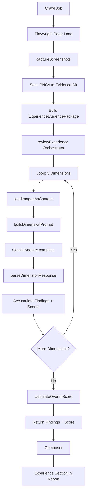

# M5 Vision Model Integration — Design Spec

> **For agentic workers:** REQUIRED SUB-SKILL: Use superpowers:subagent-driven-development (recommended) or superpowers:executing-plans to implement this plan task-by-task. Steps use checkbox (`- [ ]`) syntax for tracking.

**Goal:** Replace the placeholder experience-reviewer with real Gemini Pro Vision API calls that score 5 experience dimensions using screenshots + extractor data.

**Architecture:** Extend the M3 provider layer with multimodal support (text + images), add screenshot capture to the crawler, and build the experience reviewer orchestrator in services/agents that reuses M3 infrastructure (GeminiAdapter, circuit breaker, cost tracker, model resolver).

**Tech Stack:** @google/genai SDK, Playwright (screenshots), TypeScript, existing M3 agent infrastructure.

**Spec:** This document.

## Global Constraints

- Reuse M3 agent infrastructure — no new provider abstractions
- Dimension-per-call strategy: 5 separate Gemini calls per page (one per dimension)
- Pre-loaded prompts: screenshots + extractor data loaded into each dimension's prompt upfront (not tool-based)
- D-012 separation: Experience score never blended with Presence Readiness score
- Backward compatibility: existing text-only agents unaffected by provider changes
- File paths over inline buffers for screenshot storage to keep evidence package lean

---

## Section 1: Provider Layer Extension

### 1.1 ContentPart Type

Add multimodal content support to `services/agents/src/providers/types.ts`:

```typescript
export type ContentPart =
  | { type: 'text'; text: string }
  | { type: 'image'; mimeType: string; data: string }; // base64

export interface CompletionRequest {
  model: string;
  systemPrompt: string;
  userPrompt: string;           // kept for backward compat
  content?: ContentPart[];      // new: multimodal content (optional)
  toolDefinitions?: ToolDefinition[];
  maxTokens?: number;
  temperature?: number;
}
```

The `content` field is optional. When absent, adapters use `userPrompt` as before (backward compatible).

### 1.2 GeminiAdapter Changes

In `services/agents/src/providers/gemini-adapter.ts`, build `Part[]` array when `content` is present:

```typescript
import type { Part } from "@google/genai";

// Inside complete():
const contents: string | Part[] = request.content
  ? request.content.map(part => {
      if (part.type === 'text') {
        return { text: part.text };
      }
      return {
        inlineData: {
          mimeType: part.mimeType,
          data: part.data,
        },
      };
    })
  : request.userPrompt;
```

Pass `contents` to `generateContent()` as before.

### 1.3 Model Tier Addition

In `services/agents/src/providers/model-resolver.ts`, add `vision_capable` tier:

```typescript
const MODEL_MAP: Record<string, string> = {
  fast: "gemini-2.0-flash",
  fast_plus_embedding: "gemini-2.5-flash",
  strong_reasoning: "gemini-2.5-pro",
  vision_capable: "gemini-2.5-pro",  // new
};
```

Gemini 2.5 Pro supports vision. No pricing change needed (already has pricing entry).

---

## Section 2: Screenshot Capture

### 2.1 New Module

Create `services/crawler/src/screenshot-capture.ts`.

### 2.2 Types

```typescript
export interface ScreenshotImage {
  buffer: Buffer;
  mime_type: 'image/png';
  width: number;
  height: number;
}

export interface ScreenshotResult {
  viewport: ScreenshotImage | null;
  full_page: ScreenshotImage | null;
  above_fold: ScreenshotImage | null;
}
```

Null for failed captures (timeout, page crash, etc.).

### 2.3 Implementation

```typescript
import type { Page } from 'playwright';

const ABOVE_FOLD_HEIGHT = 1080;

export async function captureScreenshots(page: Page): Promise<ScreenshotResult> {
  const viewport = await captureViewport(page);
  const fullPage = await captureFullPage(page);
  const aboveFold = await captureAboveFold(page);

  return { viewport, full_page: fullPage, above_fold: aboveFold };
}

async function captureViewport(page: Page): Promise<ScreenshotImage | null> {
  try {
    const buffer = await page.screenshot({ type: 'png' });
    const viewport = page.viewportSize();
    return {
      buffer,
      mime_type: 'image/png',
      width: viewport?.width ?? 1280,
      height: viewport?.height ?? 720,
    };
  } catch {
    return null;
  }
}

async function captureFullPage(page: Page): Promise<ScreenshotImage | null> {
  try {
    const buffer = await page.screenshot({ type: 'png', fullPage: true });
    const dimensions = await page.evaluate(() => ({
      width: document.documentElement.scrollWidth,
      height: document.documentElement.scrollHeight,
    }));
    return {
      buffer,
      mime_type: 'image/png',
      width: dimensions.width,
      height: dimensions.height,
    };
  } catch {
    return null;
  }
}

async function captureAboveFold(page: Page): Promise<ScreenshotImage | null> {
  try {
    const viewport = page.viewportSize();
    const width = viewport?.width ?? 1280;
    const buffer = await page.screenshot({
      type: 'png',
      clip: { x: 0, y: 0, width, height: ABOVE_FOLD_HEIGHT },
    });
    return {
      buffer,
      mime_type: 'image/png',
      width,
      height: ABOVE_FOLD_HEIGHT,
    };
  } catch {
    return null;
  }
}
```

### 2.4 Integration Point

Call `captureScreenshots(page)` after page load in the render job (services/crawler/src/render-job.ts). Save PNGs to evidence directory, update `ExperienceEvidencePackage.screenshots` with file paths.

---

## Section 3: Evidence Package Evolution

### 3.1 ScreenshotRef Type

Change `packages/core/src/types/experience-evidence.ts`:

```typescript
export interface ScreenshotRef {
  evidence_id: string;
  path: string;              // filesystem path to PNG
  mime_type: 'image/png';
  width: number;
  height: number;
}

export interface ExperienceEvidencePackage {
  page_url: string;
  language: string;
  market: string;
  business_goal?: string;

  screenshots: {
    viewport: ScreenshotRef | null;
    full_page: ScreenshotRef | null;
    above_fold: ScreenshotRef | null;
  };

  extractor_results: {
    heading: HeadingExtractorOutput;
    form: FormExtractorOutput;
    contact: ContactExtractorOutput;
    policy: PolicyExtractorOutput;
    language: LanguageExtractorOutput;
    analytics: AnalyticsExtractorOutput;
    viewport: ViewportExtractorOutput;
    wayfinding: WayfindingExtractorOutput;
  };

  readiness_results: {
    score: number | null;
    categories: CategoryResult[];
    confidence: 'high' | 'medium' | 'low';
  };
}
```

### 3.2 Migration

The current placeholder uses `string` evidence IDs. The new type uses `ScreenshotRef` objects with file paths. The orchestrator reads PNGs from disk and converts to base64 `ContentPart[]` for the Gemini API.

---

## Section 4: Experience Reviewer Orchestrator

### 4.1 Module Structure

Create `services/agents/src/experience-reviewer/` with 4 modules:

- `orchestrator.ts` — main entry, loops over 5 dimensions
- `dimension-prompt.ts` — builds per-dimension multimodal prompts
- `response-parser.ts` — parses structured JSON responses
- `image-loader.ts` — reads PNG from disk → base64 ContentPart

### 4.2 Orchestrator Flow

```typescript
import { GeminiAdapter } from '../providers/gemini-adapter.js';
import { resolveModel } from '../providers/model-resolver.js';
import { CostTracker } from '../providers/cost-tracker.js';
import { buildDimensionPrompt } from './dimension-prompt.js';
import { parseDimensionResponse } from './response-parser.js';
import { loadImagesAsContent } from './image-loader.js';
import type { ExperienceEvidencePackage } from '@wpi/core';
import type { ExperienceScoreResult } from '@wpi/core';

export interface OrchestratorDeps {
  adapter: GeminiAdapter;
  costTracker: CostTracker;
  auditId: string;
}

export async function reviewExperience(
  evidence: ExperienceEvidencePackage,
  deps: OrchestratorDeps
): Promise<{ findings: any[]; score: ExperienceScoreResult }> {
  const model = resolveModel('vision_capable');
  const dimensions = ['design_hierarchy', 'copy_and_positioning_clarity', 'ux_and_navigation', 'trust_and_proof', 'conversion_path_and_measurement'];

  const allFindings = [];
  const dimensionScores = {};

  for (const dimension of dimensions) {
    const imageParts = loadImagesAsContent(evidence.screenshots);
    const prompt = buildDimensionPrompt(dimension, evidence, imageParts);

    const response = await deps.adapter.complete({
      model,
      systemPrompt: prompt.systemPrompt,
      userPrompt: '',  // not used when content is present
      content: prompt.content,
      temperature: 0.3,
    });

    deps.costTracker.record({
      audit_id: deps.auditId,
      agent_name: 'experience-reviewer',
      model,
      tokens_in: response.usage.tokens_in,
      tokens_out: response.usage.tokens_out,
      usd: calculateCost(model, response.usage),
    });

    const { findings, score } = parseDimensionResponse(
      dimension,
      response.content,
      evidence.language,
      evidence.market
    );

    allFindings.push(...findings);
    dimensionScores[dimension] = score;
  }

  const overallScore = calculateOverallScore(
    dimensionScores,
    getDimensionWeights(),
    calculateCoverage(allFindings),
    calculateConfidence(allFindings)
  );

  return { findings: allFindings, score: overallScore };
}
```

### 4.3 Dimension Prompt Builder

```typescript
import type { ContentPart } from '../providers/types.js';
import type { ExperienceEvidencePackage } from '@wpi/core';
import { loadRubricConfig } from '@wpi/core';

export function buildDimensionPrompt(
  dimension: string,
  evidence: ExperienceEvidencePackage,
  imageParts: ContentPart[]
): { systemPrompt: string; content: ContentPart[] } {
  const config = loadRubricConfig();
  const dimensionConfig = config.dimensions[dimension];
  const criteria = config.criteria[dimension];

  const systemPrompt = `You are evaluating a webpage's ${dimensionConfig.title}.

Criteria:
${Object.entries(criteria).map(([id, weight]) => `- ${id} (weight: ${weight}): ${getCriterionDescription(id)}`).join('\n')}

For each criterion, respond with:
- result: 'pass', 'partial', 'fail', or 'not_applicable'
- confidence: 'high', 'medium', or 'low'
- rationale: brief explanation (1-2 sentences)

Respond in JSON format:
{
  "criteria": [
    {
      "criterion_id": "EXP-DH-01",
      "result": "pass",
      "confidence": "high",
      "rationale": "..."
    }
  ]
}`;

  const textContent: ContentPart = {
    type: 'text',
    text: `URL: ${evidence.page_url}
Language: ${evidence.language}
Market: ${evidence.market}

Extractor results:
${JSON.stringify(evidence.extractor_results, null, 2)}

Evaluate the screenshots based on the criteria above.`,
  };

  return {
    systemPrompt,
    content: [textContent, ...imageParts],
  };
}
```

### 4.4 Response Parser

```typescript
import type { ReviewerTrace } from '@wpi/core';
import { calculateDimensionScore } from '@wpi/core';
import { loadRubricConfig } from '@wpi/core';

interface DimensionResponse {
  criteria: Array<{
    criterion_id: string;
    result: 'pass' | 'partial' | 'fail' | 'not_applicable';
    confidence: 'high' | 'medium' | 'low';
    rationale: string;
  }>;
}

export function parseDimensionResponse(
  dimension: string,
  responseText: string,
  language: string,
  market: string
): { findings: any[]; score: any } {
  let parsed: DimensionResponse;
  try {
    parsed = JSON.parse(responseText);
  } catch {
    // If parsing fails, return error findings for all criteria
    return createErrorFindings(dimension, language, market);
  }

  const config = loadRubricConfig();
  const criteria = config.criteria[dimension];

  const findings = parsed.criteria.map(c => ({
    id: `exp_${c.criterion_id}_${Date.now()}`,
    result_state: c.result,
    confidence: c.confidence,
    evidence_ids: ['screenshot_viewport', 'screenshot_above_fold'],
    data: {
      reviewer_trace: {
        rubric_version: config.methodology_version,
        criterion_id: c.criterion_id,
        criterion_name: getCriterionName(c.criterion_id),
        result: c.result,
        confidence: c.confidence,
        rationale: c.rationale,
        evidence_ids: ['screenshot_viewport', 'screenshot_above_fold'],
        reviewer_type: 'model',
        model_id: 'gemini-pro-vision',
        model_version: 'gemini-2.5-pro',
        language,
        language_direction: language === 'ar' ? 'rtl' : 'ltr',
        market,
        evaluated_at: new Date().toISOString(),
        prompt_version: '0.2.0',
        limitations: [],
      } as ReviewerTrace,
    },
  }));

  const score = calculateDimensionScore(
    findings.map(f => ({
      criterion_id: f.data.reviewer_trace.criterion_id,
      result: f.data.reviewer_trace.result,
      confidence: f.data.reviewer_trace.confidence,
    })),
    criteria
  );

  return { findings, score };
}

function createErrorFindings(dimension: string, language: string, market: string) {
  const config = loadRubricConfig();
  const criteria = config.criteria[dimension];

  const findings = Object.keys(criteria).map(criterionId => ({
    id: `exp_${criterionId}_${Date.now()}`,
    result_state: 'error',
    confidence: 'low',
    evidence_ids: [],
    data: {
      reviewer_trace: {
        rubric_version: config.methodology_version,
        criterion_id: criterionId,
        criterion_name: getCriterionName(criterionId),
        result: 'error',
        confidence: 'low',
        rationale: 'Failed to parse model response',
        evidence_ids: [],
        reviewer_type: 'model',
        model_id: 'gemini-pro-vision',
        model_version: 'gemini-2.5-pro',
        language,
        language_direction: language === 'ar' ? 'rtl' : 'ltr',
        market,
        evaluated_at: new Date().toISOString(),
        prompt_version: '0.2.0',
        limitations: ['Model response parsing failed'],
      } as ReviewerTrace,
    },
  }));

  const score = calculateDimensionScore(
    findings.map(f => ({
      criterion_id: f.data.reviewer_trace.criterion_id,
      result: f.data.reviewer_trace.result,
      confidence: f.data.reviewer_trace.confidence,
    })),
    criteria
  );

  return { findings, score };
}
```

### 4.5 Image Loader

```typescript
import { readFileSync } from 'node:fs';
import type { ContentPart } from '../providers/types.js';
import type { ScreenshotRef } from '@wpi/core';

export function loadImagesAsContent(
  screenshots: {
    viewport: ScreenshotRef | null;
    full_page: ScreenshotRef | null;
    above_fold: ScreenshotRef | null;
  }
): ContentPart[] {
  const parts: ContentPart[] = [];

  // Prioritize viewport and above_fold for dimension evaluation
  if (screenshots.viewport) {
    const buffer = readFileSync(screenshots.viewport.path);
    const base64 = buffer.toString('base64');
    parts.push({
      type: 'image',
      mimeType: 'image/png',
      data: base64,
    });
  }

  if (screenshots.above_fold) {
    const buffer = readFileSync(screenshots.above_fold.path);
    const base64 = buffer.toString('base64');
    parts.push({
      type: 'image',
      mimeType: 'image/png',
      data: base64,
    });
  }

  // Include full_page only if viewport/above_fold are missing
  if (parts.length === 0 && screenshots.full_page) {
    const buffer = readFileSync(screenshots.full_page.path);
    const base64 = buffer.toString('base64');
    parts.push({
      type: 'image',
      mimeType: 'image/png',
      data: base64,
    });
  }

  return parts;
}
```

---

## Section 5: Error Handling

### 5.1 Circuit Breaker Integration

The GeminiAdapter already has a circuit breaker (opens after 3 consecutive failures, 15-minute cooldown). If the circuit opens during dimension evaluation:

- The orchestrator catches the error
- Marks remaining dimensions as `unavailable`
- Returns partial results with available dimensions scored
- Overall confidence drops to `low` if < 3 dimensions evaluated

### 5.2 Cost Cap Enforcement

Before each dimension call, check `costTracker.canProceed(auditId)`:

```typescript
if (!deps.costTracker.canProceed(deps.auditId)) {
  // Stop evaluation, mark remaining dimensions as unavailable
  throw new Error('Cost cap reached');
}
```

### 5.3 Screenshot Capture Failures

If screenshot capture fails (timeout, page crash):

- `ScreenshotResult` fields are `null`
- `loadImagesAsContent()` returns empty array
- Dimension prompts contain text only (no images)
- Model evaluates based on extractor data alone
- Confidence marked as `low` for affected dimensions

### 5.4 Model Response Parsing Failures

If JSON parsing fails:

- `parseDimensionResponse()` returns error findings for all criteria in that dimension
- Result state: `error`
- Confidence: `low`
- Rationale: "Failed to parse model response"
- Dimension score calculated with error findings (excluded from weighted sum)

### 5.5 Partial Results

The orchestrator returns partial results if:

- Circuit breaker opens mid-evaluation
- Cost cap reached
- Individual dimension calls fail

Partial results include:

- Findings for completed dimensions
- Scores for completed dimensions
- `unavailable` markers for incomplete dimensions
- Overall confidence adjusted based on coverage

---

## Section 6: Testing Strategy

### 6.1 Unit Tests

**Provider Layer:**

- Test `GeminiAdapter` builds correct `Part[]` array when `content` is present
- Test backward compatibility: `userPrompt` only (no `content`) still works
- Test `vision_capable` tier resolves to `gemini-2.5-pro`

**Screenshot Capture:**

- Test viewport screenshot capture (mock Playwright Page)
- Test full-page screenshot capture
- Test above-fold clip dimensions
- Test null return on capture failure

**Image Loader:**

- Test base64 encoding of PNG files
- Test priority: viewport + above_fold preferred over full_page
- Test empty array when all screenshots are null

**Response Parser:**

- Test valid JSON parsing
- Test error findings on parse failure
- Test dimension score calculation

### 6.2 Integration Tests

**Orchestrator:**

- Mock GeminiAdapter, verify 5 dimension calls made
- Verify cost tracker records 5 entries
- Verify findings structure matches `ReviewerTrace` schema
- Verify score calculation matches scoring engine

**End-to-End:**

- Create test fixture with sample screenshots + extractor data
- Run orchestrator with mock adapter
- Verify findings and score output
- Verify composer integration (D-012 separation)

### 6.3 Golden Fixtures

Create golden fixture in `tests/fixtures/experience/`:

- `screenshots/` — viewport.png, full_page.png, above_fold.png (small test images)
- `extractor-results.json` — sample extractor output
- `expected-findings.json` — expected findings structure
- `expected-score.json` — expected score calculation

### 6.4 Calibration Tool Integration

The existing calibration tool (Task 11-13) compares model responses to human ratings. With real vision calls:

- Run calibration on 10 sample pages
- Compare model scores to human expert scores
- Calculate Cohen's kappa agreement
- Target: kappa ≥ 0.6 (substantial agreement)

---

## Data Flow



---

## Implementation Notes

### Backward Compatibility

- `CompletionRequest.content` is optional
- Existing agents (content-strategist, keyword-researcher) use `userPrompt` only
- No changes to existing agent code

### Cost Estimation

Gemini 2.5 Pro pricing: $1.25 / 1M input tokens, $10 / 1M output tokens

Per audit (5 dimensions):

- Input: ~2000 tokens (text) + ~1500 tokens (2 images) = ~3500 tokens × 5 = 17,500 tokens
- Output: ~500 tokens × 5 = 2,500 tokens
- Cost: (17,500 / 1M × $1.25) + (2,500 / 1M × $10) = $0.022 + $0.025 = **$0.047 per audit**

Well within the $4.00 per-audit hard cap.

### Performance

- 5 sequential Gemini calls (not parallel) to avoid rate limits
- Expected latency: 3-5 seconds per call = 15-25 seconds total
- Acceptable for batch audit processing (not real-time)

### Future Enhancements

- Parallel dimension calls with rate limiting
- Prompt caching for common extractor data
- Multi-language prompt support (currently English only)
- Video/screenshot comparison for dynamic content evaluation

---

## Decision Log

**D-023: Dimension-per-call strategy**

Chose 5 separate Gemini calls (one per dimension) over single-call or tool-based approaches.

Rationale:

- Focused prompts: each call evaluates one dimension with clear criteria
- Predictable cost: 5 calls × known token count
- Easier debugging: isolate dimension-specific failures
- Matches spec's plan

**D-024: Pre-loaded prompts over tool-based**

Chose pre-loading screenshots + extractor data into prompts over tool-based retrieval.

Rationale:

- Simpler: no tool registration, no multi-turn orchestration
- Predictable: known token count upfront
- Faster: no tool call round-trips
- Cost: same or lower (no tool call overhead)

**D-025: File paths over inline buffers**

Chose `ScreenshotRef` with file paths over inline base64 buffers in evidence package.

Rationale:

- Lean evidence package: JSON remains small and readable
- Flexibility: images can be re-loaded, resized, or cached
- Debugging: can inspect PNG files directly
- Performance: load images only when needed (not for text-only agents)

---

## Acceptance Criteria

- [ ] Provider layer supports multimodal content (text + images)
- [ ] Screenshot capture produces viewport, full-page, and above-fold PNGs
- [ ] Evidence package uses `ScreenshotRef` with file paths
- [ ] Experience reviewer orchestrator makes 5 dimension calls
- [ ] Findings match `ReviewerTrace` schema
- [ ] Score calculation matches scoring engine
- [ ] Composer integrates experience section (D-012 separation)
- [ ] Circuit breaker and cost tracker enforced
- [ ] Error handling for screenshot failures, parsing failures, circuit breaker
- [ ] Unit tests for all new modules
- [ ] Integration test with mock adapter
- [ ] Golden fixture test
- [ ] Calibration tool runs on sample pages
- [ ] Backward compatibility: existing text-only agents unaffected
- [ ] Cost per audit < $0.10
