# M6 — AI Visibility Laboratory Design Spec

**Status:** Proposed
**Date:** 2026-10-09
**Milestone:** M6 (AI Visibility Laboratory)
**Spec source:** `docs/spec/02-DETAILED-SPECIFICATION.md`, `docs/spec/05-PROJECT-PLAN.md`

---

## 1. Purpose

M6 tests how AI providers (ChatGPT, Claude, Gemini, Perplexity, Grok) respond to prompts about an audited website. It measures **observed presence** — mentions, citations, competitor share, accuracy issues — and is reported separately from Presence Readiness (D-012: observed presence is never blended into the readiness score).

Two panel tiers:
- **Free (anonymous audit):** 8 prompts × providers × 1 run. Results shown as counts, not percentages.
- **Connected (registered):** 20–40 prompts × providers × 3 runs, 6 categories. Full metrics with small-cell rules.

---

## 2. Architecture Overview

```mermaid
graph TD
    subgraph Config["Config Layer"]
        PY[providers.yaml]
        FP[free-panel.yaml]
        CP[connected-panel.yaml]
        PT[prompt templates/*.yaml]
        AC[visibility-tester.yaml]
    end

    subgraph Gateway["Provider Gateway"]
        PA[ProviderAdapter interface]
        GA[GeminiAdapter]
        CA[ClaudeAdapter]
        OA[OpenAIAdapter]
        PxA[PerplexityAdapter]
        GRA[GrokAdapter]
        CB[ConfigurableCircuitBreaker]
        CL[CostLedger]
        MR[ModelResolver]
    end

    subgraph Runner["Panel Runner"]
        PR[PanelRunner]
        PB[VisibilityPromptBuilder]
        SM[StateMachine]
    end

    subgraph Analysis["Response Analysis"]
        RA[ResponseAnalyzer]
        ME[match_entity tool]
        NC[normalize_citation tool]
        BF[check_brand_facts tool]
        AR[analyze_response tool]
    end

    subgraph Metrics["Metrics Engine"]
        MT[MetricsCalculator]
        LP[LostPromptAnalyzer]
    end

    subgraph Storage["Persistence"]
        PRun[(prompt_run)]
        PPRun[(prompt_panel_run)]
        PSet[(prompt_set)]
        Cit[(citation)]
        AI[(accuracy_issue)]
        CLE[(cost_ledger_entry)]
        PB2[(provider_breaker)]
    end

    PY --> PA
    FP --> PR
    CP --> PR
    PT --> PB
    AC --> RA

    PA --> GA & CA & OA & PxA & GRA
    PA --> CB
    PA --> CL
    PA --> MR

    PR --> PB
    PR --> SM
    PR --> PA
    PR --> RA
    PR --> MT

    RA --> ME & NC & BF & AR

    PRun --> PPRun
    Cit --> PRun
    AI --> PRun
    CLE --> PRun
    PB2 --> PA
```

### Component Responsibilities

| Component | Responsibility |
|-----------|---------------|
| **Provider Gateway** | Extends `ProviderAdapter` with 4 new adapters, configurable circuit breakers, cost ledger integration |
| **Panel Runner** | Orchestrates prompt × engine × repeat executions with state machine, budget/breaker checks |
| **Visibility Prompt Builder** | Fills prompt templates with intake values (brand, market, offering, etc.) |
| **Response Analyzer** | Runs visibility-tester tools on provider responses to extract mentions, citations, accuracy |
| **Metrics Engine** | Computes rates with valid denominators and small-cell rules |
| **Lost-Prompt Analyzer** | Identifies prompts where competitors appear but brand does not |

---

## 3. Provider Gateway

### 3.1 New Adapters

Each adapter implements `ProviderAdapter` from `services/agents/src/providers/types.ts`, following the `GeminiAdapter` pattern.

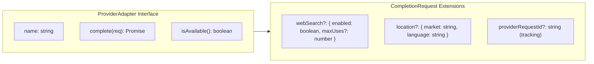

**New adapter files** (all under `services/agents/src/providers/`):

| File | Provider | SDK | Web Search |
|------|----------|-----|------------|
| `claude-adapter.ts` | Anthropic Claude | `@anthropic-ai/sdk` | Not supported; `webSearch.enabled` → error |
| `openai-adapter.ts` | OpenAI | `openai` | Via `web_search_preview` tool ( Responses API) |
| `perplexity-adapter.ts` | Perplexity | `openai` (compatible) | Built-in; always on |
| `grok-adapter.ts` | xAI Grok | `openai` (compatible) | Via `search` parameter |

Each adapter:
1. Wraps a `ConfigurableCircuitBreaker` (Section 3.2)
2. Records cost entries to the `CostLedger` (Section 3.3)
3. Maps provider-specific errors to `error_class` enum values from `prompt-run.schema.json`
4. Returns `CompletionResponse` with `usage.tokens_in`, `usage.tokens_out`, `finishReason`

### 3.2 Configurable Circuit Breaker

Evolves `services/agents/src/providers/circuit-breaker.ts` from hard-coded constants to schema-driven configuration matching `schemas/provider-breaker.schema.json`.

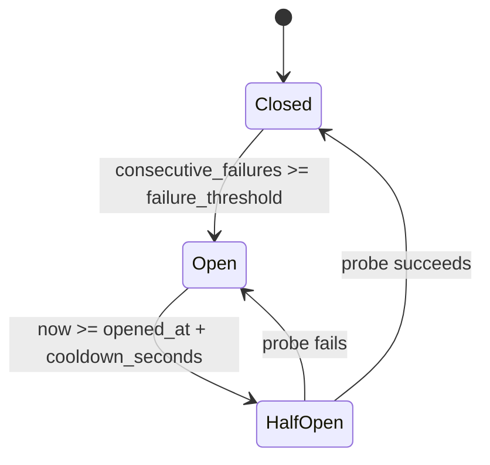

**Changes to `circuit-breaker.ts`:**

```typescript
export interface CircuitBreakerConfig {
  failureThreshold: number;   // was hard-coded OPEN_AFTER_FAILURES = 3
  cooldownMs: number;         // was hard-coded COOLDOWN_MS = 15 * 60 * 1000
}

export class CircuitBreaker {
  constructor(private config: CircuitBreakerConfig) {}
  // ... same logic, but reads config.failureThreshold and config.cooldownMs
}
```

Config sourced from `providers.yaml` per-provider `call_defaults` section, with fallback to `DEFAULT_CONFIG` constants matching current behavior.

### 3.3 Cost Ledger Evolution

Evolves `services/agents/src/providers/cost-tracker.ts` from simple in-memory tracker to schema-matching ledger matching `schemas/cost-ledger-entry.schema.json`.

**New interface:**

```typescript
export interface CostLedgerEntry {
  entry_id: string;
  occurred_at: Date;
  line: "paid_call" | "hosting";
  entry_type: "estimate" | "actual" | "credit" | "adjustment";
  provider?: string;
  model_id?: string;
  audit_id?: string;
  project_id?: string;
  workflow: "anonymous_audit" | "registered_audit" | "prompt_panel" | "keyword_sync" | "content" | "verification" | "report" | "other";
  tokens?: { input: number; output: number };
  amount: number;
  source: "pre_call_estimate" | "post_call_actual" | "billing_export";
  cap_check?: {
    decision: "allowed" | "allowed_soft_cap_reached" | "denied_audit_hard_cap" | "denied_monthly_cap" | "denied_breaker_open";
    month_to_date: number;
    checked_at: Date;
  };
  reconciled: boolean;
}
```

The `CostTracker` class becomes `CostLedger` with:
- `record(entry)` → validates against schema shape, stores
- `preCallCheck(auditId, estimatedCost)` → returns cap_check decision before the call
- `postCallRecord(result)` → records actual cost with `source: "post_call_actual"`
- `getMonthlyTotal()` → sum of all entries for current month
- `getAuditCost(auditId)` → sum for one audit

The `canProceed()` check moves to `preCallCheck()` which returns the decision enum rather than a boolean.

### 3.4 Model Resolver Extensions

`services/agents/src/providers/model-resolver.ts` gains pricing entries for new providers:

```typescript
const MODEL_PRICING: Record<string, ModelPricing> = {
  // Existing
  "gemini-2.0-flash": FLASH_PRICING,
  "gemini-2.5-pro": { inputPer1k: 0.00125, outputPer1k: 0.01 },
  // M6 additions (placeholder values — read from config at runtime)
  "claude-sonnet-4-20250514": { inputPer1k: 0.003, outputPer1k: 0.015 },
  "gpt-4o": { inputPer1k: 0.0025, outputPer1k: 0.01 },
  "sonar-pro": { inputPer1k: 0.001, outputPer1k: 0.001 },
  "grok-3": { inputPer1k: 0.003, outputPer1k: 0.015 },
};
```

Model IDs come from `providers.yaml` (currently `<DECIDE_AT_M0>` placeholders — resolved before M6 implementation).

---

## 4. Panel Runner

### 4.1 State Machine

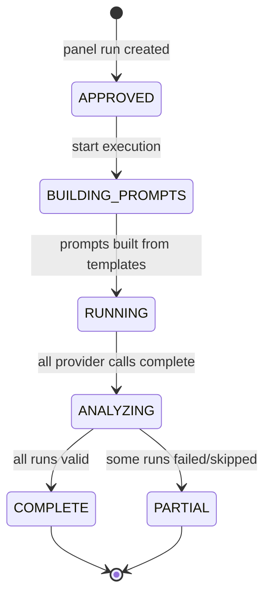

**File:** `services/agents/src/visibility/panel-runner.ts`

The runner:
1. Loads the prompt set (free or connected) from YAML config
2. For each prompt × engine × repeat combination:
   a. Checks circuit breaker → if open, creates `skipped_breaker` run
   b. Checks cost budget via `preCallCheck()` → if denied, creates `skipped_budget` run
   c. Builds the final prompt via `VisibilityPromptBuilder`
   d. Calls the provider adapter
   e. Records the `PromptRun` with status (`valid`, `error`, `timeout`, `refused`)
3. After all calls: passes valid runs to `ResponseAnalyzer`
4. Computes metrics via `MetricsEngine`

### 4.2 Prompt Run Record

Each execution creates a `PromptRun` matching `schemas/prompt-run.schema.json`. Key fields:

```typescript
interface PromptRun {
  run_id: string;
  panel_run_id: string;
  audit_id: string;
  prompt_id: string;
  prompt_family: string;
  final_prompt: string;
  repeat_index: number;
  engine: "gemini" | "claude" | "openai" | "perplexity" | "grok";
  model_id: string;
  market: string;
  language: "ar" | "en";
  status: "queued" | "running" | "valid" | "error" | "timeout" | "refused" | "skipped_budget" | "skipped_breaker";
  counted_in_denominator: boolean | null;
  brand_mentioned: boolean | null;
  recommended: boolean | null;
  competitors_mentioned: string[] | null;
  accuracy_issue_ids: string[] | null;
  // ... 40+ fields total per schema
}
```

**Valid denominator rule:** Only runs with `status: "valid"` have `counted_in_denominator: true`. Provider failures (error, timeout, refused) and budget/breaker skips are excluded from metric denominators. If zero valid runs exist for a metric, the result is "unavailable" (not 0%).

### 4.3 Execution Flow

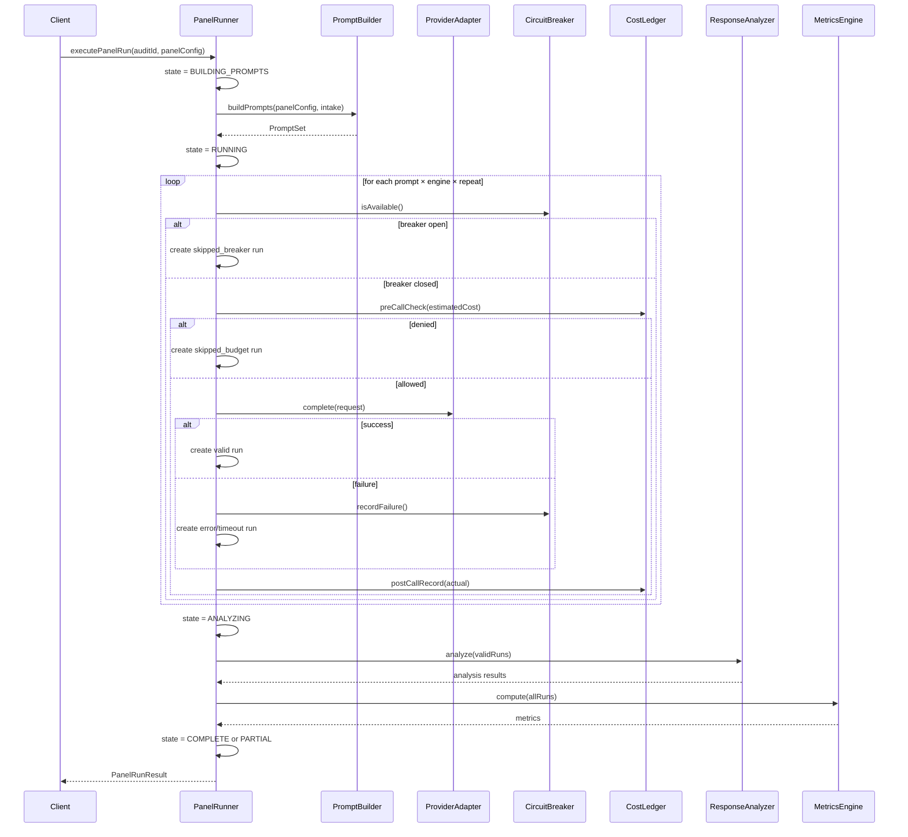

---

## 5. Visibility Prompt Builder

**File:** `services/agents/src/visibility/prompt-builder.ts`

Fills prompt templates from `config/prompt-panels/templates/` with intake values.

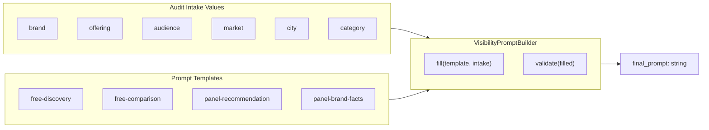

**Intake → placeholder mapping:**

| Placeholder | Source | Required |
|-------------|--------|----------|
| `{brand}` | audit.brand_name | Yes |
| `{offering}` | audit.offering_description | Yes |
| `{audience}` | audit.target_audience | Yes |
| `{market}` | audit.market | Yes |
| `{city}` | audit.city | Only for local prompts |
| `{category}` | audit.category | Yes |
| `{use_case}` | audit.use_case | For connected panel |
| `{requirement}` | audit.requirement | For connected panel |

Templates use `{placeholder}` syntax. The builder:
1. Loads the template YAML for the requested panel tier + language
2. For each prompt in the template, replaces placeholders with intake values
3. Validates no unresolved placeholders remain
4. Returns the final prompt text

---

## 6. Response Analyzer

**File:** `services/agents/src/visibility/response-analyzer.ts`

Implements the visibility-tester agent tools from `config/agents/visibility-tester.yaml`:

### 6.1 Tools

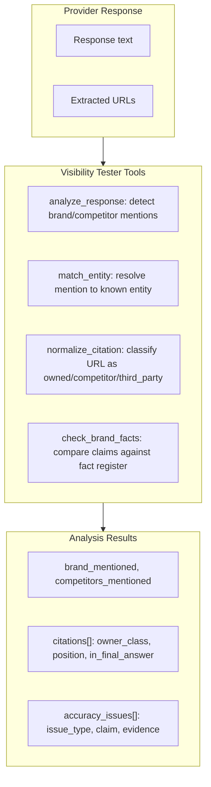

**`analyze_response`:**
- Scans response text for brand name, known competitors, and entity variants
- Returns: `brand_mentioned: boolean`, `mention_spans: [{start, end, text}]`, `competitors_mentioned: string[]`

**`match_entity`:**
- Resolves a mention span to a known entity (brand, competitor, third party)
- Uses the audit's entity register (brand name + aliases, competitor list from intake)
- Returns: `entity_id`, `entity_type`, `confidence`

**`normalize_citation`:**
- Takes a URL extracted from the response
- Classifies as `owned` (matches audit domain), `competitor` (matches known competitor domain), `third_party` (neither), or `unknown`
- Tracks position (1st, 2nd, 3rd cited URL) and whether it appears in the final answer
- Returns: `Citation` record matching `schemas/citation.schema.json`

**`check_brand_facts`:**
- Compares factual claims in the response against the audit's fact register (brand facts from intake)
- Detects: wrong prices, outdated info, incorrect location, wrong founder/owner, policy errors
- Returns: `AccuracyIssue` records matching `schemas/accuracy-issue.schema.json`

### 6.2 Citation Classification

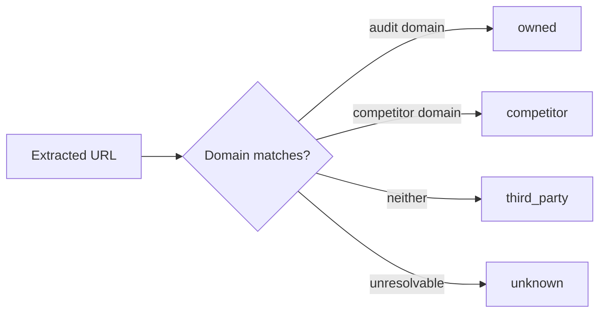

### 6.3 Accuracy Issue Workflow

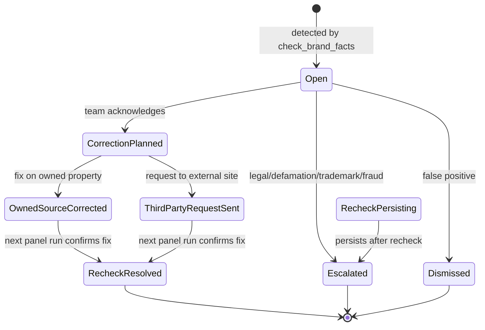

---

## 7. Metrics Engine

**File:** `services/agents/src/visibility/metrics-engine.ts`

### 7.1 Metrics

| Metric | Formula | Panel Tier |
|--------|---------|------------|
| `mention_rate` | valid runs where `brand_mentioned=true` / valid runs | Connected |
| `recommendation_rate` | valid runs where `recommended=true` / valid runs where `brand_mentioned=true` | Connected |
| `domain_citation_rate` | valid runs where `brand_url_cited=true` / valid runs | Connected |
| `share_of_observed_mentions` | brand mentions / (brand + all competitor mentions) | Both |
| `accuracy_issue_count` | count of open accuracy issues | Connected |
| `provider_coverage` | providers with ≥1 valid run / total configured providers | Connected |

### 7.2 Small-Cell Rule

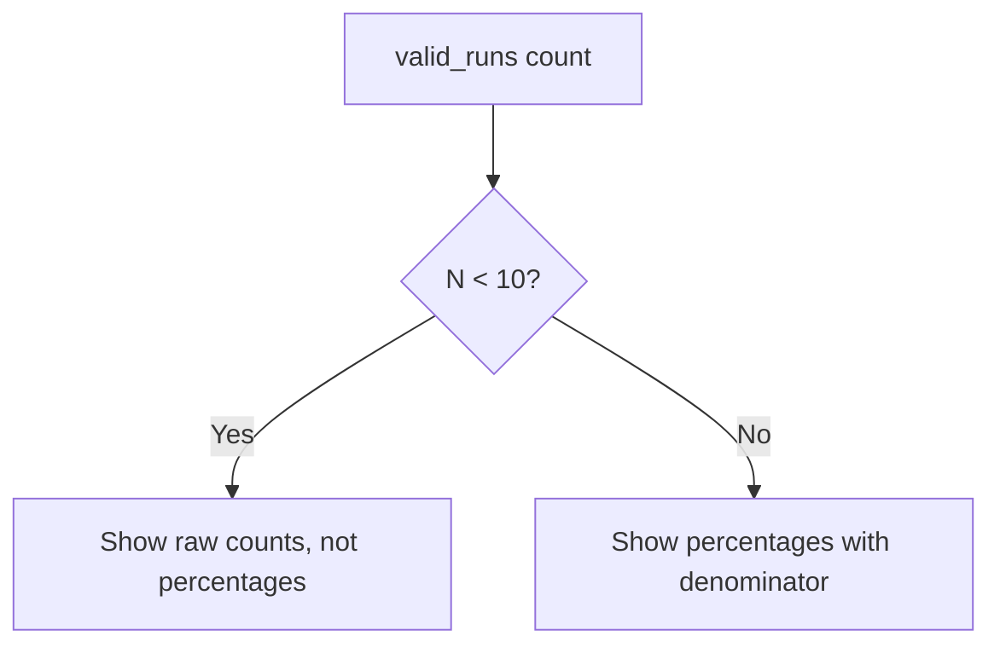

When `valid_runs < 10`, metrics are reported as counts (e.g., "mentioned in 3 of 8 runs") instead of percentages (e.g., "37.5%"). This prevents misleading rates from small samples.

### 7.3 Valid Denominator Rule

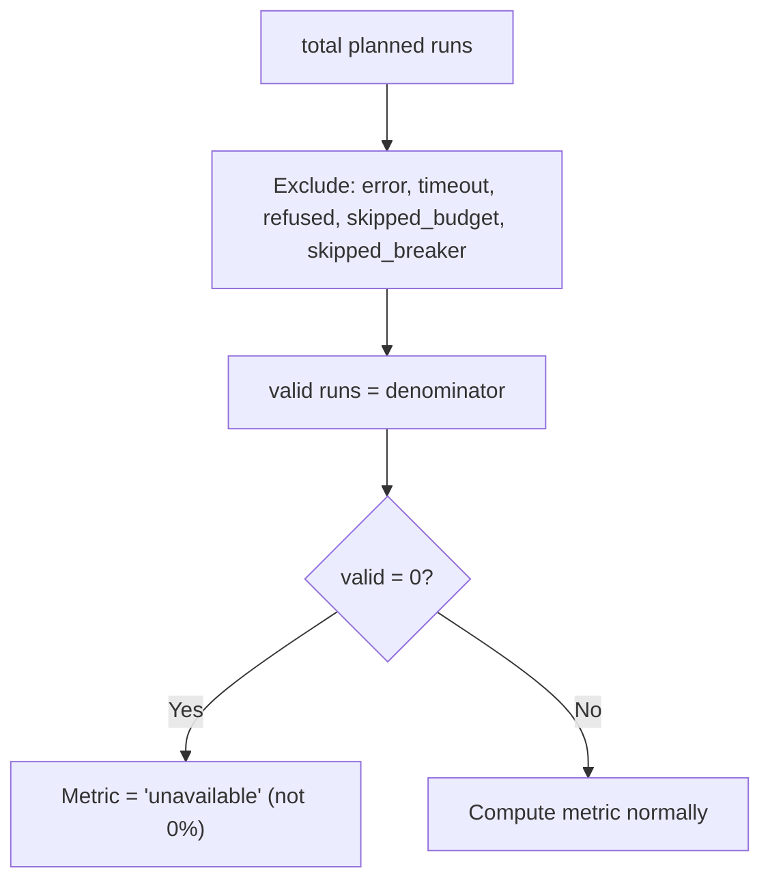

Provider failures and budget/breaker skips are **never** counted as "brand not mentioned." They are excluded from the denominator entirely.

---

## 8. Lost-Prompt Analysis

**File:** `services/agents/src/visibility/lost-prompt-analyzer.ts`

Identifies prompts where competitors appear but the audited brand does not. For each such prompt:

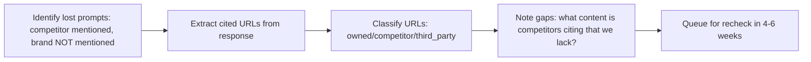

Output: a list of lost prompts with competitor-cited URLs, gap notes, and a scheduled recheck date. Rechecks create a new `PromptPanelRun` with `recheck_of_panel_run_id` pointing to the original.

---

## 9. Separation Constraint (D-012)

AI Visibility results are **never** blended into the Presence Readiness score. The two are independent result sets:

| Result Set | Score | Purpose |
|-----------|-------|---------|
| Presence Readiness (M5) | 0–100% | Can the brand be found online? |
| AI Visibility (M6) | Metrics + counts | How do AI providers describe the brand? |

They may be displayed side-by-side in the report but are computed and stored independently. No shared scoring formula.

---

## 10. File Structure

All new files under `services/agents/src/`:

```
services/agents/src/
  providers/
    circuit-breaker.ts          (MODIFY: configurable thresholds)
    cost-tracker.ts             (MODIFY: → cost-ledger.ts, schema-matching)
    model-resolver.ts           (MODIFY: add new provider pricing)
    gemini-adapter.ts           (unchanged)
    claude-adapter.ts           (NEW)
    openai-adapter.ts           (NEW)
    perplexity-adapter.ts       (NEW)
    grok-adapter.ts             (NEW)
    adapter-factory.ts          (NEW: creates adapter by provider name)
    types.ts                    (MODIFY: extend CompletionRequest)
  visibility/
    panel-runner.ts             (NEW)
    prompt-builder.ts           (NEW)
    response-analyzer.ts        (NEW)
    metrics-engine.ts           (NEW)
    lost-prompt-analyzer.ts     (NEW)
    types.ts                    (NEW: visibility-specific types)
    index.ts                    (NEW)
```

TypeScript types derived from JSON schemas live in `services/agents/src/visibility/types.ts` (or `packages/core/src/types/visibility.ts` if shared across services).

---

## 11. Dependencies

| Package | Purpose | Used By |
|---------|---------|---------|
| `@anthropic-ai/sdk` | Claude API | `claude-adapter.ts` |
| `openai` | OpenAI + Perplexity + Grok (compatible APIs) | `openai-adapter.ts`, `perplexity-adapter.ts`, `grok-adapter.ts` |
| `@google/genai` | Gemini API (existing) | `gemini-adapter.ts` |
| `js-yaml` | Prompt template loading | `prompt-builder.ts` |

---

## 12. Open Items Resolved by M6

| Open Item | Resolution |
|-----------|-----------|
| OI-013: Runtime AI providers for launch | `providers.yaml` defines 5 providers; all disabled by default; tenant opt-in via config |
| OI-051: Prompt families consolidation | Connected panel uses 6 families from detailed spec; V4 additional families disabled |
| OI-052: Arabic prompt templates | Templates marked `needs_native_review: true`; M6 ships English templates, Arabic flagged for review |

---

## 13. Testing Strategy

- **Provider adapters:** Unit tests with mocked HTTP responses. Each adapter has its own test file.
- **Circuit breaker:** State transition tests (closed → open → half-open → closed).
- **Cost ledger:** Pre-call check decision tests (allowed, denied_audit_hard_cap, denied_monthly_cap, denied_breaker_open).
- **Panel runner:** Integration tests with mocked adapters. State machine transitions. Budget/breaker skip behavior.
- **Prompt builder:** Template filling tests. Unresolved placeholder detection.
- **Response analyzer:** Tests with sample provider responses containing known brand mentions, citations, accuracy issues.
- **Metrics engine:** Valid denominator tests. Small-cell rule tests. Zero-valid-runs → "unavailable" test.
- **Lost-prompt analyzer:** Tests with responses containing competitor-only mentions.

All tests follow TDD: write failing test first, implement minimal code, verify pass, refactor.

---

## 14. Exit Criteria

M6 is complete when:
1. All 5 provider adapters pass unit tests with mocked responses
2. Panel runner executes free panel (8 prompts × 1 run) end-to-end
3. Panel runner executes connected panel (20+ prompts × 3 runs) end-to-end
4. Metrics engine produces correct rates with valid denominators
5. Small-cell rule activates when valid_runs < 10
6. Zero valid runs → metric = "unavailable" (not 0%)
7. Cost ledger records pre-call checks and post-call actuals
8. Circuit breakers are configurable per provider
9. Lost-prompt analysis identifies competitor-only prompts and extracts cited URLs
10. AI Visibility results are stored separately from Presence Readiness (D-012)
11. Provider failure handling: errors/timeouts excluded from denominators
12. Exact observation metadata: every PromptRun has full lineage (prompt text, model_id, timestamps)
