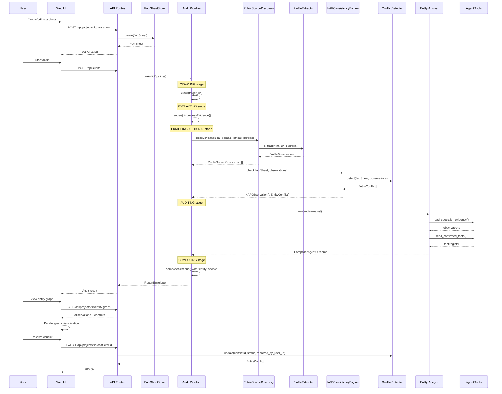

# M7 — Public Footprint, Entity Graph & Brand Truth Design Spec

**Status:** Proposed
**Date:** 2026-10-11
**Milestone:** M7 (Public Footprint, Entity Graph, Brand Truth)
**Spec source:** `docs/spec/02-DETAILED-SPECIFICATION.md`, `docs/spec/05-PROJECT-PLAN.md`, `docs/spec/03-PRODUCTION-CONTRACTS.md`

---

## 1. Purpose

M7 delivers the core entity graph: brand fact sheets, fact register, public source discovery via web scraping, profile observation extraction, NAP consistency checking, entity conflict detection, and the entity-analyst agent. This is a launch gate — the first anonymous audit promises public footprint visibility.

**In scope (core entity graph):**

- Fact sheet management (CRUD + confirmation workflow)
- Fact register seeded from fact sheets
- Public source discovery (web scraping via existing crawler)
- Profile observation extraction (HTML → structured ProfileObservation)
- NAP consistency engine (compare name/address/phone across sources)
- Entity conflict detection and tracking (never auto-resolved)
- Entity-analyst agent with `read_specialist_evidence` and `read_confirmed_facts` tools
- GEO-011 evaluator implementation (replace M2 stub)
- Pipeline integration ("entity" section in composer)
- Full UI views (fact sheet editor, entity graph visualization, conflict resolution)

**Deferred to M8A:**

- Reputation packs (review cases, rating tracking)
- Brand truth monitor (hallucination/outdated-fact detection)
- Cited-source correction workflow
- Merchant Center reconciliation

---

## 2. Architecture Overview

```mermaid
graph TD
    subgraph Config["Config Layer"]
        PY[platforms.yaml]
        EAY[entity-analyst.yaml]
        GEO[geo.yaml rules]
    end

    subgraph Discovery["Public Source Discovery"]
        PSD[PublicSourceDiscovery]
        PE[ProfileExtractor]
        NCE[NAPConsistencyEngine]
    end

    subgraph EntityGraph["Entity Graph"]
        FS[FactSheetStore]
        FR[FactRegisterStore]
        CD[ConflictDetector]
        EAT[EntityAnalystTools]
    end

    subgraph Pipeline["Audit Pipeline Integration"]
        P[pipeline.ts]
        C[composer.ts]
        RE[rules-engine/geo.ts]
    end

    subgraph Storage["Persistence"]
        DB[(PostgreSQL)]
        FS_T[(fact_sheets)]
        FR_T [(fact_registers)]
        PO_T [(profile_observations)]
        PSO_T [(public_source_observations)]
        NAP_T [(nap_observations)]
        EC_T [(entity_conflicts)]
        LOC_T [(locations)]
    end

    subgraph UI["Web Frontend"]
        FSE[Fact Sheet Editor]
        EGV[Entity Graph View]
        CRU[Conflict Resolution UI]
    end

    PY --> PSD
    PSD --> PE
    PE --> NCE
    NCE --> CD

    FS --> DB
    FR --> DB
    CD --> DB

    PSD --> PSO_T
    PE --> PO_T
    NCE --> NAP_T
    CD --> EC_T

    EAT --> FR
    EAT --> FS

    P --> PSD
    C --> EAT
    RE --> NCE

    FS_T --> FSE
    EC_T --> CRU
    PO_T --> EGV
```

---

## 3. Data Model

### 3.1 Schema Strategy

Dual schema approach:

- **JSON Schema** in `/schemas/` — canonical contracts (already exist as Draft 2020-12)
- **Zod schemas** in TypeScript — runtime validation, derived from JSON Schema specs

All domain records carry a `lineage` object from `common.schema.json` with 18 required fields (record_id, project_id, site_id, source_type, source_id, source_version, captured_at, as_of, market, language, device, method, methodology_version, fidelity_label, content_hash, parent_ids, validation_state, audit_id optional).

### 3.2 Core Entities

**FactSheet** — Brand fact sheet (client-supplied, `user_supplied` fidelity → `client_stated` evidence state)

- Required: fact_sheet_id, project_id, version, legal_names[], brand_names[], aliases[], canonical_domain, official_profiles[], addresses[], contacts[], approved_claims[], status, fidelity_label
- Status: draft | confirmed | superseded
- When confirmed: requires confirmed_by_user_id, confirmed_at, fidelity_label=attested
- Max 500 approved_claims, each with claim_id (referenced as fact_id by agents)

**FactRegister** — Client-confirmed dated register of brand facts (seeded from FactSheet)

- Required: register_id, project_id, version, facts[], updated_at
- Max 2000 facts
- 22 category enum values (legal_name, brand_name, alias, founder, location, contact, hours, service, product, price, availability, policy, licence, credential, award, claim, profile_url, other)
- Source: client_confirmed | owned_page | public_record | third_party
- Fidelity: attested | user_supplied | observed
- Status: confirmed | pending_confirmation | disputed | retired

**EntityConflict** — Two or more sources disagree about an entity attribute

- Required: conflict_id, project_id, attribute, values (min 2), status, detected_at, lineage
- Attribute: name | address | phone | hours | category | price | availability | url | founder | service_area | other
- Source: fact_register | owned_site | business_profile | merchant_center | directory | social_profile | ai_answer | third_party
- Status: open | owner_confirmed_value | correction_requested | resolved | dismissed
- **Never auto-resolved**: a named human resolves it (02-DETAILED-SPECIFICATION §15)

**ProfileObservation** — Business profile observation

- Platform: google_business_profile | apple_business_connect | bing_places | directory | social | other
- Access: public | owner_supplied
- Attributes: name | category | address | service_area | phone | hours | website | description | attributes
- Observer location recorded (01-PRODUCT-REQUIREMENTS §16)

**NAPObservation** — Name, address, phone as seen on one source

- Source kind: owned_site | business_profile | directory | social_profile | structured_data | other
- Match object: name/address/phone each: match | mismatch | missing | not_applicable

**PublicSourceObservation** — Public footprint observation

- Source kind: social_profile | directory | review_platform | marketplace | news | forum | wiki | knowledge_panel | other
- Review display: rating_value (0-5), review_count, as_displayed=true (never estimated)
- Confidence: high | medium | low

**Location** — Business location or service area

- Business model: storefront | service_area | hybrid
- Includes seasonal hour exceptions (Ramadan, national day)
- E.164 phone storage format

**BrandTerms** — Owner-confirmed brand-term list (Arabic + English)

- Kind: brand_name | product_name | misspelling | transliteration | abbreviation | domain
- Splits query reports into brand vs non-brand

---

## 4. Components

### 4.1 Database Migrations

Six new tables (numbered migrations starting at 0003):

1. **0003_create_fact_sheets.sql** — fact_sheets table (JSONB storage for complex nested structures)
2. **0004_create_fact_registers.sql** — fact_registers table
3. **0005_create_locations.sql** — locations table
4. **0006_create_brand_terms.sql** — brand_terms table
5. **0007_create_observations.sql** — profile_observations, public_source_observations, nap_observations tables
6. **0008_create_entity_conflicts.sql** — entity_conflicts table

All tables include:

- `id` UUID PRIMARY KEY
- `project_id` UUID NOT NULL (FK to projects, or standalone for anonymous audits)
- `created_at` TIMESTAMPTZ NOT NULL DEFAULT NOW()
- `updated_at` TIMESTAMPTZ NOT NULL DEFAULT NOW()
- JSONB column for domain data (matches JSON Schema structure)
- Indexes on project_id and relevant lookup fields

### 4.2 Footprint Store Package

New package: `packages/footprint-store/`

Responsibilities:

- TypeScript types (Zod schemas) for all M7 domain entities
- CRUD stores: FactSheetStore, FactRegisterStore, LocationStore, BrandTermsStore
- Observation stores: ProfileObservationStore, PublicSourceObservationStore, NAPObservationStore
- Conflict store: EntityConflictStore
- All stores implement interface pattern: `create()`, `get()`, `list()`, `update()`, `delete()`
- Postgres-backed implementations using raw SQL (no ORM)

### 4.3 Public Source Discovery Module

New module: `packages/footprint-store/src/discovery/`

**PublicSourceDiscovery** — Discovers public profiles via web scraping

- Input: canonical_domain, official_profiles (from fact sheet)
- Process:
  1. Load platform URL patterns from `config/platforms.yaml`
  2. Generate candidate URLs from domain + patterns
  3. Fetch candidate URLs using existing crawler service
  4. Extract profile signals (name, category, NAP, social links)
  5. Store PublicSourceObservation for each discovered source
- Output: PublicSourceObservation[] with confidence levels

**Platform URL Patterns** — `config/platforms.yaml`

- Defines URL patterns for major platforms (Google Business Profile, Apple Business Connect, Bing Places, Facebook, Instagram, LinkedIn, YouTube, Twitter/X, Yelp, TripAdvisor, etc.)
- Each pattern: platform name, URL template, extraction hints

**ProfileExtractor** — HTML → ProfileObservation

- Input: HTML content, source URL, platform
- Process:
  1. Extract structured data (JSON-LD, Microdata, RDFa)
  2. Extract NAP from page content (heuristic patterns)
  3. Extract profile metadata (name, category, description, hours)
  4. Build ProfileObservation with lineage
- Output: ProfileObservation

### 4.4 NAP Consistency Engine

New module: `packages/footprint-store/src/nap/`

**NAPConsistencyEngine** — Compares name/address/phone across sources

- Input: FactSheet (or FactRegister), ProfileObservation[], NAPObservation[]
- Process:
  1. For each observation, compare against fact sheet values
  2. Generate NAPObservation with match/mismatch/missing for each field
  3. Detect conflicts (2+ sources disagree)
  4. Store NAPObservation and EntityConflict records
- Output: NAPObservation[], EntityConflict[]

**ConflictDetector** — Detects entity conflicts

- Input: FactSheet, observations from multiple sources
- Process:
  1. Compare fact sheet vs site vs business profile
  2. When disagreement detected, create EntityConflict
  3. Status: open (never auto-resolved)
- Output: EntityConflict[]

### 4.5 Agent Tools

Two new tools for entity-analyst agent:

**read_specialist_evidence** — Reads specialist evidence (observations, NAP consistency results)

- Input: { observation_type: "profile" | "public_source" | "nap", project_id: string, filters?: Record<string, unknown> }
- Output: ToolResult with observation data, source_tier, limitations
- Implementation: queries observation stores, returns normalized evidence

**read_confirmed_facts** — Reads confirmed facts from fact register

- Input: { project_id: string, fact_ids?: string[], category?: string }
- Output: ToolResult with fact register data, source_tier, limitations
- Implementation: queries FactRegisterStore, returns confirmed facts only

Both tools registered in `services/agents/src/tools/registry.ts`.

### 4.6 GEO-011 Evaluator

Replace stub in `packages/rules-engine/src/evaluators/geo.ts`:

**Current (M2):** Returns `not_applicable` with rationale "Requires business_profile_or_merchant_center data — not available in M2"

**M7 implementation:**

- Input: PageEvidence, EvidenceBundle (with connector data)
- Process:
  1. Check if Business Profile or Merchant Center data available in bundle.connectors
  2. If not available: return `not_applicable` (rule requires this data)
  3. If available: compare business profile details against site content
  4. Check NAP consistency (name, address, phone match)
  5. If disagreement: return `fail` with rationale, evidence_ids
  6. If match: return `pass` with evidence_ids
- Output: RuleEvaluation (pass | fail | not_applicable)

Note: GEO-011's key constraint — "A fact-sheet, site or Business Profile disagreement raises an entity-conflict finding that is never auto-resolved" — is enforced by the ConflictDetector, not the evaluator itself. The evaluator reports the rule result; the conflict detector creates the EntityConflict record.

### 4.7 Pipeline Integration

**FindingSection extension** — `packages/audit-pipeline/src/report-envelope.ts`:

```typescript
export type FindingSection =
  "technical" | "keywords" | "content" | "performance" | "experience" | "entity";
```

**SECTION_BY_AGENT extension** — Add entity-analyst mapping:

```typescript
export const SECTION_BY_AGENT: Record<string, FindingSection> = {
  auditor: "technical",
  "keyword-analyst": "keywords",
  "content-strategist": "content",
  "entity-analyst": "entity",
};
```

**SECTION_ORDER extension** — `packages/audit-pipeline/src/composer.ts`:

```typescript
const SECTION_ORDER = [
  "technical",
  "keywords",
  "content",
  "performance",
  "experience",
  "entity",
] as const;
```

**CATEGORY_TO_SECTION extension** — Map geo category to entity section:

```typescript
const CATEGORY_TO_SECTION: Record<RuleCategory, FindingSection> = {
  crawlability: "technical",
  on_page: "technical",
  structured_data: "technical",
  aeo: "content",
  geo: "entity", // Changed from "content" to "entity"
  i18n_accessibility: "content",
  performance_security: "performance",
};
```

**Pipeline stage** — Add footprint discovery stage after crawl, before agents:

- New pipeline state: ENRICHING_OPTIONAL (already defined in audit_state enum)
- Process:
  1. After EXTRACTING, before AUDITING
  2. Run PublicSourceDiscovery if fact sheet exists
  3. Run NAPConsistencyEngine
  4. Store observations and conflicts
  5. Continue to AUDITING (agents can now read observations via tools)

**Composer integration** — Entity-analyst follows standard agent processing path (not the experience-reviewer special case). The composer's existing agent loop processes entity-analyst outcomes via SECTION_BY_AGENT mapping.

### 4.8 Entity-Analyst Agent Config

Finalize `config/agents/entity-analyst.yaml`:

- Change status from `draft` to `active`
- Set model_tier (DECIDE_AT_M0 resolution — use standard model tier for now)
- Tools: read_specialist_evidence, read_confirmed_facts (both implemented in 4.5)
- Forbidden tools: keep existing list (10 write-class tools)

### 4.9 Web Frontend

**Fact Sheet Editor** — `/apps/web/src/app/[locale]/projects/[projectId]/fact-sheet/`

- Form-based editor for all fact sheet fields
- Validation against Zod schemas
- Save as draft, confirm workflow (confirmation sets status=confirmed, fidelity_label=attested)
- Display confirmation status and fidelity label

**Entity Graph View** — `/apps/web/src/app/[locale]/projects/[projectId]/entity-graph/`

- Visualize entity relationships (fact sheet → observations → conflicts)
- Show NAP consistency status per source
- Filter by attribute (name, address, phone, hours, category)
- Color-coded by match status (green=match, red=mismatch, yellow=missing)

**Conflict Resolution UI** — `/apps/web/src/app/[locale]/projects/[projectId]/conflicts/`

- List all EntityConflict records (status=open first)
- Show conflicting values with source attribution
- Resolution actions: owner_confirmed_value, correction_requested, resolved, dismissed
- Require resolved_by_user_id and resolution_note for resolved/dismissed status
- Never auto-resolve (enforced in UI + backend)

**i18n keys** — Add to `apps/web/messages/en.json` and `apps/web/messages/ar.json`:

- Fact sheet editor labels and validation messages
- Entity graph labels (match, mismatch, missing, not_applicable)
- Conflict resolution labels and actions
- NAP consistency labels

---

## 5. Data Flow



---

## 6. Error Handling

**Fact sheet validation failures:**

- Zod validation errors → 400 Bad Request with field-level errors
- Missing required fields → specific error messages per field

**Public source discovery failures:**

- Crawler failures → log and continue (discovery is best-effort)
- Extraction failures → store observation with confidence=low, add limitation

**NAP consistency check failures:**

- Missing fact sheet → skip NAP check (not_applicable)
- No observations → no conflicts detected (valid state)

**Entity conflict resolution:**

- Invalid status transition → 400 Bad Request
- Missing resolved_by_user_id for resolved/dismissed → 400 Bad Request
- Auto-resolve attempt → rejected (enforced in backend + UI)

**Agent tool failures:**

- Tool execution error → return ToolResult with limitations, source_tier="third_party_unverified"
- Missing data → return empty result with limitation message

---

## 7. Testing Strategy

**Unit tests:**

- Zod schema validation (all domain entities)
- Store CRUD operations (in-memory + Postgres)
- NAP consistency engine (match/mismatch/missing logic)
- Conflict detector (disagreement detection)
- Agent tools (read_specialist_evidence, read_confirmed_facts)
- GEO-011 evaluator (pass/fail/not_applicable cases)

**Integration tests:**

- Pipeline stage (ENRICHING_OPTIONAL) with mock crawler
- Composer integration (entity section in report)
- API routes (fact sheet CRUD, conflict resolution)

**End-to-end tests:**

- Fact sheet creation → audit → entity graph view → conflict resolution
- NAP consistency check → conflict detection → resolution workflow

---

## 8. Exit Criteria

M7 is complete when:

- Fact sheet CRUD works (create, read, update, confirm)
- Public source discovery finds profiles via web scraping
- NAP consistency engine detects mismatches
- Entity conflicts are tracked (never auto-resolved)
- Entity-analyst agent can read specialist evidence and confirmed facts
- GEO-011 evaluator returns real results (not stub)
- Pipeline includes "entity" section in reports
- UI shows fact sheet editor, entity graph, conflict resolution
- All tests pass (unit, integration, e2e)
- Sources and confidence are visible in reports
- No fabricated reviews/counts
- Correction actions remain governed (human-owned)

---

## 9. Dependencies

**Internal:**

- M0A contracts (evidence and fidelity, lineage)
- M1 secure crawler (HTML extraction)
- M2 rules engine (GEO-011 rule definition)
- M3 agents service (tool registry, agent dispatch)
- M4 web frontend (UI framework, API routes)
- M5 connectors (connector interface pattern)
- M6 AI visibility laboratory (pipeline integration patterns)

**External:**

- PostgreSQL (persistence)
- Existing crawler service (web scraping)
- Zod (runtime validation)

---

## 10. Open Items

**Model tier for entity-analyst:** DECIDE_AT_M0 resolution — using standard model tier for now. May need adjustment based on cost analysis.

**Platform URL patterns coverage:** Initial set covers major platforms (Google, Apple, Bing, Facebook, Instagram, LinkedIn, YouTube, Twitter/X, Yelp, TripAdvisor). Additional platforms can be added post-M7.

**Arabic parity:** All i18n keys must have Arabic translations. Fact sheet supports Arabic legal_names, brand_names, aliases with language field.

**Performance:** Public source discovery may be slow for domains with many official profiles. Consider batching crawler requests and caching results.

---

## 11. References

- 02-DETAILED-SPECIFICATION §3 (conflict rules), §5.9 (public footprint), §6 (connected project journey), §15 (data integrity), §16 (data requirements)
- 03-PRODUCTION-CONTRACTS (evidence and fidelity, agent tool boundaries, minimum schema set)
- 05-PROJECT-PLAN §5 (M7 milestone definition, exit criteria)
- schemas/fact-sheet.schema.json, fact-register.schema.json, entity-conflict.schema.json, profile-observation.schema.json, nap-observation.schema.json, public-source-observation.schema.json, location.schema.json, brand-terms.schema.json, common.schema.json
- config/agents/entity-analyst.yaml
- config/rules/geo.yaml (GEO-011)
