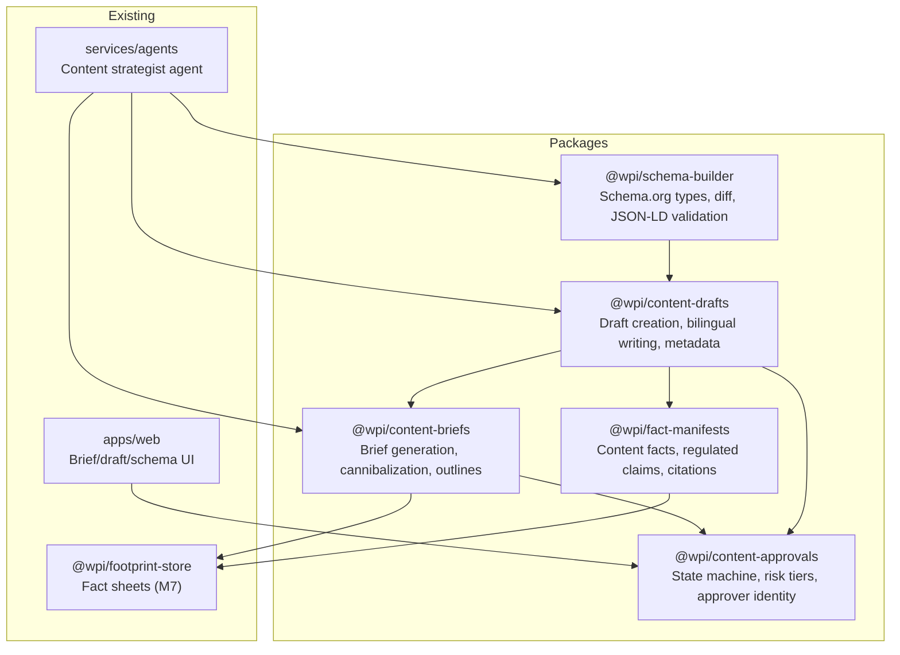
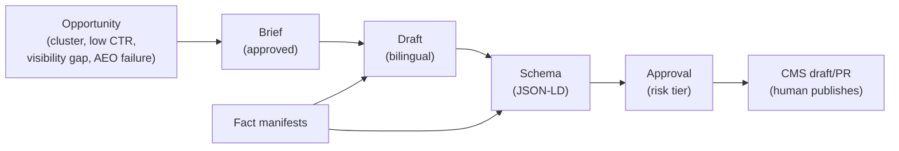
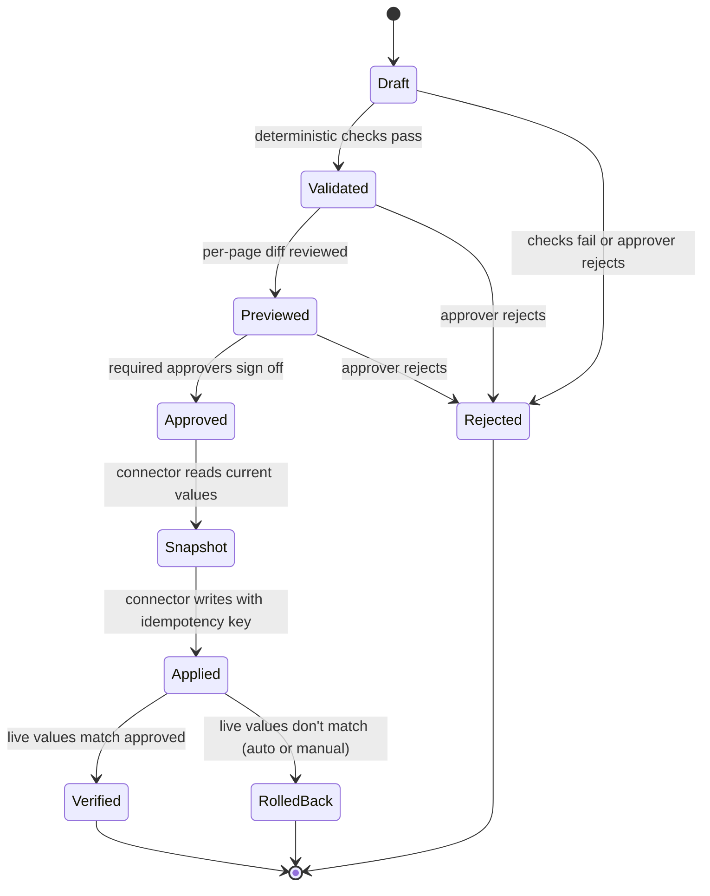

# M8 — Content and Schema Studio Design Spec

**Date:** 2026-10-12
**Milestone:** M8 (INT-09)
**Spec authority:** `docs/spec/02-DETAILED-SPECIFICATION.md` §9, §10; `docs/spec/05-PROJECT-PLAN.md` §5 M8

## Goal

Implement the content brief/draft workflow, schema builder, fact manifests, and approval system. Content work starts from a keyword cluster or visibility gap, produces a brief, optionally produces a bilingual draft, and never publishes automatically.

## Exit Criteria (from project plan)

- Fabricated-claim/citation evals pass
- Cannibalization checks precede new pages
- No automatic publishing

## Architecture

Five focused packages matching the spec's workflow stages, plus agent configuration, API routes, and UI in the existing app/services.



### Data Flow



## Package 1: `@wpi/content-briefs`

### Responsibility

Generate content briefs from opportunities, enforce cannibalization checks, produce bilingual outlines.

### Opportunity Sources

1. **Unmapped clusters** — keyword clusters with no mapped page (from M4 keyword mapping)
2. **Low CTR queries** — Search Console queries with impressions but low CTR or average position > 10
3. **Visibility gaps** — prompts where competitors are recommended and the site is not (from M6 visibility lab)
4. **AEO failures** — customer questions the site never answers (from M2 AEO rules)

### Brief Schema

```typescript
interface ContentBrief {
  id: string;
  project_id: string;
  audit_id: string;
  status: "draft" | "approved" | "rejected";
  
  // Opportunity link
  opportunity_type: "unmapped_cluster" | "low_ctr" | "visibility_gap" | "aeo_failure";
  opportunity_ref: string; // cluster_id, query_id, prompt_id, or finding_id
  
  // Page definition
  page_goal: string;
  audience: string;
  target_action: string;
  target_url: string | null; // existing page to improve, or null for new page
  proposed_slug: string | null; // for new pages
  
  // Target cluster
  primary_keyword: string;
  keyword_variants: { keyword: string; language: "ar" | "en" }[];
  intent: "informational" | "navigational" | "commercial" | "transactional";
  market: string;
  volume: number | null;
  volume_source: string | null;
  position: number | null;
  position_source: string | null;
  
  // Observations
  observations: {
    date: string;
    source: "serp" | "ai_citation" | "manual";
    urls_examined: string[];
    notes: string;
  }[];
  
  // Recommended angle
  recommended_angle: string;
  
  // Outlines (separate per language)
  outlines: {
    language: "ar" | "en";
    headings: { level: 1 | 2 | 3; text: string; notes?: string }[];
  }[];
  
  // Questions to answer
  questions: {
    question: string;
    source: "search_console" | "upload" | "visibility_prompt" | "manual";
  }[];
  
  // Entities and terms
  entities: string[];
  terms: string[];
  
  // Title and meta options
  titles: { language: "ar" | "en"; text: string }[]; // 2-3 per language
  meta_descriptions: { language: "ar" | "en"; text: string }[]; // 2 per language
  
  // Facts
  fact_sheet_ids: string[]; // from M7 footprint-store
  inputs_needed: string[]; // proof points client must supply
  
  // Internal links
  internal_links: { url: string; anchor: string; reason: string }[];
  
  // Schema types
  schema_types: string[]; // e.g., ["Article", "FAQPage", "Product"]
  
  // Length guidance
  length_guidance: {
    min_words: number;
    max_words: number;
    basis: string; // e.g., "top 3 competitors average 1,800 words"
  };
  
  // CTA and conversion
  cta: string;
  conversion_notes: string;
  regulated_topic: "health" | "finance" | "legal" | null;
  
  // Success measures
  success_measures: {
    metric: "impressions" | "clicks" | "average_position" | "panel_retest";
    target: string;
  }[];
  review_date: string; // ISO date
  
  // Metadata
  created_by: string; // user email
  approved_by: string | null;
  approved_at: string | null;
  created_at: string;
  updated_at: string;
}
```

### Cannibalization Check

Before creating a brief for a **new page** (when `target_url` is null), check if the target cluster already has a mapped page. If it does, reject the brief with a cannibalization error. Briefs targeting existing pages for improvement do not trigger this check.

```typescript
function checkCannibalization(
  clusterId: string,
  targetUrl: string | null,
  existingMappings: Map<string, string>, // cluster_id -> url
): { ok: boolean; error?: string } {
  // Only check for new pages; existing pages can be improved
  if (targetUrl !== null) {
    return { ok: true };
  }

  const existingUrl = existingMappings.get(clusterId);
  if (existingUrl) {
    return {
      ok: false,
      error: `Cluster ${clusterId} is already mapped to ${existingUrl}. Improve that page instead of creating a new one.`,
    };
  }
  return { ok: true };
}
```

### Draft Rate Limit

Enforce max 8 new-article drafts per project per month (from spec §9).

```typescript
function checkDraftRate(
  projectId: string,
  monthStart: Date,
  currentCount: number,
): { ok: boolean; error?: string } {
  if (currentCount >= 8) {
    return {
      ok: false,
      error: `Project ${projectId} has reached the monthly limit of 8 drafts. Wait until next month or request an exception.`,
    };
  }
  return { ok: true };
}
```

### Bilingual Outlines

Generate separate outlines for Arabic and English when search results differ by language. Arabic outlines are written from Arabic evidence, not translated.

### Database Tables

**`content_briefs`** — stores briefs with all fields above.

### Tests

- Brief generation from each opportunity type
- Cannibalization rejection when cluster is already mapped (new page)
- Cannibalization check skipped when targeting existing page (target_url not null)
- Draft rate limit enforcement (8/month)
- Bilingual outline generation (separate AR/EN)
- Brief approval state transitions
- Regulated topic flagging

## Package 2: `@wpi/content-drafts`

### Responsibility

Create bilingual drafts from approved briefs, enforce draft gates, generate metadata and internal links.

### Draft Schema

```typescript
interface ContentDraft {
  id: string;
  brief_id: string;
  project_id: string;
  status: "drafting" | "review" | "approved" | "published";
  
  // Author
  author: string; // named human author (required by spec §9)
  ai_assisted: boolean;
  ai_disclosure: string | null;

  // Client input
  client_input_received: boolean; // draft cannot start without client's first-hand input
  client_input_notes: string | null;
  
  // Content by language
  content: {
    language: "ar" | "en";
    title: string;
    meta_description: string;
    body: string; // HTML or Markdown
    headings: { level: 1 | 2 | 3; text: string }[];
  }[];
  
  // Facts used
  facts_used: {
    fact_id: string;
    fact_sheet_id: string;
    citation: string;
  }[];
  
  // Internal links
  internal_links: { url: string; anchor: string }[];
  
  // Schema markup
  schema_json_ld: object | null;
  
  // Metadata
  word_count: { ar: number; en: number };
  reading_time_minutes: { ar: number; en: number };
  
  // Review
  arabic_reviewer: string | null; // required for Arabic drafts
  arabic_review_date: string | null;
  arabic_review_notes: string | null;
  
  // Publication
  cms_draft_url: string | null;
  cms_pr_url: string | null;
  published_url: string | null;
  published_at: string | null;
  
  // Timestamps
  created_at: string;
  updated_at: string;
  last_updated_content_at: string; // changes only when content changes
}
```

### Draft Gates (from spec §9)

1. **Brief approval required** — draft cannot start until brief is approved
2. **Named human author** — draft must have a named author (not anonymous)
3. **Client input required** — draft needs client's first-hand input; without it, work stops at brief
4. **Facts from fact sheet only** — facts come only from fact sheet and cited evidence; unsupported claims removed before review
5. **One page per cluster** — system refuses draft that duplicates a mapped page
6. **Max 8 drafts/month** — rate limit enforced
7. **Arabic native review** — Arabic drafts get native review
8. **AI disclosure** — AI assistance disclosed where project policy requires
9. **Human publishes** — system never publishes; drafts land in CMS as drafts or PRs

### Writing Rules (from spec §9)

- Arabic from Arabic evidence, not translated
- Modern Standard Arabic default; dialect terms flagged for native review
- Correct spelling (ة, ى, hamza) even when users search without it
- Answer first: direct answer in opening sentences under each question heading
- Facts specific and checkable
- Comparisons use real HTML tables, fair to competitors
- Authorship visible
- Last-updated date changes only when content changes

### Database Tables

**`content_drafts`** — stores drafts with all fields above.

**`draft_rate_limits`** — tracks drafts per project per month.

```sql
CREATE TABLE draft_rate_limits (
  id UUID PRIMARY KEY,
  project_id UUID NOT NULL,
  month_start DATE NOT NULL,
  draft_count INTEGER NOT NULL DEFAULT 0,
  UNIQUE(project_id, month_start)
);
```

### Tests

- Draft creation from approved brief
- Draft rejection when brief not approved
- Draft rejection when no named author
- Draft rejection when client_input_received is false
- Draft rejection when cluster already mapped
- Draft rate limit enforcement
- Arabic draft requires native reviewer
- Facts only from fact sheet (no unsupported claims)
- Last-updated date unchanged when metadata edited

## Package 3: `@wpi/schema-builder`

### Responsibility

Build schema.org JSON-LD, diff against existing schema, validate output, recommend schema types from audit evidence.

### Schema Types

Support common schema types:

- `Article`, `BlogPosting`, `NewsArticle`
- `Product`, `Offer`, `AggregateOffer`
- `FAQPage`, `QAPage`
- `LocalBusiness`, `Organization`, `Person`
- `BreadcrumbList`
- `Review`, `AggregateRating`
- `HowTo`, `Recipe`
- `Event`
- `MedicalWebPage` (regulated)

### Schema Builder Interface

```typescript
interface SchemaBuilder {
  build(type: string, data: Record<string, unknown>): SchemaResult;
  diff(existing: object, proposed: object): SchemaDiff;
  validate(schema: object): ValidationResult;
  recommend(evidence: AuditEvidence): string[];
}

interface SchemaResult {
  json_ld: object;
  html_snippet: string; // <script type="application/ld+json">
  validation_errors: string[];
}

interface SchemaDiff {
  added: string[]; // JSON paths
  removed: string[];
  changed: { path: string; old_value: unknown; new_value: unknown }[];
}

interface ValidationResult {
  valid: boolean;
  errors: { path: string; message: string }[];
  warnings: { path: string; message: string }[];
}
```

### Schema Recommendations

Recommend schema types based on audit evidence:

- Page has FAQ headings → `FAQPage`
- Page has product with price → `Product` + `Offer`
- Page has how-to steps → `HowTo`
- Page has reviews → `Review` or `AggregateRating`
- Page is local business → `LocalBusiness`
- Page has breadcrumbs → `BreadcrumbList`

### JSON-LD Validation

Validate against schema.org vocabulary:

- Required properties present
- Property types correct (URL, Text, Number, etc.)
- Nested types valid
- No orphaned nodes

### Diff Engine

Compare existing JSON-LD (from crawl) with proposed JSON-LD:

- Added properties
- Removed properties
- Changed values
- Structural changes (nested objects)

Output as JSON Patch (RFC 6902) or simple diff object.

### Database Tables

**`schema_objects`** — stores proposed schema markup per page.

```sql
CREATE TABLE schema_objects (
  id UUID PRIMARY KEY,
  project_id UUID NOT NULL,
  page_url TEXT NOT NULL,
  schema_type TEXT NOT NULL,
  json_ld JSONB NOT NULL,
  html_snippet TEXT NOT NULL,
  source TEXT NOT NULL, -- "audit", "brief", "manual"
  status TEXT NOT NULL, -- "proposed", "approved", "applied"
  created_at TIMESTAMPTZ NOT NULL,
  updated_at TIMESTAMPTZ NOT NULL
);
```

### Tests

- Build each supported schema type
- Validate required properties
- Detect validation errors (missing required, wrong type)
- Diff existing vs proposed
- Recommend schema from audit evidence
- Generate valid HTML snippet

## Package 4: `@wpi/fact-manifests`

### Responsibility

Manage fact sheets for content, flag regulated claims, track citations, extend M7's footprint-store.

### Fact Manifest Schema

```typescript
interface FactManifest {
  id: string;
  project_id: string;
  fact_sheet_id: string; // links to M7 footprint-store
  
  // Facts
  facts: {
    id: string;
    category: "product" | "service" | "pricing" | "credential" | "result" | "review" | "policy";
    statement: string;
    evidence: {
      type: "first_party" | "third_party" | "manual";
      source_url: string | null;
      source_name: string;
      retrieved_at: string;
    };
    regulated: boolean;
    regulated_topic: "health" | "finance" | "legal" | null;
    requires_professional_review: boolean;
    expires_at: string | null;
  }[];
  
  // Citations
  citations: {
    id: string;
    fact_id: string;
    draft_id: string | null;
    citation_text: string;
    url: string | null;
  }[];
  
  // Metadata
  created_by: string;
  created_at: string;
  updated_at: string;
}
```

### Regulated Claims

Flag claims on regulated topics (health, finance, legal) for professional review.

```typescript
function flagRegulatedClaim(fact: Fact): {
  requires_review: boolean;
  topic: "health" | "finance" | "legal" | null;
} {
  const healthKeywords = ["treat", "cure", "diagnose", "medicine", "drug"];
  const financeKeywords = ["invest", "return", "profit", "interest", "loan"];
  const legalKeywords = ["law", "legal", "court", "liability", "contract"];
  
  const statement = fact.statement.toLowerCase();
  
  if (healthKeywords.some(k => statement.includes(k))) {
    return { requires_review: true, topic: "health" };
  }
  if (financeKeywords.some(k => statement.includes(k))) {
    return { requires_review: true, topic: "finance" };
  }
  if (legalKeywords.some(k => statement.includes(k))) {
    return { requires_review: true, topic: "legal" };
  }
  
  return { requires_review: false, topic: null };
}
```

### Citation Tracking

Track which facts are used in which drafts. Ensure every factual claim in a draft cites a fact from the fact sheet.

### Integration with M7 Footprint Store

Fact manifests extend M7's fact sheets with content-specific facts. M7 fact sheets contain business facts (name, phone, address, hours). Fact manifests add product facts, service facts, pricing, credentials, results, reviews.

### Database Tables

**`fact_manifests`** — stores fact manifests.

**`fact_manifest_facts`** — stores individual facts.

**`fact_manifest_citations`** — tracks citations in drafts.

### Tests

- Fact creation with evidence
- Regulated claim flagging (health, finance, legal)
- Citation tracking (fact → draft)
- Fact expiry detection
- Integration with M7 fact sheets

## Package 5: `@wpi/content-approvals`

### Responsibility

Manage approval state machine, enforce risk tiers, record approver identity, handle expiry.

### Approval State Machine



### Risk Tiers (from spec §10)

| Tier | Examples | Approval | Rollout |
|------|----------|----------|---------|
| 1 – Low | Meta description, image alt, OG tags | One approver | Canary 1-2 pages, then batches (up to 25) |
| 2 – Medium | Title, H1, JSON-LD, internal links, content blocks | One approver after per-page diff | Page by page |
| 3 – High | robots.txt, meta robots, noindex, canonical, redirects, hreflang, sitemap, slugs, templates | Two approvers; requester cannot approve | Staging or PR, one change at a time, in change window |
| Forbidden | Deleting pages, new pages without author, fabricated reviews/ratings/claims, hidden text, cloaking, link schemes | Never | — |

### Approval Record

```typescript
interface ApprovalRecord {
  id: string;
  change_set_id: string;
  risk_tier: 1 | 2 | 3;
  
  // Approvers
  approvers: {
    user_id: string;
    name: string;
    email: string;
    approved_at: string;
    is_requester: boolean;
  }[];
  
  // Snapshot
  snapshot: {
    taken_at: string;
    values: Record<string, unknown>; // current values before change
  };
  
  // Expiry
  expires_at: string; // approval expires after N days
  
  // Status
  status: "pending" | "approved" | "rejected" | "expired";
  
  // Metadata
  created_at: string;
  updated_at: string;
}
```

### Approval Rules

1. **Tier 1:** One approver (anyone)
2. **Tier 2:** One approver after per-page diff review
3. **Tier 3:** Two approvers; requester cannot be one of them
4. **Forbidden:** Never approved
5. **Expiry:** Approvals expire after `APPROVAL_EXPIRY_DAYS` environment variable (default: 7 days)
6. **Snapshot:** Current values stored before change
7. **Idempotency:** Connector writes with idempotency key

### Database Tables

**`approval_records`** — stores approval records.

**`change_sets`** — groups related changes (e.g., title + meta + JSON-LD for one page).

**`change_set_items`** — individual changes in a change set.

### Tests

- State transitions (draft → validated → previewed → approved → snapshot → applied → verified)
- Risk tier enforcement (Tier 3 requires two approvers, requester cannot approve)
- Approval expiry
- Snapshot storage
- Forbidden changes never approved
- Idempotency key generation

## Agent Configuration

### Content Strategist Agent

Add a `content-strategist` agent configuration in `services/agents/src/agents/`.

**Tools:**
- `find_opportunities` (existing, from M3)
- `check_cannibalization` (existing, from M3)
- `write_brief` (existing, from M3 — enhance to use `@wpi/content-briefs`)
- `create_draft` (new — uses `@wpi/content-drafts`)
- `build_schema` (new — uses `@wpi/schema-builder`)
- `manage_facts` (new — uses `@wpi/fact-manifests`)
- `request_approval` (new — uses `@wpi/content-approvals`)

**Model tier:** `standard` (content creation requires judgment but not most capable)

**Budget:** Track tokens and cost against project budget.

## API Routes

### Briefs

- `POST /api/briefs` — create brief
- `GET /api/briefs/:id` — get brief
- `PUT /api/briefs/:id` — update brief
- `POST /api/briefs/:id/approve` — approve brief
- `GET /api/briefs?project_id=:id` — list briefs for project

### Drafts

- `POST /api/drafts` — create draft (from approved brief)
- `GET /api/drafts/:id` — get draft
- `PUT /api/drafts/:id` — update draft
- `POST /api/drafts/:id/approve` — approve draft
- `GET /api/drafts?project_id=:id` — list drafts for project

### Schema

- `POST /api/schema/build` — build schema from type + data
- `POST /api/schema/diff` — diff existing vs proposed
- `POST /api/schema/validate` — validate JSON-LD
- `POST /api/schema/recommend` — recommend schema from evidence
- `GET /api/schema?page_url=:url` — get schema for page

### Facts

- `POST /api/facts` — create fact manifest
- `GET /api/facts/:id` — get fact manifest
- `PUT /api/facts/:id` — update fact manifest
- `POST /api/facts/:id/flag-regulated` — flag regulated claim
- `GET /api/facts?project_id=:id` — list fact manifests for project

### Approvals

- `POST /api/approvals` — create approval request
- `GET /api/approvals/:id` — get approval record
- `POST /api/approvals/:id/approve` — approve (with approver identity)
- `POST /api/approvals/:id/reject` — reject
- `GET /api/approvals?project_id=:id` — list approvals for project

## UI Components

### Brief Editor

- Brief list (filter by status, opportunity type)
- Brief detail view (all fields)
- Brief form (create/edit)
- Approval button (with approver identity)
- Cannibalization warning (if cluster already mapped)

### Draft Editor

- Draft list (filter by status, author)
- Draft detail view (bilingual content side-by-side)
- Draft form (create/edit)
- Fact citation picker (link facts to content)
- Arabic review panel (reviewer notes, approval)
- Approval button (with risk tier display)

### Schema Builder

- Schema type picker
- Schema form (dynamic per type)
- JSON-LD preview
- Validation errors display
- Diff view (existing vs proposed)
- Recommendation panel (from audit evidence)

### Fact Manifest Editor

- Fact manifest list
- Fact manifest detail view
- Fact form (add/edit fact)
- Regulated claim flag display
- Citation tracker (which drafts use this fact)

### Approval Dashboard

- Approval queue (pending approvals for user)
- Approval detail view (change set, risk tier, diff)
- Approve/reject buttons (with identity verification)
- Approval history (all approvals for project)

## Integration with Existing Systems

### M4 Keywords

- Brief generation uses keyword clusters from M4
- Cannibalization check uses keyword-to-page mappings from M4

### M6 Visibility Lab

- Brief generation uses visibility gaps from M6
- Observations include AI citation data from M6

### M7 Footprint Store

- Fact manifests extend M7 fact sheets
- Brief references fact sheet IDs from M7

### M2 Rules Engine

- Schema validation uses rules from M2 (STR-001..008)
- AEO failures from M2 trigger brief opportunities

### M3 Agents

- Content strategist agent uses M3 orchestration
- Tools call M8 packages

### M9 Connectors (future)

- Approved drafts sent to CMS as drafts or PRs
- M9 connector writes to CMS; M8 never writes directly

## Testing Strategy

### Fabricated Claim Evals

Test that drafts cannot contain unsupported claims:

1. Create draft with fact sheet containing 3 facts
2. Attempt to add claim not in fact sheet
3. Verify claim is rejected or flagged

### Cannibalization Evals

Test that briefs refuse to create duplicate pages:

1. Map cluster A to page X
2. Attempt to create brief for cluster A targeting new page Y
3. Verify brief is rejected with cannibalization error

### Bilingual Parity

Test that Arabic and English content are equivalent:

1. Create brief with Arabic and English outlines
2. Verify outlines have same structure (same headings, same questions)
3. Verify Arabic content is written from Arabic evidence (not translated)

### Rate Limit Evals

Test that draft rate limit is enforced:

1. Create 8 drafts in month 1
2. Attempt to create 9th draft
3. Verify draft is rejected with rate limit error
4. Verify 1 draft in month 2 is allowed

### Regulated Claim Evals

Test that regulated claims are flagged:

1. Create fact with health-related statement
2. Verify fact is flagged as regulated
3. Verify draft using this fact requires professional review

### Approval Evals

Test that approval rules are enforced:

1. Create Tier 3 change set
2. Attempt to approve with one approver
3. Verify approval is rejected
4. Attempt to approve with requester as approver
5. Verify approval is rejected
6. Approve with two non-requester approvers
7. Verify approval succeeds

## Database Migrations

### Migration 0009: Content Briefs

```sql
CREATE TABLE content_briefs (
  id UUID PRIMARY KEY,
  project_id UUID NOT NULL,
  audit_id UUID NOT NULL,
  status TEXT NOT NULL CHECK (status IN ('draft', 'approved', 'rejected')),
  opportunity_type TEXT NOT NULL,
  opportunity_ref TEXT NOT NULL,
  page_goal TEXT NOT NULL,
  audience TEXT NOT NULL,
  target_action TEXT NOT NULL,
  target_url TEXT,
  proposed_slug TEXT,
  primary_keyword TEXT NOT NULL,
  keyword_variants JSONB NOT NULL,
  intent TEXT NOT NULL,
  market TEXT NOT NULL,
  volume INTEGER,
  volume_source TEXT,
  position DOUBLE PRECISION,
  position_source TEXT,
  observations JSONB NOT NULL,
  recommended_angle TEXT NOT NULL,
  outlines JSONB NOT NULL,
  questions JSONB NOT NULL,
  entities TEXT[] NOT NULL,
  terms TEXT[] NOT NULL,
  titles JSONB NOT NULL,
  meta_descriptions JSONB NOT NULL,
  fact_sheet_ids UUID[] NOT NULL,
  inputs_needed TEXT[] NOT NULL,
  internal_links JSONB NOT NULL,
  schema_types TEXT[] NOT NULL,
  length_guidance JSONB NOT NULL,
  cta TEXT NOT NULL,
  conversion_notes TEXT NOT NULL,
  regulated_topic TEXT,
  success_measures JSONB NOT NULL,
  review_date DATE NOT NULL,
  created_by TEXT NOT NULL,
  approved_by TEXT,
  approved_at TIMESTAMPTZ,
  created_at TIMESTAMPTZ NOT NULL,
  updated_at TIMESTAMPTZ NOT NULL
);

CREATE INDEX idx_content_briefs_project ON content_briefs(project_id);
CREATE INDEX idx_content_briefs_status ON content_briefs(status);
```

### Migration 0010: Content Drafts

```sql
CREATE TABLE content_drafts (
  id UUID PRIMARY KEY,
  brief_id UUID NOT NULL REFERENCES content_briefs(id),
  project_id UUID NOT NULL,
  status TEXT NOT NULL CHECK (status IN ('drafting', 'review', 'approved', 'published')),
  author TEXT NOT NULL,
  ai_assisted BOOLEAN NOT NULL,
  ai_disclosure TEXT,
  client_input_received BOOLEAN NOT NULL DEFAULT FALSE,
  client_input_notes TEXT,
  content JSONB NOT NULL,
  facts_used JSONB NOT NULL,
  internal_links JSONB NOT NULL,
  schema_json_ld JSONB,
  word_count JSONB NOT NULL,
  reading_time_minutes JSONB NOT NULL,
  arabic_reviewer TEXT,
  arabic_review_date TIMESTAMPTZ,
  arabic_review_notes TEXT,
  cms_draft_url TEXT,
  cms_pr_url TEXT,
  published_url TEXT,
  published_at TIMESTAMPTZ,
  created_at TIMESTAMPTZ NOT NULL,
  updated_at TIMESTAMPTZ NOT NULL,
  last_updated_content_at TIMESTAMPTZ NOT NULL
);

CREATE INDEX idx_content_drafts_project ON content_drafts(project_id);
CREATE INDEX idx_content_drafts_status ON content_drafts(status);
CREATE INDEX idx_content_drafts_brief ON content_drafts(brief_id);
```

### Migration 0011: Draft Rate Limits

```sql
CREATE TABLE draft_rate_limits (
  id UUID PRIMARY KEY,
  project_id UUID NOT NULL,
  month_start DATE NOT NULL,
  draft_count INTEGER NOT NULL DEFAULT 0,
  UNIQUE(project_id, month_start)
);

CREATE INDEX idx_draft_rate_limits_project_month ON draft_rate_limits(project_id, month_start);
```

### Migration 0012: Schema Objects

```sql
CREATE TABLE schema_objects (
  id UUID PRIMARY KEY,
  project_id UUID NOT NULL,
  page_url TEXT NOT NULL,
  schema_type TEXT NOT NULL,
  json_ld JSONB NOT NULL,
  html_snippet TEXT NOT NULL,
  source TEXT NOT NULL CHECK (source IN ('audit', 'brief', 'manual')),
  status TEXT NOT NULL CHECK (status IN ('proposed', 'approved', 'applied')),
  created_at TIMESTAMPTZ NOT NULL,
  updated_at TIMESTAMPTZ NOT NULL
);

CREATE INDEX idx_schema_objects_project ON schema_objects(project_id);
CREATE INDEX idx_schema_objects_page ON schema_objects(page_url);
```

### Migration 0013: Fact Manifests

```sql
CREATE TABLE fact_manifests (
  id UUID PRIMARY KEY,
  project_id UUID NOT NULL,
  fact_sheet_id UUID NOT NULL,
  created_by TEXT NOT NULL,
  created_at TIMESTAMPTZ NOT NULL,
  updated_at TIMESTAMPTZ NOT NULL
);

CREATE TABLE fact_manifest_facts (
  id UUID PRIMARY KEY,
  fact_manifest_id UUID NOT NULL REFERENCES fact_manifests(id),
  category TEXT NOT NULL,
  statement TEXT NOT NULL,
  evidence JSONB NOT NULL,
  regulated BOOLEAN NOT NULL,
  regulated_topic TEXT,
  requires_professional_review BOOLEAN NOT NULL,
  expires_at TIMESTAMPTZ
);

CREATE TABLE fact_manifest_citations (
  id UUID PRIMARY KEY,
  fact_id UUID NOT NULL REFERENCES fact_manifest_facts(id),
  draft_id UUID REFERENCES content_drafts(id),
  citation_text TEXT NOT NULL,
  url TEXT
);

CREATE INDEX idx_fact_manifests_project ON fact_manifests(project_id);
CREATE INDEX idx_fact_manifest_facts_manifest ON fact_manifest_facts(fact_manifest_id);
CREATE INDEX idx_fact_manifest_citations_fact ON fact_manifest_citations(fact_id);
CREATE INDEX idx_fact_manifest_citations_draft ON fact_manifest_citations(draft_id);
```

### Migration 0014: Approvals

```sql
CREATE TABLE change_sets (
  id UUID PRIMARY KEY,
  project_id UUID NOT NULL,
  description TEXT NOT NULL,
  risk_tier INTEGER NOT NULL CHECK (risk_tier IN (1, 2, 3)),
  status TEXT NOT NULL CHECK (status IN ('draft', 'validated', 'previewed', 'approved', 'snapshot', 'applied', 'verified', 'rolled_back', 'rejected')),
  created_by TEXT NOT NULL,
  created_at TIMESTAMPTZ NOT NULL,
  updated_at TIMESTAMPTZ NOT NULL
);

CREATE TABLE change_set_items (
  id UUID PRIMARY KEY,
  change_set_id UUID NOT NULL REFERENCES change_sets(id),
  page_url TEXT NOT NULL,
  field_name TEXT NOT NULL,
  old_value TEXT,
  new_value TEXT NOT NULL
);

CREATE TABLE approval_records (
  id UUID PRIMARY KEY,
  change_set_id UUID NOT NULL REFERENCES change_sets(id),
  risk_tier INTEGER NOT NULL,
  approvers JSONB NOT NULL,
  snapshot JSONB NOT NULL,
  expires_at TIMESTAMPTZ NOT NULL,
  status TEXT NOT NULL CHECK (status IN ('pending', 'approved', 'rejected', 'expired')),
  created_at TIMESTAMPTZ NOT NULL,
  updated_at TIMESTAMPTZ NOT NULL
);

CREATE INDEX idx_change_sets_project ON change_sets(project_id);
CREATE INDEX idx_change_set_items_change_set ON change_set_items(change_set_id);
CREATE INDEX idx_approval_records_change_set ON approval_records(change_set_id);
CREATE INDEX idx_approval_records_status ON approval_records(status);
```

## i18n Keys

Add English and Arabic translations for:

- Brief statuses (draft, approved, rejected)
- Draft statuses (drafting, review, approved, published)
- Opportunity types (unmapped cluster, low CTR, visibility gap, AEO failure)
- Risk tiers (low, medium, high, forbidden)
- Regulated topics (health, finance, legal)
- Schema types (Article, Product, FAQPage, etc.)
- Fact categories (product, service, pricing, credential, result, review, policy)
- UI labels (create brief, approve, reject, etc.)
- Error messages (cannibalization, rate limit, regulated claim, etc.)

## Implementation Order

1. **`@wpi/content-approvals`** — approval state machine is used by all other packages
2. **`@wpi/content-briefs`** — briefs come first in the workflow
3. **`@wpi/fact-manifests`** — facts are needed by drafts
4. **`@wpi/content-drafts`** — drafts depend on briefs and facts
5. **`@wpi/schema-builder`** — schema is part of drafts
6. **Agent configuration** — wire content strategist agent
7. **API routes** — expose packages via REST
8. **UI components** — build editors and dashboards
9. **Database migrations** — run all migrations
10. **i18n** — add translations
11. **Integration tests** — end-to-end workflow tests
12. **Evals** — fabricated claim, cannibalization, bilingual parity, rate limit, regulated claim, approval

## Constraints

- **No automatic publishing** — system never publishes; human publishes
- **Bilingual parity** — Arabic and English content must be equivalent
- **Evidence lineage** — every fact traces to evidence
- **Approval required** — no change without approval
- **Rate limits** — max 8 drafts per project per month
- **Cannibalization prevention** — one page per cluster
- **Regulated claim flagging** — health, finance, legal claims flagged
- **Arabic from Arabic evidence** — not translated
- **Named authors** — no anonymous drafts
- **AI disclosure** — AI assistance disclosed where required
