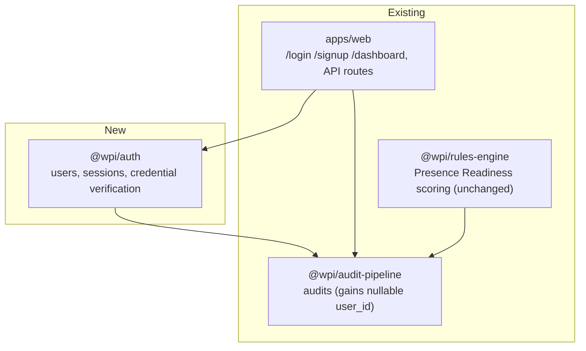
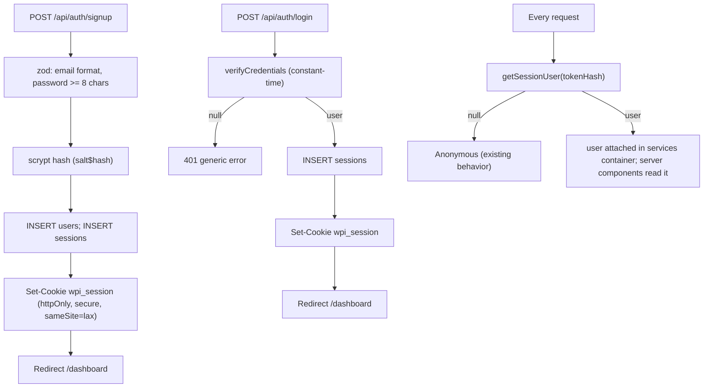
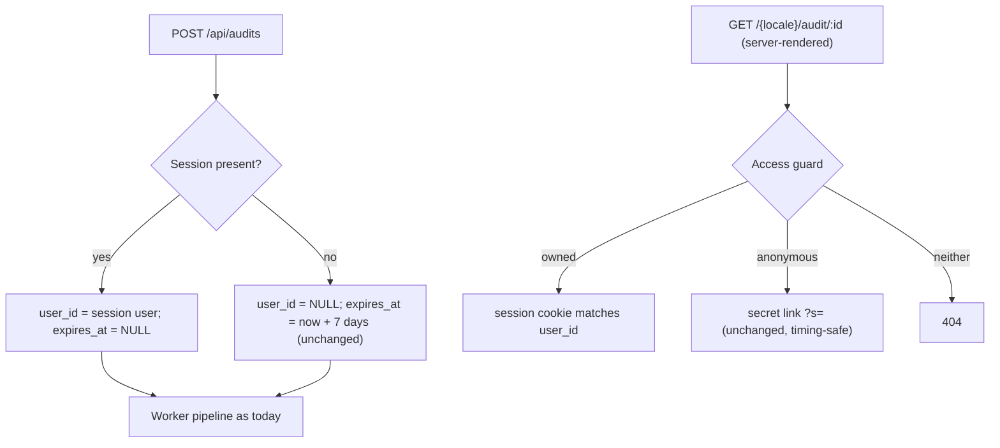
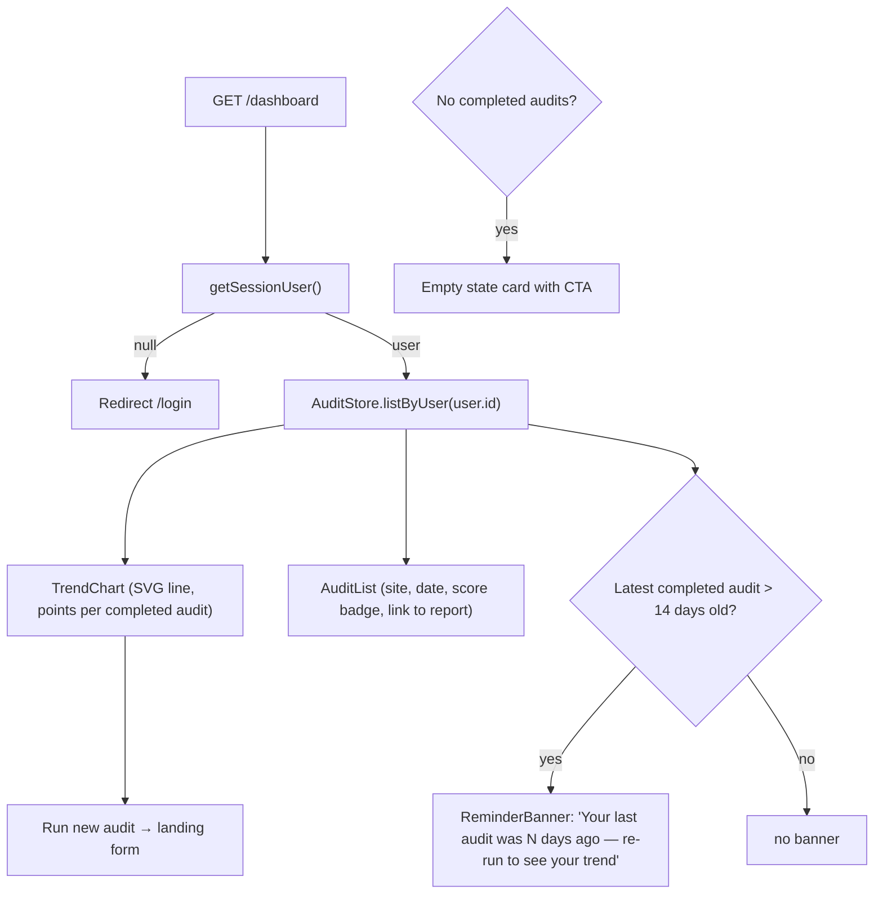
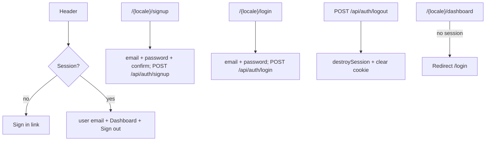

# User Accounts and Score Tracking Design Spec

**Date:** 2026-10-13
**Milestone:** Post-M8 retention feature (not in original project plan)
**Motivation:** WPI is a one-shot anonymous tool — no accounts, no history, 7-day report expiry, no return-visit mechanics. Accounts + score history + a re-audit reminder form the minimum retention loop.

## Goal

Let visitors create an account, sign in, and keep every audit they run forever. The dashboard shows their Presence Readiness score over time so they can see progress and have a reason to come back and re-audit. The anonymous flow is untouched.

## User Decisions

| Decision        | Choice               | Implication                                              |
| --------------- | -------------------- | -------------------------------------------------------- |
| Auth method     | Email/password only  | No OAuth, no magic links; zero new dependencies          |
| Existing audits | Clean break          | Anonymous audits stay anonymous; no claim/migration flow |
| Reminders       | In-app only          | No email service; dashboard banner only                  |
| Re-audits       | Manual, kept forever | No scheduler; user runs audits on their own cadence      |

## Architecture

One new package (`@wpi/auth`), one new page group in `apps/web`, a nullable `user_id` on `audits`, and a small services layer in the web app.



### Auth Flow



## Section 1: `@wpi/auth` Package

New package following the repo pattern: `package.json`, `src/` with zod-validated interfaces, SQL migration files, Vitest tests, DI-friendly constructor.

### Migrations

**`users` table:**

```sql
CREATE TABLE users (
  id UUID PRIMARY KEY DEFAULT gen_random_uuid(),
  email TEXT NOT NULL UNIQUE,  -- stored lowercase
  password_hash TEXT NOT NULL, -- scrypt: "salt$hash", both hex
  created_at TIMESTAMPTZ NOT NULL DEFAULT now(),
  updated_at TIMESTAMPTZ NOT NULL DEFAULT now()
);
```

**`sessions` table:**

```sql
CREATE TABLE sessions (
  token_hash TEXT PRIMARY KEY,  -- SHA-256 hex of the raw token; raw token never stored
  user_id UUID NOT NULL REFERENCES users(id) ON DELETE CASCADE,
  created_at TIMESTAMPTZ NOT NULL DEFAULT now(),
  expires_at TIMESTAMPTZ NOT NULL,
  last_seen_at TIMESTAMPTZ NOT NULL DEFAULT now()
);
CREATE INDEX idx_sessions_user_id ON sessions(user_id);
```

**`audits` table (new migration):** add nullable column — anonymous rows keep `user_id = NULL`:

```sql
ALTER TABLE audits ADD COLUMN user_id UUID REFERENCES users(id) ON DELETE CASCADE;
CREATE INDEX idx_audits_user_id ON audits(user_id);
ALTER TABLE audits ALTER COLUMN expires_at DROP NOT NULL;
```

All three table changes ship as new migration files (0016+) in `packages/audit-pipeline/src/migrations/` — the repo never edits already-applied migrations. `audits.expires_at` is currently `NOT NULL` (0001_create_audits.sql): account audits set it to `NULL` (never expire); anonymous audits keep the 7-day value.

### Interfaces

```typescript
interface CreateUserInput { email: string; password: string; }
interface AuthUser { id: string; email: string; createdAt: Date; }

createUser(input: CreateUserInput): Promise<AuthUser>
// zod validation: email format, password >= 8 chars; scrypt hash; INSERT.
// Duplicate email raises a typed DuplicateEmailError (lowercase-normalized compare).

verifyCredentials(input: CreateUserInput): Promise<AuthUser | null>
// Constant-time: hashes the presented password and compares against the stored
// hash with the scrypt verifier (crypto.timingSafeEqual). Returns null for
// unknown email OR wrong password — same response, same latency.

createSession(userId: string): Promise<{ token: string; expiresAt: Date }>
// 32 random bytes (crypto.randomBytes), hex token returned raw;
// SHA-256(token) stored; expiry = now + 30 days.

getSessionUser(tokenHash: string): Promise<AuthUser | null>
// Looks up by hash; returns null if expired or unknown.
// Sliding renewal: if last_seen_at is older than 7 days, extends
// expires_at to now + 30 days and updates last_seen_at.

destroySession(tokenHash: string): Promise<void>
```

### Security Details

- **Hashing:** Node built-in `crypto.scrypt` (N=16384 default), 16-byte random salt, stored as `salt$hash` hex. No new dependency.
- **Timing safety:** password verification uses `crypto.timingSafeEqual` over equal-length buffers; session lookup is a primary-key hash lookup (no string comparison on secrets). Mirrors the existing secret-guard pattern in `apps/web/src/services/access.ts`.
- **Rate limiting:** reuse the per-key counter pattern from `packages/content-briefs/src/draft-rate.ts` — limit POST /api/auth/signup and /api/auth/login per IP and per email. Counters reset on success.
- **Cookie:** name `wpi_session`, value = raw token, `httpOnly; secure; sameSite=lax; max-age=30d; path=/`.

## Section 2: Audits for Account Users



- Owned audit access = valid session whose `user_id` matches the audit's `user_id`, **or** the secret link (both always work).
- Exports remain denied for everyone (D-022); owned-access applies to report and status pages only.
- Known v1 limitation: no password reset (no email service). Not surfaced in UI copy — documented here only.

## Section 3: Dashboard `/{locale}/dashboard`

Server-rendered from the session. Redirects to `/{locale}/login` when no session.



### Score Trend Chart

Hand-rolled SVG line chart component (`TrendChart` in `apps/web`) — no chart library. One series per site URL; a point per completed audit; hover tooltip shows date + score; y-axis 0–100%, x-axis time. Accounts with one site render a single line; multiple sites render multiple colored lines with a legend.

### Audit List

Row per audit (newest first): site URL, completed date, Presence Readiness score badge (color-coded as in the existing report view), status for in-flight audits, link to the existing report view `/{locale}/audit/{id}` — owned audits are authorized by session, so the link omits `?s=`.

### Reminder Banner

Shown when the latest completed audit is more than 14 days old: "Your last audit was N days ago — re-run to see your trend." Dismissal persisted in `localStorage` (key includes audit id) so it stays dismissed. In-app only; no email.

### Empty State

New account with no completed audits: a card explaining the loop — run an audit, come back, watch the score move — with a "Run my first audit" CTA linking to the landing form.

## Section 4: Routes and UI Changes



- New routes under `apps/web/src/app/[locale]/`: `login/`, `signup/`, `dashboard/`. Bilingual strings added to the EN and AR catalogs (`next-intl`), same keys pattern as existing pages.
- Header (existing `apps/web` header component): "Sign in" when logged out; email + "Dashboard" + "Sign out" when logged in.
- Anonymous report footer gains a passive line: "Sign up to keep reports forever →" linking to `/signup`.
- "Claim this audit" button stays disabled (clean break).
- Signed-in users running the landing form are redirected to `/dashboard` after submission instead of the anonymous status URL (the audit appears on the dashboard immediately).

## Section 5: Testing

| Layer                       | Coverage                                                                                                                                                                                                                                                                                                                                                     |
| --------------------------- | ------------------------------------------------------------------------------------------------------------------------------------------------------------------------------------------------------------------------------------------------------------------------------------------------------------------------------------------------------------ |
| `packages/auth` unit        | scrypt hash/verify round-trip; wrong password → null; unknown email → null (same shape as wrong password); session create → lookup → sliding renewal only after 7 days → expiry → destroy; duplicate email error                                                                                                                                             |
| `packages/auth` integration | Postgres test container (existing setup in `packages/test-utils`): migrations apply, CRUD on users/sessions/audits with `user_id`, cascade delete                                                                                                                                                                                                            |
| `apps/web` route tests      | signup → cookie set → 303 to /dashboard; login wrong password → 401, no cookie; logout clears cookie; `/dashboard` with session renders chart + list; without session → redirect `/login`; owned audit accessible by session without `?s=`, denied without either; anonymous audit expiry unchanged (7 days), owned audit `expires_at IS NULL` never expires |
| Playwright e2e (chromium)   | signup → run audit from landing form → dashboard shows the audit; after completion the score appears; run a second audit → trend shows 2 points; sign out → dashboard redirects to login; anonymous flow (secret link) unchanged                                                                                                                             |

## Section 6: Explicitly Out of Scope (YAGNI)

- OAuth / social sign-in
- Email verification, password reset, any email sending
- Scheduled auto re-audits or email digests
- Team accounts / multi-user workspaces
- Billing / plan limits
- Claiming anonymous audits (clean break; schema would support it later if ever wanted — `user_id` is nullable and anonymous audits keep their secret)
