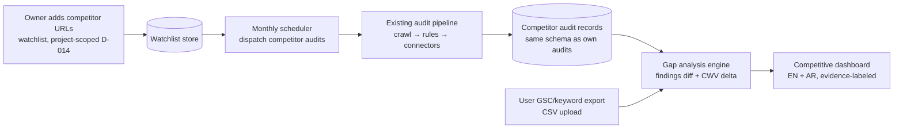

# Seed: M10 Competitor Tracking (SEO Agent Frameworks)

| Field            | Value                                                                                                                                     |
| ---------------- | ----------------------------------------------------------------------------------------------------------------------------------------- |
| Type             | Design seed (pre-intent input material)                                                                                                   |
| Seeds            | M10 "Competitor Tracking" in `docs/m9-roadmap.md` (Priority 2)                                                                            |
| Source           | `seo-agent-skill/` (outside repo) — competitive-intelligence framework (profiling, gap analysis, opportunity scoring, monitoring cadence) |
| Status           | draft — input material for the future M10 intent, not an accepted spec                                                                    |
| Date             | 2026-10-14                                                                                                                                |
| Skill governance | Per CLAUDE.md: port logic into product code, never import skill scripts (D-009, `forbidden_endpoints.py`)                                 |

## Why this seed exists

The M10 roadmap says "Add competitor URLs to watchlist, Monthly automated competitor audits, Competitive analysis dashboard." The SEO agent skill defines how competitive analysis is done properly: identify search competitors, profile them, run structured gap analysis, score opportunities, and monitor movements on a cadence. This seed adapts that framework to WPI's hard constraint set — especially **D-009 (never call Google Autocomplete or scrape search-result pages)**, which forbids the classic "SERP gap" approach used by third-party SEO tools.

## What WPI can and cannot use (constraint-first design)

| Capability from the skill                      | Allowed in WPI?                                                      | WPI replacement                                                                                |
| ---------------------------------------------- | -------------------------------------------------------------------- | ---------------------------------------------------------------------------------------------- |
| SERP scraping / rank tracking via search pages | ❌ D-009 forbids                                                     | GSC Search Analytics API (owned property) + user-exported data                                 |
| Google Autocomplete / PAA mining               | ❌ D-009 forbids                                                     | GSC query data for the user's own property; LLM-provider knowledge is NOT evidence (no source) |
| Competitor backlink profiles (Ahrefs/SEMrush)  | ⚠️ Not in M1–M8 connectors; paid API adds cost                       | Defer to a future decision; M10 ships without third-party backlink data                        |
| On-page competitor audits                      | ✅ Existing M1 crawler + M2 rules engine can audit any submitted URL | Monthly automated competitor audits = re-run the existing audit pipeline on watchlist URLs     |
| PSI / CrUX for competitor pages                | ✅ M5 connectors are read-only public APIs                           | Core Web Vitals comparison — allowed and cheap                                                 |
| Content gap (topics competitors cover)         | ✅ Via crawl evidence from competitor audits                         | Rules-engine findings diff, not scraped SERPs                                                  |

## Proposed pipeline

Trust boundaries: competitor URLs are untrusted input → full SSRF validation (M1 fetcher, `@wpi/security`) applies identically to own-site audits. Watchlist and gap records are project-scoped (D-014). Exports are user-uploaded CSVs — untrusted content, validated against schema before analysis.

## Draft requirements (for the M10 intent to formalize)

1. **FR-1** Watchlist: signed-in users add competitor URLs (max `<DECIDE_AT_M10>` per project) to a project-scoped watchlist. Duplicate/same-site validation. Bilingual UI.
2. **FR-2** Monthly automated competitor audit: scheduler dispatches the existing audit pipeline per watchlist entry. Each competitor audit is a normal audit record (project-scoped, same schema, same scoring) tagged `role=competitor`. Cost per audit is metered against D-005 and shown before enabling the schedule.
3. **FR-3** Gap analysis compares the user's latest audit vs each competitor's latest audit on dimensions WPI actually measures: rules findings present/absent (M2 categories), Presence Readiness score delta, Experience dimension deltas (M5), Core Web Vitals from PSI/CrUX (M5). **Never blends** these into one number (D-012) — deltas are reported per dimension.
4. **FR-4** Content-gap view: topics/subpages where the competitor site has substantive indexed-style content and the user's site has thin/missing equivalents, derived from crawl evidence (titles, headings, page counts per section). Labeled as crawl-inference with `fidelity_label`, never as "ranking data".
5. **FR-5** Keyword-gap view is **export-driven**: the user uploads their own GSC query export (and optionally a competitor's from a tool they license); WPI computes overlap/gaps offline. WPI itself never queries SERPs. Uploaded files: CSV schema-validated, personal data redaction reminder shown, retention per `docs/data-classification.md`.
6. **FR-6** Monitoring cadence: weekly diff of the latest two competitor audits (what changed), surfaced on the dashboard as a movement log with as-of timestamps.
7. **FR-7** Dashboard: competitor list, per-dimension delta table, movement log, CWV comparison — bilingual EN + AR, logical CSS/RTL.
8. **FR-8** Anonymous reports: competitor features are signed-in only (D-002 alignment — anonymous flow stays minimal and read-only).

## Data contracts (draft)

- `schemas/competitor-watchlist.schema.json` — `project_id`, `competitor_url`, `label`, `added_at`, `schedule_enabled`, `last_audit_id`
- `schemas/competitor-gap.schema.json` — `user_audit_id`, `competitor_audit_id`, `dimension` (enum: rules_category / presence_score / experience / cwv / content_topics), `delta`, `direction`, `source`, `as_of`, `fidelity_label`
- Reuse existing audit schema unchanged for competitor audits (tag, not fork).

## Cost impact (D-005, USD 150/month combined cap)

- Competitor audits reuse the existing pipeline. Cost per audit ≈ existing audit cost (crawl + render + rules are local; agents/connectors only if enabled for the competitor run — recommend `agents_enabled=false` for competitor audits to keep cost near zero; rules + connectors cover the gap analysis).
- Estimated worst case: 10 competitors × 1 audit/month ≈ 10 pipeline runs/month — well within cap if Gemini agent inference stays off for competitor runs.
- PSI/CrUX connector calls: same rate limits as own-site audits.

## Policy conformance concerns to carry into the intent

| Policy                 | Concern                                                                                                                                                                                                         |
| ---------------------- | --------------------------------------------------------------------------------------------------------------------------------------------------------------------------------------------------------------- |
| google-search-guidance | D-009 is the binding constraint: no SERP scraping, no Autocomplete. Export-driven keyword gap is the compliant substitute — must be stated in product copy so users don't expect third-party-tool rank tracking |
| security-baseline      | Competitor URLs are user-submitted → identical SSRF/validation path as own audits; watchlist add is an owned-record write                                                                                       |
| data-integrity         | Deltas carry source + as-of + fidelity label; crawl-inferred content gaps never labeled as search-performance data                                                                                              |
| cost-guard             | Monthly schedule spends by default once enabled — needs explicit user confirmation + budget display                                                                                                             |
| arabic-rtl-a11y        | Dashboard tables in logical CSS; competitor URLs bidi-isolated                                                                                                                                                  |
| connector-safety       | No new connectors in M10; PSI/CrUX reuse only                                                                                                                                                                   |

## Open questions for the M10 intent (do not guess)

1. `<DECIDE_AT_M10>` Watchlist size cap per project (proposal: 5 on Hobby-tier hosting)?
2. `<DECIDE_AT_M10>` Do competitor audits run agents (paid) or rules+connectors only (near-free)? Proposal: rules+connectors only.
3. `<DECIDE_AT_M10>` CSV export format spec for keyword-gap (GSC UI export vs GSC API export vs third-party CSV) — one schema or per-source mappers?
4. `<DECIDE_AT_M10>` Retention of competitor audit records (same 7-day anonymous rule cannot apply — these are owned; confirm owned-audit retention)?
5. `<DECIDE_AT_M10>` Does gap analysis include AI Visibility Lab prompts against competitor domains? (M6 measures user's brand; competitor AEO measurement is a new cost + design question. Proposal: out of scope for M10.)
