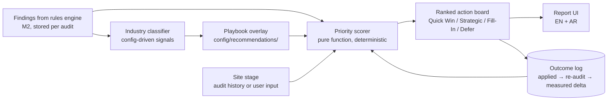

# Seed: M10 Recommendations Engine (SEO Agent Frameworks)

| Field | Value |
| ----- | ----- |
| Type | Design seed (pre-intent input material) |
| Seeds | M10 "Recommendations Engine" in `docs/m9-roadmap.md` (Priority 2) |
| Source | `seo-agent-skill/` (outside repo) — prioritization matrix, industry playbooks, knowledge-growth loop |
| Status | draft — input material for the future M10 intent, not an accepted spec |
| Date | 2026-10-14 |
| Skill governance | Per CLAUDE.md: skill content is ported into product code and tested; nothing is imported from any skill directory (`forbidden_endpoints.py` blocks skill-script imports) |

## Why this seed exists

The M10 roadmap item says "Personalized action items based on business type, Priority scoring for recommendations." The SEO agent skill contains a concrete, tested-in-practice framework for exactly this: an impact/effort/timeline prioritization matrix, per-industry playbook selection, and an outcome-feedback loop. This seed captures that framework in WPI's vocabulary so the M10 intent does not start from zero.

## What is ported from the skill

| Skill concept | WPI product form |
| ------------- | ---------------- |
| Priority Score = (Impact × 2) − Effort − Timeline (each 1–10) | Deterministic scoring function over audit findings; NOT a rule-weight change (no `methodology_version` bump — this is a downstream ranking layer, not the rules engine) |
| Quick Win / Strategic / Fill-In / Defer categories | Categorization of the action board items shown on the report |
| Industry playbooks (SaaS, e-commerce, local, publisher, professional services) | `config/recommendations/industry-playbooks.yaml` (D-010: config-sourced, with source + date per entry) |
| Site stage (new <1yr / growth 1–3yr / mature 3+yr) | Derived per-audit attribute (first-seen date from audit history or user-declared) |
| Knowledge-growth loop (what was done → what was measured) | Outcome-tracking table: applied recommendations link back to later audits to record measured deltas with `fidelity_label` |

## Proposed pipeline

Trust boundaries: findings come from the existing pipeline (trusted, project-scoped per D-014). The industry classifier reads only audit evidence and user-provided inputs. The outcome log is written only when a signed-in user marks a recommendation applied; anonymous reports stay read-only, in-app, 7-day expiry (D-002).

## Draft requirements (for the M10 intent to formalize)

1. **FR-1** Every finding on the action board carries a Priority Score computed by a pure function `(impact × 2) − effort − timeline`, with all three inputs recorded alongside the score. Scores are a presentation-layer ranking; they never alter Presence Readiness, Experience Effectiveness, AI visibility, or search performance numbers (D-012 separation).
2. **FR-2** The action board groups findings into Quick Win / Strategic / Fill-In / Defer using config thresholds in `config/recommendations/scoring.yaml` (source + date per D-010).
3. **FR-3** Industry classification maps the audited site to one playbook (SaaS, e-commerce, local, publisher, professional services, or `generic`). Signals: schema types found, crawl evidence, user-declared business type (highest precedence). Classification is shown to the user with its basis.
4. **FR-4** Playbook overlays reorder or annotate recommendations; they never add findings the rules engine did not produce.
5. **FR-5** Signed-in users can mark a recommendation "applied" (manual confirmation, no CMS write in M10 — CMS integration is the roadmap's separate item). Applied recommendations create outcome-log records keyed to the audit.
6. **FR-6** When a later audit of the same site runs, the outcome log joins to the new findings and records measured deltas (metric, before, after, as-of times, `fidelity_label`) — following the metrics conventions in CLAUDE.md (CTR from totals, impression-weighted position, percentage-point changes, explicit zero denominators).
7. **FR-7** Bilingual EN + AR for all new UI strings and report sections; native Arabic review required.

## Data contracts (draft)

- `schemas/recommendation-priority.schema.json` — `finding_id`, `impact_score`, `effort_score`, `timeline_score`, `priority_score`, `category`, `playbook_id`, `computed_at`, `scoring_config_version`
- `schemas/recommendation-outcome.schema.json` — `finding_id`, `audit_id_applied`, `audit_id_measured`, `metric`, `value_before`, `value_after`, `as_of_before`, `as_of_after`, `fidelity_label`, `source`
- Both schemas carry lineage fields per 03-PRODUCTION-CONTRACTS; every stored number carries source + as-of + fidelity label (CLAUDE.md conventions).

## Cost impact

Deterministic scoring adds no paid calls. The outcome loop reuses existing audit runs — no extra audits required (users run audits on their existing schedule). No new LLM usage in this scope. Cost cap D-005 (USD 150/month combined) unaffected.

## Policy conformance concerns to carry into the intent

| Policy | Concern |
| ------ | ------- |
| data-integrity | Outcome deltas must not imply causation; correlation-only records need a fidelity label such as `correlation_only` |
| arabic-rtl-a11y | New action-board UI in logical CSS, bidi-isolated URLs |
| security-baseline | "Mark applied" is an owned-record write → `authorizeRecord` ownership guard required |
| cost-guard | No paid calls; confirm |

## Open questions for the M10 intent (do not guess)

1. `<DECIDE_AT_M10>` Who owns scoring threshold values in `config/recommendations/scoring.yaml` — SEO lead sign-off required?
2. `<DECIDE_AT_M10>` Does industry classification run on every audit (recompute) or persist per site and refresh?
3. `<DECIDE_AT_M10>` Is "site stage" user-declared only, or derived from first-audit date? (Derivation needs an audit-history retention rule.)
4. `<DECIDE_AT_M10>` Minimum evidence before the outcome log is shown to users (e.g., hide deltas until 2 measured audits exist)?
