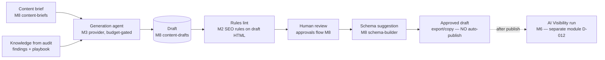

# Seed: M11 AI Content Assistant (SEO Agent Frameworks)

| Field            | Value                                                                                                                                                          |
| ---------------- | -------------------------------------------------------------------------------------------------------------------------------------------------------------- |
| Type             | Design seed (pre-intent input material)                                                                                                                        |
| Seeds            | M11 "AI Content Assistant" in `docs/m9-roadmap.md` (Priority 3)                                                                                                |
| Source           | `seo-agent-skill/` (outside repo) — ai-search-optimization reference (answer-first structure, AI Overviews/ChatGPT/Perplexity tactics), content-brief patterns |
| Status           | draft — input material for the future M11 intent, not an accepted spec                                                                                         |
| Date             | 2026-10-14                                                                                                                                                     |
| Skill governance | Per CLAUDE.md: port logic into product code, never import skill scripts; LLM usage flows through the M3 provider layer with budget gates                       |

## Why this seed exists

The M11 roadmap says "Generate SEO-optimized content suggestions, AI-powered meta description generator, Automated internal linking recommendations." WPI already has the substrate: M8 Content & Schema Studio (`@wpi/content-briefs`, `@wpi/content-drafts`, `@wpi/schema-builder`) and the M3 agents service (Gemini provider, tool allowlists, cost tracking). What the skill adds is the _optimization doctrine_ — answer-first structure for AI search citation, quotability, entity building — plus guardrails about what AI-generated content must never do (fabricate data, promise rankings).

## Relationship to existing milestones

| Existing capability                                                               | Role in M11                                                                                                                                                                                      |
| --------------------------------------------------------------------------------- | ------------------------------------------------------------------------------------------------------------------------------------------------------------------------------------------------ |
| M3 agents service (provider layer, cost tracker, circuit breaker, prompt builder) | The ONLY path for generation calls; write-class tools remain forbidden (CLAUDE.md)                                                                                                               |
| M6 AI Visibility Lab (5 provider adapters)                                        | Measurement side: after content ships, visibility runs show whether AI answers cite the new content. M11 does not merge with D-012 separation — generation and measurement stay separate modules |
| M8 content-briefs / content-drafts / schema-builder                               | Storage and drafting substrate; M11 fills the scaffold gaps noted in the M8 known-issues (API routes are scaffolds)                                                                              |
| M2 rules engine                                                                   | Post-generation lint: drafts are checked by the same SEO rules so a draft cannot ship what an audit would flag                                                                                   |

## Proposed pipeline

Trust boundaries: generation happens in the agents service; the assistant has **no write access** to any CMS or Git (connector service is the only writer, and M11 does not connect it). All generated content is untrusted output until a human approves it through the M8 approvals flow.

## Draft requirements (for the M11 intent to formalize)

1. **FR-1** Meta description / title generator: given a brief and page context, generate ≤ 60-char titles and ≤ 160-char descriptions with character counts shown. Generation uses the M3 provider layer with per-call budget checks (M6 cost-ledger pattern). Every generated artifact stores model, prompt version, cost, and timestamp.
2. **FR-2** Answer-first draft scaffolding: generated drafts follow the structure the skill's AI-search reference defines — direct answer in the first 40–60 words, then supporting sections; FAQ blocks from real user questions in evidence (GSC queries the user exports), **never fabricated PAA questions** (D-009: no SERP scraping, and LLM-generated "people also ask" must be labeled as AI-suggested, not observed demand).
3. **FR-3** Internal-linking recommendations: deterministic graph suggestions from the crawl corpus (anchor text, orphan detection, topic adjacency from existing evidence) — an algorithm, not an LLM call, so it costs nothing and is testable against fixtures.
4. **FR-4** Anti-fabrication guardrails: the generation prompt (via M3 injection-hardened builder) forbids invented statistics, invented sources, and ranking guarantees; drafts containing number-like claims without an evidence citation get flagged by the rules lint and cannot reach "approved" state while flagged. Regulated-claims detection (M8, English-only known limitation) applies.
5. **FR-5** Rules lint before approval: the M2 SEO rule set runs against draft HTML; any CRW/SEO category failure blocks approval (same rules, same weights — no `methodology_version` change).
6. **FR-6** No auto-publish: M11 ends at approved-draft export/copy. Publishing is the connector service's domain and is explicitly out of scope (split-trust boundary, CLAUDE.md layout).
7. **FR-7** Arabic support: drafts can be generated for AR locales with the Arabic normalizer patterns from M8; Arabic copy requires native review flag before approval (CLAUDE.md convention).
8. **FR-8** Cost display: before generation, show estimated cost range; after, actual cost from the cost tracker. Monthly cap D-005 enforced by existing budget gates.

## Data contracts (draft)

- Extend M8 draft schema: `generation_metadata` (model, prompt_version, cost_micros, generated_at, lint_result_ids)
- `schemas/content-lint-result.schema.json` — `draft_id`, `rule_id`, `category`, `severity`, `message`, `evidence_state`
- All numbers stored with source + as-of + `fidelity_label`; AI-suggested labels distinct from observed evidence.

## Cost impact (D-005, USD 150/month combined cap)

- Generation: per-draft Gemini calls via M3 adapter (pricing from config, D-010). Rough envelope for pilot scale: 50 drafts/month × ~5K tokens ≈ low single-digit USD — safe under cap, but must be confirmed with the model-resolver pricing table at intent time.
- Rules lint: free (deterministic). Internal-linking: free (deterministic). Visibility measurement: existing M6 cost model, separate.

## Policy conformance concerns to carry into the intent

| Policy                 | Concern                                                                                                              |
| ---------------------- | -------------------------------------------------------------------------------------------------------------------- |
| cost-guard             | Pre-call cap check + per-user generation quota `<DECIDE_AT_M11>`                                                     |
| data-integrity         | Generated claims must cite evidence or be flagged; AI-suggested ≠ observed demand                                    |
| security-baseline      | Prompt-injection surface: page context is untrusted content → M3 hardened prompt builder; no tool_use write paths    |
| connector-safety       | No CMS/Git writes; export-only                                                                                       |
| arabic-rtl-a11y        | AR drafts, bidi-isolated URLs in drafts, native review flag                                                          |
| google-search-guidance | Do not promise rich results (FAQ rich results stopped May 2026 — CLAUDE.md); copy must not claim guaranteed rankings |

## Open questions for the M11 intent (do not guess)

1. `<DECIDE_AT_M11>` Which Gemini model tier for generation (check provider's current model-versions page at M11 time — never hard-code now, D-010)?
2. `<DECIDE_AT_M11>` Per-user monthly generation quota (drafts count)?
3. `<DECIDE_AT_M11>` Does the lint gate block approval on any SEO-rule failure, or only high-severity? Proposal: block on CRW/SEO high+medium, warn on low.
4. `<DECIDE_AT_M11>` Is AI-visibility follow-up (M6 run on published URL) user-triggered or automatic? Proposal: user-triggered, explicit cost display.
5. `<DECIDE_AT_M11>` Arabic generation model quality gates — what eval proves AR draft quality before feature flag on for AR?
