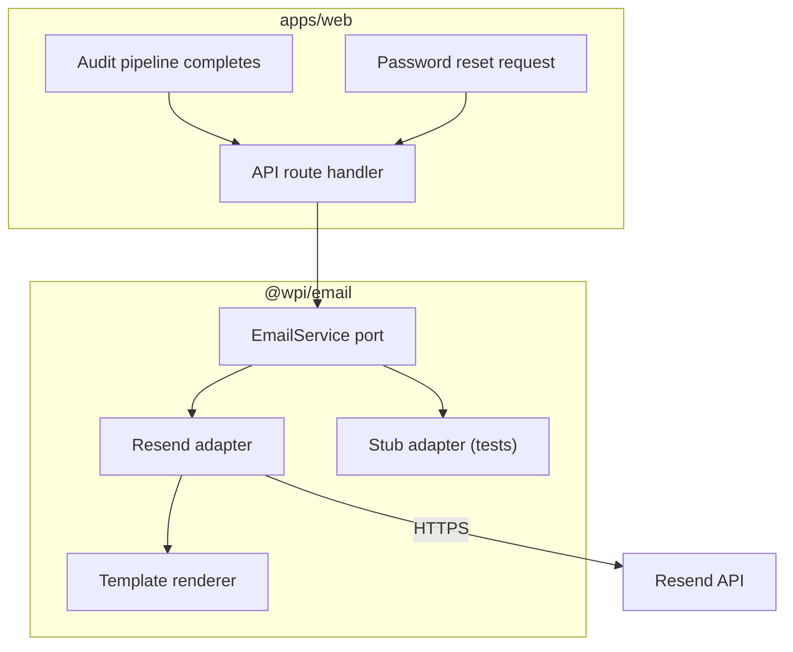

# M9 Email Notifications Design Spec

**Date:** 2026-10-14  
**Milestone:** M9 Production Readiness (sub-project 2 of 3)  
**Motivation:** WPI has no email delivery. Users cannot receive audit completion notifications, password reset links, or any other account-related messages. Email is required for user engagement and account recovery.

## Goal

Add a small, testable email abstraction (`@wpi/email`) with a Resend adapter and bilingual EN/AR templates. Send audit-completion and password-reset emails asynchronously from the web app without blocking API responses.

## User Decisions

| Decision        | Choice                    | Implication                                                                            |
| --------------- | ------------------------- | -------------------------------------------------------------------------------------- |
| Provider        | Resend                    | Free tier covers pilot; simple API; domain verification required for production sender |
| Template format | Plain text + minimal HTML | Easier to maintain; HTML avoids spam-folder bias; bilingual copy                       |
| Async strategy  | Fire-and-forget Promise   | No external queue for pilot; Resend call runs after response is sent                   |
| Weekly digest   | Deferred to M10           | Out of scope for M9; keeps spec focused                                                |

## Architecture



## Section 1: `@wpi/email` Package

### Layout

```
packages/email/
├── package.json
├── tsconfig.json
├── src/
│   ├── index.ts
│   ├── types.ts
│   ├── templates/
│   │   ├── audit-completion/
│   │   │   ├── en.ts
│   │   │   └── ar.ts
│   │   └── password-reset/
│   │       ├── en.ts
│   │       └── ar.ts
│   ├── resend-adapter.ts
│   └── stub-adapter.ts
└── tests/
    └── email-service.test.ts
```

### Port

```typescript
export type EmailLocale = "en" | "ar";

export interface SendEmailRequest {
  to: string;
  subject: string;
  html: string;
  text: string;
  locale: EmailLocale;
}

export interface EmailService {
  send(request: SendEmailRequest): Promise<{ id?: string }>;
}
```

### Resend Adapter

- Reads `RESEND_API_KEY` and `EMAIL_FROM_ADDRESS` from environment.
- Calls `POST https://api.resend.com/emails` with `from`, `to`, `subject`, `html`, `text`.
- Returns Resend's `id` on success.
- Throws a typed `EmailSendError` on failure so callers can log but not crash.

### Stub Adapter

- Stores sent messages in memory.
- Used in tests and local dev when `RESEND_API_KEY` is not set.
- Exposes `getSent(): SendEmailRequest[]` for assertions.

## Section 2: Templates

Each template is a function that takes context data and returns `{ subject, html, text }`.

### Audit Completion

**Context:**

```typescript
interface AuditCompletionContext {
  locale: "en" | "ar";
  siteUrl: string;
  score: number;
  reportUrl: string;
}
```

**EN subject:** "Your WPI audit for example.com is ready"

**AR subject:** "تقرير WPI لموقع example.com جاهز"

Both versions link to the in-app report URL (private link with signed secret). No PDF attachments. No score numbers in email subject to avoid triggering spam filters.

### Password Reset

**Context:**

```typescript
interface PasswordResetContext {
  locale: "en" | "ar";
  resetUrl: string;
  expiresInMinutes: number;
}
```

**EN subject:** "Reset your WPI password"

**AR subject:** "إعادة تعيين كلمة مرور WPI"

The reset URL contains a single-use token with a short expiry (15 minutes).

## Section 3: Web Integration

### Audit Completion Email

In `apps/web/src/services/container.ts`, extend the audit completion callback:

```typescript
onComplete: async (record: AuditRecord, user: User | null) => {
  if (user) {
    const reportUrl = buildReportUrl(record);
    await emailService.send(
      auditCompletionTemplate({
        locale: record.locale,
        siteUrl: record.url,
        score: record.score,
        reportUrl,
      }),
    );
  }
};
```

Fire the email send inside an un awaited `Promise` so the API response is not delayed. Log failures; do not fail the audit if email fails.

### Password Reset Email

Add `POST /api/auth/forgot-password`:

1. Validate email with zod.
2. Generate a cryptographically random token (32 bytes, hex).
3. Store a hash of the token in `password_reset_tokens` table with `user_id`, `expires_at` (15 min), `created_at`.
4. Build reset URL: `${NEXT_PUBLIC_APP_URL}/reset-password?token=${token}`.
5. Send password reset email via `@wpi/email`.
6. Return 200 regardless of whether the email exists (prevents user enumeration).

Add `POST /api/auth/reset-password`:

1. Validate token and new password (>= 8 chars).
2. Look up token hash; reject if expired or already used.
3. Hash new password with scrypt.
4. Update user password and delete the token.
5. Redirect to `/login`.

## Section 4: Database Migration

Add migration `0018_password_reset_tokens.sql`:

```sql
CREATE TABLE password_reset_tokens (
  token_hash TEXT PRIMARY KEY,
  user_id UUID NOT NULL REFERENCES users(id) ON DELETE CASCADE,
  created_at TIMESTAMPTZ NOT NULL DEFAULT now(),
  expires_at TIMESTAMPTZ NOT NULL,
  used_at TIMESTAMPTZ
);
CREATE INDEX idx_password_reset_tokens_user_id ON password_reset_tokens(user_id);
```

## Section 5: Security and Privacy

- Email bodies never include the raw report JSON or attachments (D-002).
- Reset tokens are single-use, hashed, and short-lived.
- `EMAIL_FROM_ADDRESS` must be a domain verified in Resend before pilot launch.
- Do not log email bodies or reset tokens.

## Section 6: Verification and Testing

### Unit tests

- Stub adapter captures sent emails.
- Template tests assert subject, HTML and text for EN and AR.
- Resend adapter test uses `nock` or `msw` to mock the HTTP call.

### Integration tests

- Submit an audit as a signed-in user; assert stub adapter receives an audit-completion email with the correct report link.
- Request password reset; assert stub adapter receives a password-reset email with a valid-looking token URL.

### Production verification

1. Verify domain in Resend dashboard.
2. Send a real email to a test address.
3. Check Resend logs for delivery status.

## Exit Criteria

1. `@wpi/email` package builds and passes tests.
2. Audit-completion email is sent when a signed-in user's audit completes.
3. Password-reset flow generates a token, sends an email, and allows password change within 15 minutes.
4. EN and AR templates render correctly.
5. Email failures are logged but do not fail audits or API responses.
