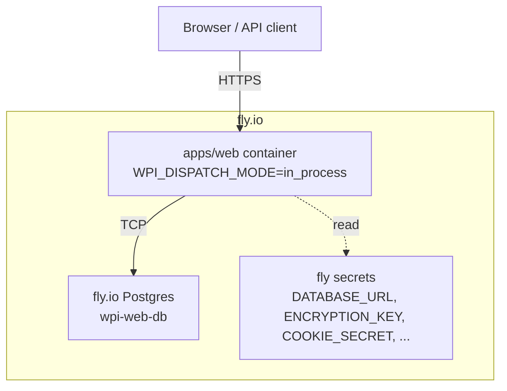
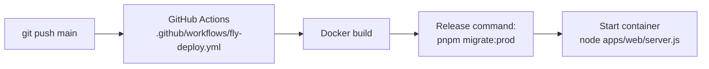

# M9 Production Runtime + Database Design Spec

**Date:** 2026-10-14  
**Milestone:** M9 Production Readiness (sub-project 1 of 3)  
**Motivation:** The WPI web app is deployed to fly.io but runs in `WPI_DISPATCH_MODE=memory`, so all audit records, user accounts, sessions and OAuth tokens are ephemeral. A production database and real secrets are required before pilot users can sign up and keep data.

## Goal

Run the WPI web app on fly.io with a managed Postgres database, production-grade secrets, and persistent data. The deployment must survive machine restarts and new deploys without data loss.

## User Decisions

| Decision | Choice | Implication |
|----------|--------|-------------|
| Database provider | fly.io managed Postgres | Same platform, automated backups, attach via `flyctl postgres attach` |
| App platform | fly.io (existing) | No Vercel function limits or Deployment Protection issues |
| Custom domain | Deferred | Use `wpi-web-delicate-dawn-7818.fly.dev` for pilot; custom domain added later without code changes |
| Migration runner | Release command in `fly.toml` | Migrations run before app starts on every deploy |
| Dispatch mode | `in_process` | Web container runs the audit pipeline in-process against the same database |

## Architecture



### Deployment Flow



## Section 1: fly.io Postgres Database

### Provisioning

Create a new fly.io Postgres cluster named `wpi-web-db` in the same region as the app (`fra`):

```bash
flyctl postgres create --name wpi-web-db --region fra --vm-size shared-cpu-1x --volume-size 10
```

Attach it to the app so `DATABASE_URL` is set automatically:

```bash
flyctl postgres attach wpi-web-db --app wpi-web-delicate-dawn-7818
```

### Backups

fly.io Postgres performs daily volume snapshots by default. For point-in-time recovery, upgrade to a HA configuration later. For the pilot, daily snapshots are sufficient.

## Section 2: Secrets and Environment Variables

Set the following secrets on the fly.io app. None are stored in the repo.

```bash
flyctl secrets set \
  DATABASE_URL="postgres://..." \
  ENCRYPTION_KEY="<32-byte hex>" \
  COOKIE_SECRET="<32-byte hex>" \
  GOOGLE_OAUTH_CLIENT_ID="..." \
  GOOGLE_OAUTH_CLIENT_SECRET="..." \
  RESEND_API_KEY="..." \
  TURNSTILE_SECRET_KEY="..." \
  --app wpi-web-delicate-dawn-7818
```

**Key rules:**
- `ENCRYPTION_KEY` and `COOKIE_SECRET` must be 32-byte hex strings (256 bits). Generate with `openssl rand -hex 32`.
- `DATABASE_URL` is injected by `flyctl postgres attach`; rotate it only if compromised.
- `RESEND_API_KEY` and `TURNSTILE_SECRET_KEY` are added by sub-projects 2 and 3 but set once on the same app.

## Section 3: `fly.toml` Changes

Update `fly.toml`:

```toml
[env]
  WPI_DISPATCH_MODE = 'in_process'

[deploy]
  release_command = "pnpm --filter @wpi/audit-pipeline migrate:prod"
```

The `release_command` runs in a temporary one-off machine with the same image and env vars, ensuring migrations run before traffic is routed to new instances.

## Section 4: Migration Strategy

### Existing Migrations

The repo has 17 migrations in `packages/audit-pipeline/src/migrations/` (0001 through 0017). They must run in order on the production database exactly once.

### Migration Command

Add a package script to `packages/audit-pipeline/package.json`:

```json
{
  "scripts": {
    "migrate:prod": "node ./dist/migrate.js"
  }
}
```

`migrate.js` reads `DATABASE_URL`, connects with `pg`, and applies any pending migrations from `src/migrations/`. It must:
- Exit 0 on success.
- Exit non-zero on failure so the deploy fails before the app starts.
- Be idempotent: re-running on an already-migrated database is a no-op.

### Local Parity

Developers continue to use Docker Postgres locally. The same migration files apply to both local and production databases. No environment-specific SQL files.

## Section 5: Container and Runtime Changes

### `apps/web` container

No Dockerfile changes are required beyond what is already committed. The existing multi-stage build produces a standalone Next.js output that runs `node apps/web/server.js`.

### Health check

Add a lightweight health check to `fly.toml` so fly.io confirms the container is ready before routing traffic:

```toml
[[services]]
  protocol = "tcp"
  internal_port = 3000

  [[services.ports]]
    port = 80
    handlers = ["http"]
    force_https = true

  [[services.ports]]
    port = 443
    handlers = ["tls", "http"]

  [[services.http_checks]]
    interval = "15s"
    timeout = "5s"
    grace_period = "10s"
    method = "get"
    path = "/api/health"
    protocol = "http"
```

Add `GET /api/health` in `apps/web/src/app/api/health/route.ts` that returns `200 { status: "ok" }` and confirms the database connection is alive.

### Boot guard

The existing boot guard refuses `WPI_DISPATCH_MODE=stub` in production. Extend it to require `DATABASE_URL` when `WPI_DISPATCH_MODE=in_process`; fail fast with a clear log message if the variable is missing.

## Section 6: Verification and Testing

### Pre-deploy checks

1. `pnpm typecheck`
2. `pnpm test`
3. `pnpm --filter @wpi/web build`
4. Local migration run against a fresh Docker Postgres container.

### Post-deploy checks

1. `curl https://wpi-web-delicate-dawn-7818.fly.dev/api/health` returns 200.
2. Sign up a test user; verify the row exists in the production `users` table.
3. Submit an audit; verify the row exists in the production `audits` table and survives a redeploy.
4. Sign out, sign back in; session persists.

### Rollback

If a deploy fails:
- Migration failures: fix the migration and redeploy. The release command prevents the bad version from serving traffic.
- App failures: find the previous release image with `flyctl releases list` and redeploy it with `flyctl deploy --image <image-ref>`, or roll back via the fly.io dashboard.
- Database corruption: restore from the latest fly.io volume snapshot.

## Exit Criteria

1. fly.io app runs with `WPI_DISPATCH_MODE=in_process` and connects to fly.io Postgres.
2. All 17 migrations apply cleanly on a fresh database via the release command.
3. `/api/health` returns 200 and confirms the database connection.
4. User signup, login, audit submission and session persistence survive a redeploy.
5. No secrets are committed to the repository.
