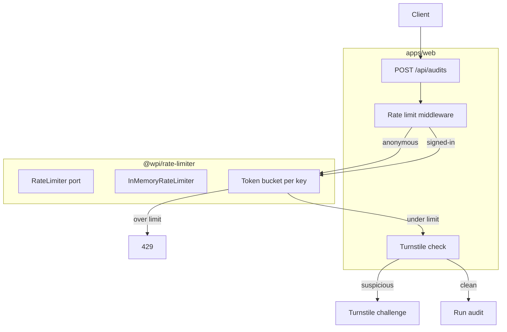

# M9 Rate Limiting and Abuse Prevention Design Spec

**Date:** 2026-10-14  
**Milestone:** M9 Production Readiness (sub-project 3 of 3)  
**Motivation:** Anonymous audit submission has no per-IP rate limits, and signed-in users have no per-user quotas. The platform is vulnerable to abuse, cost overruns, and spam audits.

## Goal

Add a reusable rate-limiting package (`@wpi/rate-limiter`) that enforces per-IP limits for anonymous audits, per-user quotas for signed-in users, and integrates Cloudflare Turnstile when suspicious activity is detected.

## User Decisions

| Decision                      | Choice                                          | Implication                                               |
| ----------------------------- | ----------------------------------------------- | --------------------------------------------------------- |
| Storage backend               | In-memory                                       | Simple; acceptable for pilot; upgrade path to Redis later |
| Anonymous limit               | 5 audits per hour per IP                        | Blocks bulk abuse while allowing legitimate retry         |
| Signed-in quota               | 50 audits per month per user                    | Generous pilot quota; project-scoped per D-014            |
| Failure threshold for CAPTCHA | 3 failed audit submissions in 10 minutes per IP | Balances friction and abuse prevention                    |
| CAPTCHA provider              | Cloudflare Turnstile                            | Free tier, privacy-friendly, low friction                 |

## Architecture



## Section 1: `@wpi/rate-limiter` Package

### Layout

```
packages/rate-limiter/
├── package.json
├── tsconfig.json
├── src/
│   ├── index.ts
│   ├── types.ts
│   ├── token-bucket.ts
│   ├── in-memory-store.ts
│   ├── audit-limiter.ts
│   └── turnstile-client.ts
└── tests/
    └── rate-limiter.test.ts
```

### Port

```typescript
export interface RateLimitResult {
  allowed: boolean;
  limit: number;
  remaining: number;
  resetAt: Date;
}

export interface RateLimiter {
  checkAnonymous(ip: string): Promise<RateLimitResult>;
  checkUser(userId: string, projectId: string): Promise<RateLimitResult>;
  recordFailure(ip: string): Promise<void>;
  isSuspicious(ip: string): Promise<boolean>;
}
```

### Token Bucket

- Anonymous: capacity 5, refill 5 per hour.
- User monthly quota: capacity 50, refill 50 per calendar month.
- Failure tracker: sliding window of 10 minutes, suspicious when count >= 3.

All times use UTC. The in-memory store resets on process restart; acceptable for pilot scale.

## Section 2: Web Middleware

Add rate-limit checks to `POST /api/audits` before creating an audit record.

### Anonymous flow

1. Extract the client IP from the left-most value in `X-Forwarded-For`; fly.io appends the real client IP and is the only trusted proxy.
2. Call `rateLimiter.checkAnonymous(ip)`.
3. If denied, return `429 Too Many Requests` with bilingual message and `Retry-After` header.
4. If allowed, proceed. On audit submission failure, call `rateLimiter.recordFailure(ip)`.

### Signed-in flow

1. Identify user from session.
2. Call `rateLimiter.checkUser(userId, projectId)`.
3. If denied, return `429` with quota details.
4. Quotas are project-scoped per D-014.

### Rate limit headers

Every `POST /api/audits` response includes:

```
X-RateLimit-Limit: 5
X-RateLimit-Remaining: 3
X-RateLimit-Reset: <Unix timestamp>
```

## Section 3: Cloudflare Turnstile Integration

### Client-side

Add a Turnstile widget to the audit form when the user is flagged as suspicious. Use the site key from `NEXT_PUBLIC_TURNSTILE_SITE_KEY`.

### Server-side

Add `turnstile-client.ts` that verifies the token with Cloudflare:

```typescript
POST https://challenges.cloudflare.com/turnstile/v0/siteverify
{
  secret: TURNSTILE_SECRET_KEY,
  response: token,
  remoteip: ip
}
```

If verification fails, reject the audit submission with `400` and require a fresh challenge.

### Suspicious detection

- Track failed audit submissions per IP in a 10-minute sliding window.
- When count reaches 3, mark IP as suspicious for 1 hour.
- While suspicious, all audit submissions (anonymous and signed-in) from that IP require a valid Turnstile token.

## Section 4: i18n

Add keys to `apps/web/messages/en.json` and `ar.json`:

```json
{
  "rateLimit": {
    "anonymous": "Too many audits from this network. Please try again in {{minutes}} minutes.",
    "userQuota": "You have reached your monthly audit limit ({{limit}}).",
    "turnstileRequired": "Please complete the security check to continue.",
    "turnstileFailed": "Security check failed. Please try again."
  }
}
```

Arabic translations require native review.

## Section 5: Security and Privacy

- Use the left-most value in `X-Forwarded-For` as the client IP; do not trust the direct connection IP inside fly.io.
- Rate-limit responses are intentionally generic about whether the limit is IP-based or user-based to avoid leaking information.
- Turnstile tokens are single-use and verified server-side; never log them.

## Section 6: Verification and Testing

### Unit tests

- Token bucket refill logic.
- Anonymous IP limit enforcement.
- User monthly quota reset.
- Suspicious detection after 3 failures.
- Turnstile client success/failure paths (mocked HTTP).

### Integration tests

- Submit 6 anonymous audits from the same IP; the 6th returns 429.
- Submit 51 audits as a signed-in user; the 51st returns 429.
- Trigger 3 failed submissions; verify Turnstile is required for the next attempt.

### Production verification

1. Submit 6 audits from one IP; confirm 429 on the 6th.
2. Verify `X-RateLimit-*` headers are present.
3. Trigger suspicious state and confirm Turnstile widget appears.

## Exit Criteria

1. `@wpi/rate-limiter` package builds and passes tests.
2. Anonymous audits are limited to 5 per hour per IP.
3. Signed-in users are limited to 50 audits per month per project.
4. `X-RateLimit-*` headers are returned on audit submissions.
5. Turnstile challenge is required after 3 failed submissions per IP in 10 minutes.
6. Rate-limit error messages are bilingual EN/AR.
